# Supplementary Information

**Article:** Transportability and local recalibration of absolute stroke risk across four national ageing cohorts. **Version tag:** round-11 frozen build; analysis outputs dated 2026-11-03. This booklet shares the main article's version tag and table/figure numbering: every Supplementary Table and Figure cited in the main text is provided here. The booklet contains supplementary tables and figures only; all method definitions, assumptions and validation are stated in the main Methods. Every number below is produced by a script that reads the published CSVs and is reverse-checked by the round-11 consistency gate.

## Supplementary Tables

**Table S1. Horizon accounting, interval-level absolute risk, and the vital-status record behind it.**

*Four-year horizon over 94,005 stroke-free adults, both estimands, from the keyed block of
`incident_horizon_accounting_2026-11-03.json` (the file's leftover unkeyed top level is a deprecated
H = 6 arm and is demoted to `unkeyed_top_level_verbatim` by the publisher, so it cannot be read as the
primary design):*

| Estimand | Events within H | Deaths within H | Deaths as non-events | Deaths excluded | Lost before H, excluded | Stroke-free through H | Evaluable | Observed prevalence (unweighted / IPCW) |
|---|---|---|---|---|---|---|---|---|
| `cif_mid` (reported) | 1,845 | 4,668 | 4,668 | 0 | 8,264 | 79,228 | 85,741 | 0.0215 / 0.0202 |
| `exclusive_start` (earlier) | 3,048 | 8,748 | 0 | 8,748 | 16,233 | 74,724 | 77,772 | 0.0392 / 0.0392 |

Median IPCW weight 1.1019 under the reported estimand and 1.0 under the earlier one, because dropping
pre-horizon deaths removes the very rows that need weighting.

*Interval-level absolute risk, logistic model, held-out country by held-out country:*

| Panel | Mean predicted hazard | Observed | Brier | Skill vs train constant | Scaled Brier | Calibration intercept | slope | Interval AUROC (95% CI) |
|---|---|---|---|---|---|---|---|---|
| China | 0.0118 | 0.0245 | 0.0238 | +0.0059 | +0.0023 | +0.78 | 1.01 | 0.7033 (0.6890–0.7171) |
| Korea | 0.0118 | 0.0099 | 0.0097 | +0.0069 | +0.0016 | −0.25 | 0.99 | 0.6605 (0.6386–0.6807) |
| Mexico | 0.0251 | 0.0131 | 0.0132 | −0.0186 | −0.0197 | −1.51 | 0.76 | 0.6588 (0.6416–0.6746) |
| United States | 0.0181 | 0.0169 | 0.0165 | +0.0053 | +0.0052 | −0.58 | 0.86 | 0.6852 (0.6780–0.6923) |

*Composed four-year risk, same model, and the interval geometry each panel has to compose over:*

| Panel | Mean predicted 4-y risk | Observed | predicted ÷ observed | Median training interval | Share of training intervals within a factor 2 of 4 y | Longest interval (LOCO training mix) |
|---|---|---|---|---|---|---|
| China | 0.0220 | 0.0216 | 1.02 | 2.027 y | 57.0% | 26.009 y |
| Korea | 0.0269 | 0.0187 | 1.44 | 2.083 y | 57.4% | 26.009 y |
| Mexico | 0.0306 | 0.0095 | 3.22 | 2.000 y | 55.8% | 26.009 y |
| United States | 0.0292 | 0.0252 | 1.16 | 2.083 y | 75.6% | 20.583 y |

*Note on interval geometry.* The "Longest interval (LOCO training mix)" column is the longest interview gap present in the three panels a model is **trained on** under leave-one-country-out: for the China, Korea and Mexico held-out fits the training pool includes the US panel, whose 26.009-year gap is the overall maximum, so those three rows read 26.009 y; for the US held-out fit the training pool is China + Korea + Mexico, whose maximum is the 20.583-year Mexican gap. This is a different quantity from the *own-panel* maximum quoted in the main text (Mexico 20.583 y, United States 26.009 y): the main text describes each panel's own longest gap, the table describes the training mixture each model sees. The two are consistent, not contradictory.

*Vital-status record per cohort (`incident_personperiod_diagnostics_2026-11-03.json`):* ever interviewed
24,458 CHARLS / 27,092 MHAS / 11,115 KLoSA / 45,233 RAND HRS; death-date coverage of wave records
1.5% / 27.0% / field absent from the main waves / 53.9%; interview-status coverage 100% in all three
panels where the item is used; intervals closed by a death code 1,557 /
6,913 / 0 / 14,877; records whose death date precedes the last dated interview 4 / 117 / 0 / 6, all
handled by wave-window censoring rather than by trusting either timestamp. Korea's zero is structural,
not a good outcome: its competing-mortality CIF equals the naive Kaplan–Meier complement by
construction. Person-clustered internal reference and the internal-to-external difference: Table 5.

**Table S2. Sensitivity arms (incident outcome, logistic model).** Interval / composed horizon AUROC and
composed horizon net benefit at a 5% threshold, four panels.

| Arm | China AUROC | Korea AUROC | Mexico AUROC | US AUROC | NB @5% CN / KR / MX / US |
|---|---|---|---|---|---|
| Reference logistic specification (sensitivity arm): ten concepts, time-included, 4 y, unweighted | 0.7033 / 0.6640 | 0.6605 / 0.7063 | 0.6588 / 0.6107 | 0.6852 / 0.7263 | −0.00015 / −0.00093 / −0.00449 / +0.00213 |
| No time term in the hazard | 0.7137 / 0.6649 | 0.6570 / 0.7033 | 0.6616 / 0.6104 | 0.6819 / 0.7215 | +0.00016 / −0.00047 / −0.00295 / +0.00168 |
| Extended set: + income, measured BMI, cholesterol (imputed where unobserved) | 0.7023 / 0.6613 | 0.6599 / 0.7067 | 0.6594 / 0.6086 | 0.6839 / 0.7004 | −0.00041 / −0.00099 / −0.00472 / +0.00117 |
| Survey design weights in fitting and evaluation† | 0.6984 / 0.6616 | 0.6466 / 0.6977 | 0.6546 / 0.6210 | 0.6603 / 0.7039 | −0.00006 / −0.00162 / −0.00822 / +0.00050 |
| Six-year horizon | 0.7033 / 0.6355 | 0.6605 / 0.7108 | 0.6588 / 0.6068 | 0.6852 / 0.7103 | +0.01433 / +0.00188 / −0.01087 / +0.00719 |

† the weighted arm's net benefit is computed on the design-weighted denominator, so its NB column is not
on the same scale as the other four rows; its AUROCs are comparable.

*Estimand and coverage arms, which no LOCO file can express because they change the label:*

| Arm | China | Korea | Mexico | United States |
|---|---|---|---|---|
| Composed horizon, midpoint dating (reported): AUROC | 0.6640 | 0.7063 | 0.6107 | 0.7263 |
| Composed horizon, interval-start dating (earlier): AUROC | 0.6730 | 0.7019 | 0.6614 | 0.7367 |
| … reported, predicted ÷ observed | 1.02 | 1.44 | 3.22 | 1.16 |
| … earlier frame, predicted ÷ observed | 0.34 | 1.06 | 0.84 | 0.74 |
| Primary coverage: evaluable / events / NB @5% | 17,474 / 399 / −0.00015 | 8,770 / 177 / −0.00093 | 19,808 / 206 / −0.00449 | 39,689 / 1,063 / +0.00213 |
| Strict coverage: evaluable / events / NB @5% | 17,267 / 399 / −0.00013 | 8,770 / 177 / −0.00112 | 16,828 / 206 / −0.00216 | 35,553 / 1,063 / +0.00283 |
| Primary coverage: predicted ÷ observed | 1.02 | 1.44 | 3.22 | 1.16 |
| Strict coverage: predicted ÷ observed | 1.03 | 1.50 | 2.65 | 1.08 |

Discrimination is stable across every specification (logistic horizon AUROC moves by ≤0.006 except
under the extended feature set in the United States, 0.7263 → 0.7004, and under design weights in
Korea, 0.7063 → 0.6977); the *level* is not stable at all, and the two rows that move it most are the
ones that change the label rather than the model. The earlier dating rule does not merely rescale the
level error, it reverses its direction in three of four panels (China 1.02 → 0.34, Mexico 3.22 → 0.84,
United States 1.16 → 0.74), which is why Table S8's headline names the estimand before the intervention.
Under design weights the Mexican interval-scale model predicts a mean hazard of 0.0439 against 0.0131
observed (Brier 0.0157, skill −0.2104, calibration slope 0.54) — the weighted arm amplifies the same
long-interval extrapolation the unweighted arm fails at, in the panel where 19.4% of intervals exceed
the horizon, and it costs the United States 0.025 AUROC as well. Composition, not algorithm, drives the
horizon numbers: at six years China's observed risk rises to 0.0741 while the frozen prediction rises
only to 0.0344 (predicted ÷ observed 0.46), so the model stays below a treat-all policy
(+0.01433 against +0.02544) and the intercept correction of Table S8 remains the binding intervention —
whereas at six years the United States is the one panel where the frozen model beats both defaults
(+0.00719 against treat-all −0.01300).
Files: `incident_loco_common_none_H4_2026-11-03.csv`,
`incident_loco_extended_linear_H4_2026-11-03.csv`, `incident_loco_common_linear_H6_2026-11-03.csv`,
`incident_loco_common_linear_H4_weighted_2026-11-03.csv`,
`incident_ascertainment_sensitivity_2026-11-03.csv`; every row above is printed by
`analysis/output/make_tableS_rows.py`.

**Table S3. Cross-sectional (prevalent) four-country arm, retained for comparison.** The United States
in this arm is **NHANES** (18,191 adults, one row each, 2015–2023 cycles), not the RAND HRS panel the
incident arm uses, so S3's US column and S4 describe the same people and S3 is not a like-for-like
re-run of the incident design in four identical cohorts. With that stated, the comparison is still the
informative one, because it is the same harmonised pool and the same classifiers. Logistic LOCO
AUROC 0.759 (China, 71,694 respondent-waves / 3,123 strokes / 4.4%), 0.737 (Korea, 65,494 / 859 /
1.3%), 0.738 (Mexico, 91,709 / 3,415 / 3.7%), 0.798 (United States, 18,191 / 784 / 4.3%); mean internal-to-external difference
across the four countries +0.012 for the logistic and elastic-net models, +0.024 for the unweighted
forest and +0.022 to +0.029 for the three boosted trees, under a person-clustered internal reference
(logistic 0.770 internal). Note that the per-country differences in this arm are not all positive — the
logistic model *gained* 0.029 AUROC in the United States — which is why the mean is quoted rather than
a range. Full table, calibration slopes and per-country confidence intervals:
`results/tables/loco_4country_corrected_2026-11-02.csv`.

The same arm re-run through the corrected pipeline (`run_loco_v2.py --features extended --unit wave
--min-age 0`, B=2,000 person-clustered bootstrap, both naive Brier references) gives logistic AUROC
0.7596 (95% CI 0.7472–0.7711) China, 0.7393 (0.7226–0.7565) Korea, 0.7379 (0.7255–0.7495) Mexico and
0.7987 (0.7840–0.8120) United States, with Brier skill against the train-prevalence constant of
+0.0386 / +0.0604 / +0.0044 / +0.0373 — i.e. Korea and Mexico carry almost no absolute-risk advantage
over a constant once the reference is computed correctly. In that run the class-weighted forest scores
Brier 0.171 / 0.111 / 0.335 / 0.112 against the unweighted forest's 0.040 / 0.013 / 0.036 / 0.040.
These values reproduce `rf_probability_ablation.py --features extended` to four decimals, so two
independent implementations of the same fit agree; file
`data/processed/intl/corrected/loco_v2_extended_wave_age0.csv`.

**Table S4. NHANES single-cohort cross-sectional arm (descriptive, not used for any prospective
claim).** 18,191 adults aged ≥ 20 across 2015–2016, 2017–2018 and 2021–2023; crude self-reported
stroke prevalence 4.3%, design-weighted 3.1% (95% CI 2.9–3.3%). Participants with stroke were older
(64.5 vs 47.2 years) with heavier cardiometabolic burden (hypertension 70.0 vs 30.1%, diabetes 33.9
vs 10.6%, high cholesterol 64.9 vs 32.2%, myocardial infarction 18.9 vs 2.8%) and lower
income-to-poverty ratio (2.4 vs 3.0). Internal five-fold AUROC 0.813–0.822 across six classifiers with
ensemble gains from −0.009 to +0.001 over penalised logistic; logistic Brier 0.037, calibration slope
0.95. Temporal external (2021–2023) AUROC 0.813, Brier 0.041, slope 0.98. Leave-one-race/ethnicity-out
transportability: AUROC 0.851 (other/multi-race) down to 0.789 and slope 0.83 in non-Hispanic Black
adults, who carried the highest prevalence (5.5%). Positive net benefit over treat-all and treat-none
across thresholds ≈1–15%. Cross-fitted risk score rose monotonically with concurrent clinically
significant depressive symptoms (weighted PHQ ≥ 10 prevalence 3.8% in the lowest risk decile to 14.7%
in the highest; odds ratio per SD 1.21, 95% CI 1.14–1.27 — concurrent and non-causal). Permutation
importance was dominated by age, income-to-poverty ratio, prior myocardial infarction and BMI. These
numbers pre-date the outcome redesign and are reported as supplementary descriptive results only; the
association with depressive symptoms is retained here rather than in the main text.

**Table S5. Exact Shapley attributions of the frozen models (mean |SHAP| on the log-odds scale,
one-hot levels grouped by concept; 4,000 rows per setting).** "Pooled" fits all three panels; CN / KR
/ MX are the leave-one-country-out fits, evaluated on their own held-out country.

| Concept | logistic pooled | CN | KR | MX |
|---|---|---|---|---|
| Hypertension | 0.268 | 0.416 | 0.038 | 0.323 |
| Age | 0.230 | 0.193 | 0.439 | 0.169 |
| Time (interval length, duration in study) | 0.115 | 0.743 | 0.098 | 0.237 |
| Sex | 0.106 | 0.066 | 0.231 | 0.109 |
| Education | 0.062 | 0.016 | 0.046 | 0.016 |
| Current smoker | 0.062 | 0.059 | 0.015 | 0.055 |
| Heart attack / heart problem | 0.053 | 0.091 | 0.017 | 0.076 |
| Ever smoker | 0.052 | 0.154 | 0.049 | 0.026 |
| Alcohol | 0.051 | 0.105 | 0.008 | 0.061 |
| Diabetes | 0.031 | 0.091 | 0.009 | 0.098 |
| Marital status | 0.015 | 0.021 | 0.033 | 0.032 |

| Concept | XGBoost pooled | CN | KR | MX |
|---|---|---|---|---|
| Time (interval length, duration in study) | 0.476 | 0.947 | 0.133 | 0.376 |
| Age | 0.324 | 0.290 | 0.527 | 0.221 |
| Hypertension | 0.264 | 0.374 | 0.047 | 0.299 |
| Sex | 0.092 | 0.045 | 0.152 | 0.085 |
| Heart attack / heart problem | 0.069 | 0.091 | 0.024 | 0.063 |
| Ever smoker | 0.062 | 0.126 | 0.095 | 0.038 |
| Diabetes | 0.058 | 0.059 | 0.012 | 0.124 |
| Alcohol | 0.029 | 0.059 | 0.011 | 0.053 |
| Current smoker | 0.021 | 0.020 | 0.021 | 0.031 |
| Education | 0.018 | 0.011 | 0.041 | 0.017 |
| Marital status | 0.010 | 0.048 | 0.044 | 0.020 |

`intl/incident_shap.py` (shap 0.49.1; LinearExplainer for the logistic model, TreeExplainer for
XGBoost) → `results/tables/incident_shap_2026-11-03.csv`. Attributions describe how the fitted score
is assembled; they are not causal effects, and imputed cells attribute the imputed value, not
information.

**Table S6. Two-dimensional sensitivity of the Mexican clinical P/O to unreported pre-fatal stroke
(hypothetical sensitivity parameters, synthetic).** The reported ascertained-scale P/O (2.98 at π_src = π_tgt = 0)
compares a transported ascertained prediction with an ascertained observation and is internally consistent. A
first stroke that is fatal before the next interview is coded death-first (a non-event), so the *clinical*
incidence can exceed the ascertained one. We cannot estimate the size of that blind spot from a two-yearly
survey, so the two under-report fractions below are **hypothetical sensitivity parameters, swept, never data
estimates**: nothing is fitted on them and the reported headline is not adjusted. π_target is the fraction of the
target panel's decedent pool that was really an unreported stroke; π_source is the same for the source panels the
model was trained on. A model calibrated to the source ascertained level and read as a clinical predictor carries
the inflation factor κ(π_source) = 1 + π_source·d_df,source / q_asc,source, so clinical P/O = prediction·κ /
(q_asc,target + π_target·d_df,target). Rows are π_source, columns π_target; the diagonal is *uniform*
under-ascertainment and the top-left-to-bottom-left is the *maximally differential* case (a perfectly-ascertained
source against a target that hides pre-fatal strokes). `intl/incident_cr_unreported_stroke_2d.py`.

| π_source \ π_target | 0.00 | 0.10 | 0.20 | 0.30 | 0.40 | 0.50 |
|---|---|---|---|---|---|---|
| 0.00 | **2.98** | 1.83 | 1.32 | 1.04 | 0.85 | 0.72 |
| 0.10 | 3.60 | 2.22 | 1.60 | 1.25 | 1.03 | 0.87 |
| 0.20 | 4.22 | 2.60 | 1.88 | 1.47 | 1.21 | 1.02 |
| 0.30 | 4.84 | 2.98 | 2.15 | 1.69 | 1.38 | 1.17 |
| 0.40 | 5.45 | 3.36 | 2.43 | 1.90 | 1.56 | 1.33 |
| 0.50 | 6.07 | 3.74 | 2.70 | 2.12 | 1.74 | 1.48 |

The grid turns the qualitative claim into a bound. Along the diagonal - reporting just as poor everywhere - the
Mexican over-prediction never disappears: even when half of every panel's decedent pool is really a missed stroke,
the clinical P/O is 1.48, still over-predicting, because numerator and denominator move together. The over-prediction
is only erased by a *differential* pattern - Mexico hiding pre-fatal strokes that the source panels caught - and even
then it takes implausibly large values to cross the line: with a fully-ascertained source (π_src = 0) Mexico must
miss 30% of its decedent pool to bring P/O to 1.04 and 40% to reach 0.85. We regard a differential of that size, in
a single panel, as not supported by these data, so we report 2.98 as the ascertained-estimand value and treat the
band as the honest limit of what a two-yearly survey can resolve rather than a route to a clinical number. Korea
behaves differently and degenerates on the target axis: its clinical P/O is invariant to π_target (every row equals
1.15 at π_src = 0) because KLoSA ascertains no deaths, so it contributes no decedent pool in which a pre-fatal
stroke could hide - the same vital-status limitation flagged for its competing-risk identification.

These classifier rows evaluate the *same* four-year estimand as the joint primary estimator (Table 3) but are **not** the primary estimator; they are reported here to show that the level-not-rank failure is a property of the estimand and observation mechanism rather than of any one learner. The joint multinomial model is the primary estimator throughout the main text.

### Table S7. Classifier comparison on the same estimand (secondary to the joint primary estimator; transferred absolute risk at the four-year horizon, `cif_mid`)

Cells give mean predicted / observed four-year risk · Brier · Brier skill against the
train-prevalence constant · scaled Brier against the oracle base rate · calibration intercept / slope.
Observed risk is IPCW-weighted; a negative calibration intercept means the model over-predicted.

| Model | United States | China | Korea | Mexico |
|---|---|---|---|---|
| **Logistic** | 0.0292 / 0.0252 · 0.0243 · +0.015 · +0.011 · −0.11 / 1.01 | 0.0220 / 0.0216 · 0.0210 · +0.008 · +0.006 · −0.69 / 0.81 | 0.0269 / 0.0187 · 0.0183 · +0.003 · +0.002 · −0.27 / 1.03 | 0.0306 / 0.0095 · 0.0101 · −0.072 · −0.078 · −2.40 / 0.64 |
| Elastic net | 0.0294 / 0.0252 · 0.0243 · +0.015 · +0.011 · −0.09 / 1.02 | 0.0220 / 0.0216 · 0.0210 · +0.008 · +0.006 · −0.66 / 0.82 | 0.0269 / 0.0187 · 0.0183 · +0.003 · +0.003 · −0.27 / 1.03 | 0.0306 / 0.0095 · 0.0101 · −0.071 · −0.077 · −2.40 / 0.64 |
| Spline logistic | 0.0290 / 0.0252 · 0.0243 · +0.016 · +0.012 · −0.10 / 1.01 | 0.0221 / 0.0216 · 0.0210 · +0.006 · +0.004 · −0.88 / 0.76 | 0.0276 / 0.0187 · 0.0183 · +0.001 · +0.001 · −0.28 / 1.04 | 0.0305 / 0.0095 · 0.0101 · −0.072 · −0.078 · −2.52 / 0.60 |
| Age + sex only | 0.0281 / 0.0252 · 0.0243 · +0.013 · +0.009 · +3.83 / 2.15 | 0.0227 / 0.0216 · 0.0211 · +0.004 · +0.002 · −0.89 / 0.77 | 0.0296 / 0.0187 · 0.0183 · +0.001 · +0.001 · +1.28 / 1.52 | 0.0269 / 0.0095 · 0.0099 · −0.042 · −0.048 · −3.47 / 0.32 |
| Random forest | 0.0211 / 0.0252 · 0.0242 · +0.019 · +0.015 · +1.28 / 1.31 | 0.0207 / 0.0216 · 0.0210 · +0.009 · +0.008 · −0.45 / 0.86 | 0.0207 / 0.0187 · 0.0182 · +0.008 · +0.008 · −0.56 / 0.87 | 0.0226 / 0.0095 · 0.0097 · −0.024 · −0.030 · −2.30 / 0.61 |
| XGBoost | 0.0208 / 0.0252 · 0.0241 · +0.020 · +0.016 · +1.53 / 1.37 | 0.0202 / 0.0216 · 0.0210 · +0.009 · +0.007 · −0.79 / 0.77 | 0.0210 / 0.0187 · 0.0182 · +0.009 · +0.009 · −0.50 / 0.89 | 0.0226 / 0.0095 · 0.0097 · −0.028 · −0.034 · −2.57 / 0.54 |
| Gradient boosting | 0.0202 / 0.0252 · 0.0242 · +0.019 · +0.015 · +1.89 / 1.46 | 0.0203 / 0.0216 · 0.0210 · +0.006 · +0.004 · −1.00 / 0.71 | 0.0209 / 0.0187 · 0.0182 · +0.009 · +0.009 · −0.39 / 0.92 | 0.0225 / 0.0095 · 0.0098 · −0.039 · −0.045 · −2.54 / 0.54 |
| LightGBM | 0.0209 / 0.0252 · 0.0242 · +0.019 · +0.016 · +1.24 / 1.29 | 0.0200 / 0.0216 · 0.0210 · +0.009 · +0.007 · −0.93 / 0.72 | 0.0209 / 0.0187 · 0.0182 · +0.009 · +0.009 · −0.64 / 0.85 | 0.0229 / 0.0095 · 0.0098 · −0.031 · −0.037 · −2.66 / 0.51 |
| Random forest, balanced | 0.4723 / 0.0252 · 0.2459 · −8.98 · −9.02 · −3.82 / 1.10 | 0.5354 / 0.0216 · 0.3129 · −13.79 · −13.82 · −4.09 / 0.68 | 0.4885 / 0.0187 · 0.2770 · −14.11 · −14.11 · −4.15 / 0.70 | 0.5384 / 0.0095 · 0.3201 · −32.84 · −33.03 · −4.80 / 0.47 |

Evaluable persons and events on the primary frame: United States 39,689 / 1,063; China 17,474 / 399;
Korea 8,770 / 177; Mexico 19,808 / 206. Every row's realised horizon is 4.000 years — with the US panel
in the training mix the composed step is 2.0 years for all four holdouts, so the three-panel version of
this table, where Korea's realised horizon was 3.0 years, no longer applies.

Two structural facts in this table were invisible in the three-panel design. First, the *sign* of the
level error is a property of the model family, not of the country: the three linear models over-predict
the United States (1.15–1.17-fold) while every tree ensemble under-predicts it (0.80–0.84-fold), and
both families over-predict Mexico by 2.4–3.2-fold. A single local intercept therefore repairs different
countries in different directions for different models, which is why the adaptation experiment reports
gains per model rather than a per-country average. Second, Mexico is the only panel where the
transported model is worse than a constant: its Brier skill against the train-prevalence reference is
negative for all nine models (−0.024 to −0.078), whereas China, Korea and the United States are
positive for the eight non-degenerate models.

### Table S7, continued. Four-year discrimination and decision utility on the same frame

| Model | US AUROC (95% CI) | China AUROC (95% CI) | Korea AUROC (95% CI) | Mexico AUROC (95% CI) | Mean | Spread |
|---|---|---|---|---|---|---|
| **Logistic** | 0.726 (0.713–0.740) | 0.664 (0.636–0.690) | 0.706 (0.669–0.742) | 0.611 (0.572–0.647) | 0.677 | 0.116 |
| Elastic net | 0.727 (0.713–0.740) | 0.664 (0.636–0.690) | 0.706 (0.669–0.742) | 0.611 (0.572–0.647) | 0.677 | 0.116 |
| Spline logistic | 0.727 (0.713–0.740) | 0.662 (0.635–0.689) | 0.706 (0.669–0.742) | 0.606 (0.567–0.643) | 0.675 | 0.121 |
| Random forest (unweighted) | 0.735 (0.721–0.748) | 0.672 (0.645–0.697) | 0.695 (0.657–0.733) | 0.613 (0.573–0.651) | 0.679 | 0.121 |
| Random forest, balanced weights | 0.724 (0.711–0.738) | 0.666 (0.638–0.692) | 0.695 (0.657–0.732) | 0.608 (0.568–0.645) | 0.673 | 0.117 |
| XGBoost | 0.747 (0.733–0.760) | 0.667 (0.639–0.693) | 0.706 (0.667–0.742) | 0.609 (0.570–0.647) | 0.682 | 0.137 |
| Gradient boosting | 0.746 (0.733–0.760) | 0.667 (0.639–0.693) | 0.707 (0.669–0.745) | 0.612 (0.573–0.650) | 0.683 | 0.134 |
| LightGBM | 0.742 (0.729–0.755) | 0.666 (0.639–0.692) | 0.707 (0.668–0.744) | 0.609 (0.569–0.646) | 0.681 | 0.133 |
| Age + sex only | 0.697 (0.681–0.713) | 0.612 (0.585–0.639) | 0.695 (0.658–0.730) | 0.537 (0.497–0.576) | 0.635 | 0.160 |

Net benefit at a 5% four-year-risk threshold, logistic model: United States **+0.00213** against
treat-all −0.02613; China −0.00015 against −0.02991; Korea −0.00093 against −0.03297; Mexico −0.00449
against −0.04264. At 2% the same model beats treat-all in the United States (+0.01106 vs +0.00528),
China (+0.00575 vs +0.00162) and Korea (+0.00488 vs −0.00135); in Mexico the model likewise outperformed treat-all (−0.00523 vs −0.01072) but stayed below treat-none (= 0), so all three comparators there are negative. Treat-all and treat-none cross at the base rate, and the four base
rates span 0.95–2.52%, so a 5% threshold sits above the epidemic threshold in every panel and the
comparators are correspondingly poor.

This is the **logistic** update arm, kept as a sensitivity to the joint primary-model update in Table 4. It is retained in full because it exposes the scale-mismatch artefact (an interval-scale offset damages China) and the middle-of-spectrum strategies (pooled updating, penalised revision, de novo refit) that the joint model does not re-run; the headline update conclusions, however, are read off the joint model (Table 4) and the prespecified policies (Table 10), not from this grid.

### Table S8. Logistic-arm local update grid (sensitivity to the joint primary update, Table 4)

Logistic model, four-year horizon under the `cif_mid` dating rule, mean of 20 replication draws. For a
given row, 2–50% of the held-out panel's adults were reserved as the "local" sample and **all five
strategies were scored on the identical remaining adults**, so every comparison is paired and no person is
ever in both sets. "Offset" re-estimates the intercept alone; the two offset columns differ only in the
*scale that intercept was fitted on* — inside the per-interval hazard (interval) or on the composed
four-year risk (horizon), the latter being the scale the rule is actually deployed on. Net benefit at a 5%
threshold; treat-all is the same rows.

| Panel | Local adults | Frozen horizon AUROC | NB frozen (SD) | NB offset, interval fit | NB offset, horizon fit (SD) | NB recalibrated (horizon) | NB retrained | NB treat-all | predicted ÷ observed: frozen → interval / horizon fit | Retrained AUROC |
|---|---|---|---|---|---|---|---|---|---|---|
| China | 349 (2%) | 0.6640 | −0.00014 (0.00007) | −0.00467 | −0.00025 (0.00052) | −0.00010 | −0.00064 | −0.02991 | 1.02 → 2.20 / 1.04 | 0.6239 |
| China | 874 (5%) | 0.6653 | −0.00013 (0.00009) | −0.00521 | −0.00026 (0.00063) | −0.00013 | +0.00028 | −0.02992 | 1.02 → 2.31 / 1.08 | 0.6515 |
| China | 1,747 (10%) | 0.6638 | −0.00017 (0.00013) | −0.00440 | −0.00014 (0.00022) | −0.00008 | +0.00051 | −0.03017 | 1.03 → 2.23 / 1.17 | 0.6689 |
| China | 4,368 (25%) | 0.6641 | −0.00022 (0.00019) | −0.00414 | −0.00021 (0.00025) | −0.00017 | +0.00060 | −0.03011 | 1.03 → 2.21 / 1.09 | 0.6761 |
| China | 8,737 (50%) | 0.6693 | −0.00006 (0.00038) | −0.00358 | −0.00002 (0.00042) | −0.00000 | +0.00092 | −0.02991 | 1.02 → 2.15 / 1.05 | 0.6814 |
| Korea | 175 (2%) | 0.7061 | −0.00091 (0.00012) | −0.00041 | −0.00044 (0.00069) | −0.00057 | −0.00207 | −0.03294 | 1.44 → 1.15 / 1.03 | 0.5661 |
| Korea | 438 (5%) | 0.7048 | −0.00095 (0.00016) | −0.00053 | −0.00058 (0.00079) | −0.00076 | −0.00172 | −0.03296 | 1.44 → 1.28 / 1.10 | 0.6036 |
| Korea | 877 (10%) | 0.7047 | −0.00089 (0.00023) | −0.00044 | −0.00026 (0.00036) | −0.00022 | −0.00131 | −0.03294 | 1.44 → 1.23 / 1.06 | 0.6479 |
| Korea | 2,192 (25%) | 0.7078 | −0.00079 (0.00035) | −0.00037 | −0.00008 (0.00048) | −0.00012 | −0.00084 | −0.03284 | 1.44 → 1.25 / 1.07 | 0.6832 |
| Korea | 4,385 (50%) | 0.7102 | −0.00076 (0.00080) | −0.00026 | −0.00012 (0.00046) | −0.00021 | −0.00049 | −0.03296 | 1.45 → 1.24 / 1.09 | 0.7039 |
| Mexico | 396 (2%) | 0.6103 | −0.00449 (0.00005) | −0.00060 | −0.00021 (0.00047) | −0.00022 | −0.00229 | −0.04262 | 3.22 → 1.69 / 1.02 | 0.5802 |
| Mexico | 990 (5%) | 0.6101 | −0.00454 (0.00011) | −0.00069 | −0.00014 (0.00012) | −0.00013 | −0.00158 | −0.04269 | 3.24 → 1.80 / 1.21 | 0.6038 |
| Mexico | 1,981 (10%) | 0.6094 | −0.00458 (0.00013) | −0.00058 | −0.00010 (0.00008) | −0.00006 | −0.00067 | −0.04269 | 3.24 → 1.73 / 1.15 | 0.6138 |
| Mexico | 4,952 (25%) | 0.6106 | −0.00450 (0.00019) | −0.00060 | −0.00009 (0.00005) | −0.00002 | −0.00043 | −0.04261 | 3.22 → 1.74 / 1.09 | 0.6289 |
| Mexico | 9,904 (50%) | 0.6107 | −0.00448 (0.00036) | −0.00057 | −0.00007 (0.00008) | −0.00001 | −0.00028 | −0.04265 | 3.24 → 1.75 / 1.10 | 0.6342 |
| United States | 794 (2%) | 0.7260 | +0.00213 (0.00006) | +0.00192 | +0.00148 (0.00047) | +0.00154 | +0.00213 | −0.02608 | 1.16 → 1.09 / 0.97 | 0.7316 |
| United States | 1,984 (5%) | 0.7262 | +0.00211 (0.00009) | +0.00197 | +0.00182 (0.00026) | +0.00181 | +0.00274 | −0.02616 | 1.16 → 1.12 / 1.08 | 0.7494 |
| United States | 3,969 (10%) | 0.7265 | +0.00215 (0.00014) | +0.00198 | +0.00188 (0.00020) | +0.00184 | +0.00293 | −0.02614 | 1.16 → 1.09 / 1.06 | 0.7532 |
| United States | 9,922 (25%) | 0.7263 | +0.00205 (0.00031) | +0.00192 | +0.00188 (0.00024) | +0.00186 | +0.00295 | −0.02619 | 1.16 → 1.09 / 1.07 | 0.7553 |
| United States | 19,844 (50%) | 0.7279 | +0.00213 (0.00041) | +0.00192 | +0.00191 (0.00036) | +0.00191 | +0.00306 | −0.02612 | 1.16 → 1.09 / 1.06 | 0.7574 |

Three things in this table were not true of the version drafted before the estimand audit, and all three
change what a reader should do with it.

**A repair has to be fitted on the scale it will be used on.** The same single parameter that repairs
Mexico on the interval scale (3.22 → 1.69; paired net-benefit gain +0.003898, SD 0.000505, better than
frozen in 19 of 19 complete replicate pairs) *damages* China there: predicted ÷ observed goes 1.02 → 2.20
and net benefit −0.00014 → −0.00467, a paired change of −0.004538 (SD 0.002965, 2.5th–97.5th percentile
range across the 20 replications
−0.00937 to −0.00133) that lost to the frozen model in **20 of 20** replications. Fitted on the composed
horizon, the identical procedure leaves China where it was (−0.000115, SD 0.000516, ahead in 11/20 — a
coin flip, which is the correct result for a level that was already right). This scale-mismatch artefact is
the largest single-strategy harm measured anywhere in the study, and it is completely invisible in the
AUROC column: an interval-scale offset is close to a monotone map, and a horizon-scale offset is exactly
one — across all 1,194 `offset_horizon` rows in the published table the maximum absolute AUROC change was
0.000000 (for `offset_interval`, 1.3 × 10⁻⁵).

**One parameter estimated on a few hundred adults is an estimate, not a correction.** The repaired
predicted ÷ observed ratio is a ratio of two noisy quantities: in Mexico (396 local adults, ≈4 local
events) the 19 complete draws have mean 1.018, median 1.023 and interquartile range 0.78–1.10; in Korea
(175 adults) 1.032 with IQR 0.62–1.54; in China (349) 1.045 with IQR 0.80–1.24. A deployment rule that
re-prices a screening threshold off a single recalibration intercept should carry that spread with it.

**Retraining is not uniformly destructive.** Paired retrain-minus-frozen horizon AUROC, all four panels ×
three models: −0.0513 (SD 0.0624) at 2% local data, worse in 192 of 234 usable comparisons; −0.0243 at 5%
(157/240); −0.0085 at 10% (118/240); +0.0018 at 25% (88/240 worse); +0.0086 at 50% (68/240). Per panel at
2% (logistic): Korea −0.1400, China −0.0401, Mexico −0.0301, United States **+0.0056** — and the US keeps
gaining to +0.0294 at 50% while Korea has still not recovered (−0.0063). The earlier sentence that
retraining "destroyed discrimination at every sample size and every comparison" was a two-panel artefact
drawn from 45 comparisons of a mislabelled outcome.

The share of screened adults flagged at a 5% threshold is where the level repair is felt operationally:
Mexico 13.6% → 0.8%, Korea 11.3% → 6.5%, United States 13.2% → 9.7%, China 6.7% → 8.3% (interval fit:
China 6.7% → 24.7%). The two-parameter recalibration is not a free upgrade of the one-parameter one:
fitting slope as well as intercept costs discrimination (mean ΔAUROC vs frozen −0.0068 across the horizon
rows, worst single draw −0.42) while buying no net benefit beyond the intercept anywhere except China
(+0.000040, SD 0.000191, ahead in 15/20).

Elastic-net rows behave like the logistic rows (Mexico +0.004197, US −0.000574, China −0.000134,
Korea +0.000415). XGBoost is the model family that inverts the sign of the level error, and therefore of
the repair, at 2% local data:

| Panel | Model | Frozen AUROC | NB frozen | NB offset (horizon) | predicted ÷ observed frozen → repaired | NB retrained | Retrained AUROC |
|---|---|---|---|---|---|---|---|
| China | XGBoost | 0.6671 | +0.00001 | −0.00033 | 0.93 → 1.04 | −0.00056 | 0.5998 |
| Korea | XGBoost | 0.7054 | −0.00077 | −0.00061 | 1.12 → 1.03 | −0.00200 | 0.6058 |
| Mexico | XGBoost | 0.6091 | −0.00259 | −0.00024 | 2.38 → 1.02 | −0.00123 | 0.5573 |
| United States | XGBoost | 0.7463 | +0.00108 | +0.00168 | 0.82 → 0.97 | +0.00145 | 0.7232 |

In the United States XGBoost is the one cell where the frozen model *under*-predicts (0.82), so the
intercept raises predicted risk, raises the flagged share from 4.5% to 10.0% and helps (+0.000594, ahead
in 15/20), while for the logistic model in the same panel the same repair costs −0.000650 (ahead in
1/20). A recalibration rule that is triggered by "the level is off" must therefore be triggered by the
*sign and magnitude* of the measured level gap, not by its existence: 0.82 and 1.16 are both "off", and
only the 2.4–3.2-fold gaps want repairing.
`intl/incident_horizon_recalibration.py` → `results/tables/incident_horizon_recal_2026-11-03.csv`
(rows carry `strategy`, `scale` and `censor_mode`; the earlier `exclusive_start` frame is published
separately as `incident_horizon_recal_preaudit_frame_2026-11-03.csv` so the difference is auditable).

### Table S8, continued. The middle of the update spectrum, at 2% local data

Logistic model, mean of 20 replications, horizon AUROC / net benefit at 5%. Every arm is scored on the
same evaluation rows as its own frozen baseline, so the comparison with the frozen column of Table S8 is
paired. Coefficient-space arms (revision, pooled, refit) exist only for the linear families.

| Strategy | China | Korea | Mexico | United States |
|---|---|---|---|---|
| Frozen (same rows) | 0.6645 / −0.00012 | 0.7066 / −0.00092 | 0.6114 / −0.00450 | 0.7265 / +0.00213 |
| Intercept only, horizon scale | 0.6645 / −0.00013 | 0.7066 / −0.00071 | 0.6114 / −0.00058 | 0.7265 / +0.00165 |
| Intercept + slope, horizon scale | 0.6476 / −0.00007 | 0.6852 / −0.00067 | 0.5544 / −0.00026 | 0.7265 / +0.00152 |
| Time coefficients only | 0.6645 / −0.00004 | 0.7066 / −0.00080 | 0.6114 / −0.00208 | 0.7265 / +0.00187 |
| Pooled updating (Riley) | 0.6646 / −0.00009 | 0.7066 / −0.00092 | 0.6113 / −0.00441 | 0.7290 / +0.00210 |
| Penalised revision, λ = 0.003 | 0.6035 / −0.00025 | 0.5233 / −0.00264 | 0.5602 / −0.00288 | 0.7391 / +0.00254 |
| Penalised revision, λ = 0.3 | 0.6099 / −0.00041 | 0.5743 / −0.00245 | 0.5615 / −0.00279 | 0.7392 / +0.00255 |
| Penalised revision, λ = 3 | 0.6301 / −0.00116 | 0.6457 / −0.00165 | 0.5748 / −0.00254 | 0.7399 / +0.00258 |
| De novo local refit | 0.6088 / −0.00022 | 0.5583 / −0.00242 | 0.5613 / −0.00276 | 0.7390 / +0.00257 |

Pooled updating is the honest "small-update" baseline and it is nearly inert: at 2% it moves net benefit
by ≤0.00008 in all four panels and horizon AUROC by +0.0025 in the United States, rising to +0.0085 at 10%
and +0.0227 at 50%, while in Mexico it never recovers the level at all (−0.00441 of −0.00450). Penalised
revision toward the frozen coefficients behaves as the shrinkage theory predicts and adds nothing to the
argument: λ = 0.003–0.3 import the refit's damage almost exactly (Korea 0.523–0.574 against a refit of
0.558), λ = 3 attenuates it (Korea 0.646, China 0.630) but never reaches the frozen model's discrimination
where the refit hurts, and where the refit helps the penalty is pointless (United States 0.7391–0.7399
against 0.7390 for the refit). Updating only the two time coefficients leaves AUROC exactly unchanged and
moves Mexico only part of the way (net benefit −0.00208 against −0.00021 for the intercept), which is what
expecting it to be a *recalibration* rather than a *re-fit* should predict.
`intl/incident_update_strategies.py` → `results/tables/incident_update_strategies_2026-11-03.csv` and
`_paired_2026-11-03.csv`; every figure in Table S8 and Table S8, continued is reproducible from the
published CSVs by `analysis/output/make_table4_rows.py` and `analysis/output/make_table4_notes.py`.

**Table S9. Known-truth competing-risks simulation (composition algebra given marginal hazards).** Produced by `intl/incident_cr_simulation.py`, published as `incident_cr_simulation.csv`. Synthetic cohorts of 12,000 persons on a 2-year grid (4-year in `long_gaps`), constant-cause hazards matched to the four panels, 6 replications per scenario; mean bias vs the analytically known exclusive-first-event cumulative incidence F, positive = over-prediction. M1 = product of two separately-fitted marginal hazards; M2 = exact exclusive formula on those marginal fits (V5); M3 = cause-specific-only risk ignoring death; M4 = exact formula on the true hazards (0% by construction). The simulation is not a fit of the joint likelihood; the joint model is validated by the probability-conservation ladder and the analytic-gradient self-test in the main Methods.

| Scenario | truth mean F | M1 product (bias %) | M2 exact-exclusive on marginal fits (bias %) | M3 cause-specific only (bias %) | mean stroke rate | mean death rate | step (y) |
|---|---|---|---|---|---|---|---|
| realistic | 0.0248 | −0.05 | −6.38 | +6.55 | 0.0135 | 0.100 | 2.0 |
| elevated | 0.0917 | +2.53 | −13.54 | +19.83 | 0.0551 | 0.255 | 2.0 |
| severe | 0.1303 | +2.32 | −24.13 | +31.75 | 0.0867 | 0.423 | 2.0 |
| frailty | 0.0817 | +4.78 | −10.02 | +20.65 | 0.0474 | 0.225 | 2.0 |
| long_gaps | 0.0917 | +1.29 | −24.96 | +1.29 | 0.0929 | 0.427 | 4.0 |

## Supplementary Figures

- **Figure S1. The logistic / XGBoost adaptation experiment (sensitivity to Figure 2).** `incident_adapt_nb_logistic`, `incident_adapt_nb_xgboost` - a 2 × 2 facet per held-out country, four-year net benefit at a 5% threshold against local sample size (2-50%, log axis) for all five arms on identical evaluation persons, SD bars across 20 draws; the yellow band is treat-all and the black line treat-none. Model: logistic / XGBoost (sensitivity to the joint Figure 2).
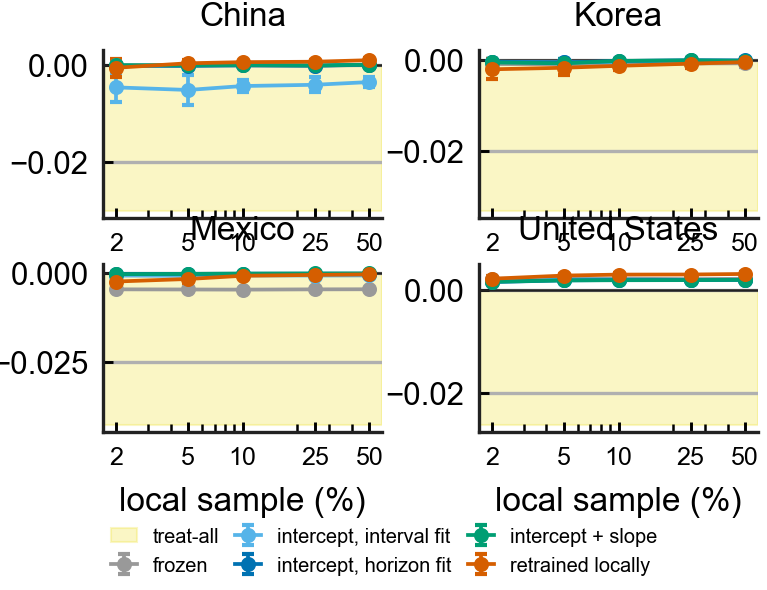
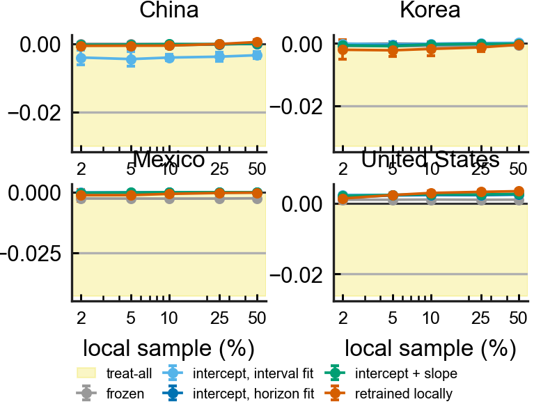
- **Figure S2. What the fitting scale is worth, and what retraining is worth (logistic).** `incident_adapt_scale` - the paired net-benefit gain over frozen for one intercept fitted on the interval scale and on the horizon scale at 2% local data, every replicate shown; China's interval-fit column is entirely below zero. `incident_adapt_auroc` - horizon AUROC against local sample size, frozen versus retrained. Model: logistic.
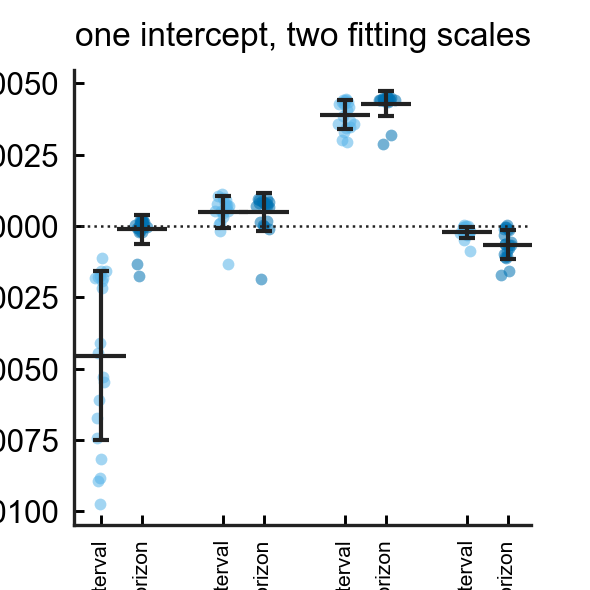
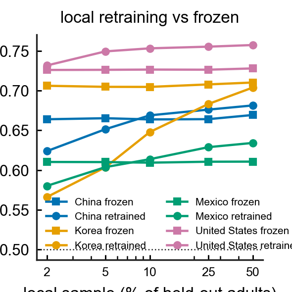
- **Figure S3. Ranking versus level (logistic).** `incident_level_interval`, `incident_level_composed` - mean predicted risk per model per country against the observed rate (dashed), on the interval grid and on the composed four-year horizon, log axis; `incident_composition` - the same logistic model scored as one four-year interval against the composed hazard. Model: logistic.
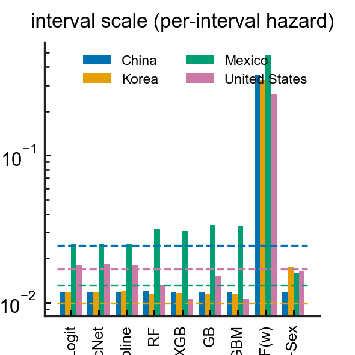
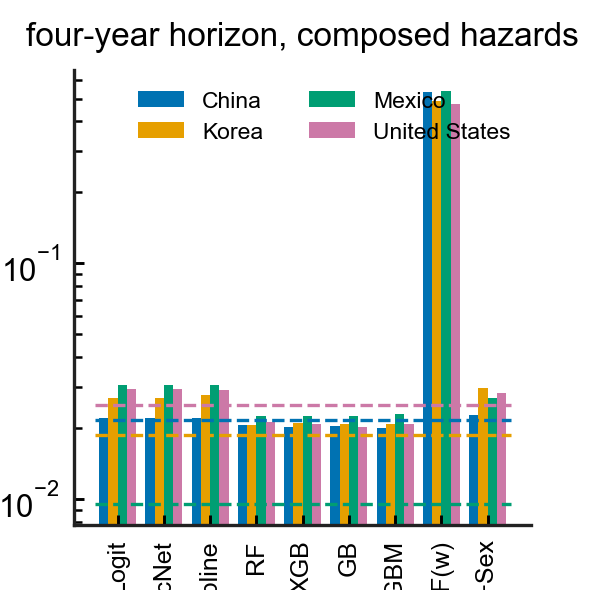
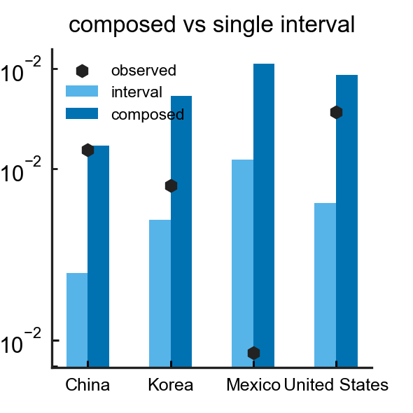
- **Figure S4. Transportability by model complexity.** `incident_internal_vs_loco` - internal (person-clustered CV) against mean held-out AUROC; `incident_spread` - best-minus-worst held-out AUROC across the four countries by model; `incident_vs_prevalent` - the same three classifiers on the prevalent and the incident outcome. These compare classifiers on the shared estimand (Table S7), not the joint primary estimator.
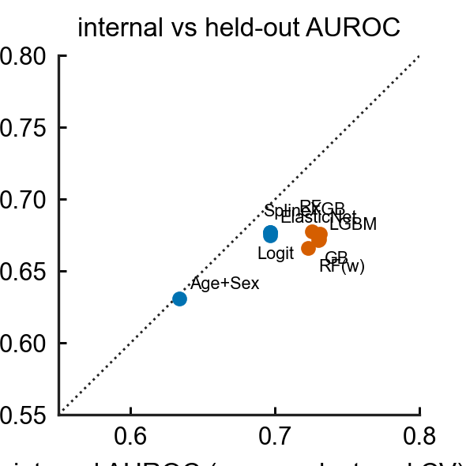
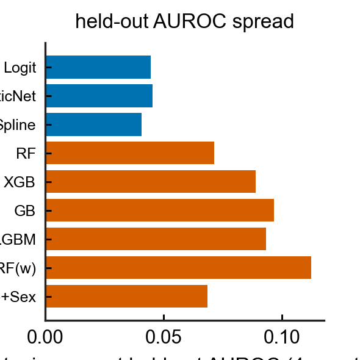
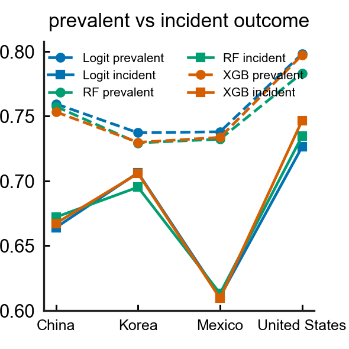
- **Figure S5. Class-weight ablation (cross-sectional arm).** `incident_ablation_skill` - Brier skill against the train-prevalence constant for logistic, plain / Platt / isotonic / balanced forest and gradient boosting, four countries.
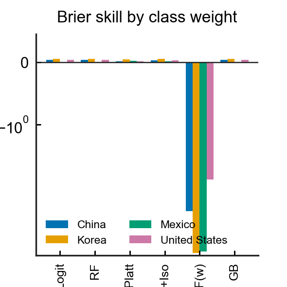
- **Figure S6. The same estimand under four hazard specifications and five ways of writing the follow-up (Table 8).** `incident_link_grid` - predicted ÷ observed four-year risk for the published L2 logistic, an unpenalised logistic GLM, a cloglog hazard with interval length as a covariate and the proportional-hazards formulation with log-length as an offset, one facet per country, five bars per specification; the vermilion bar is the interval-censored likelihood maximised directly, and the grey hatched column (†) places the stroke in the last sub-interval (drawn for transparency, excluded from every conclusion). This is the separately-fitted sensitivity arm; the joint primary composition is Figure 3.
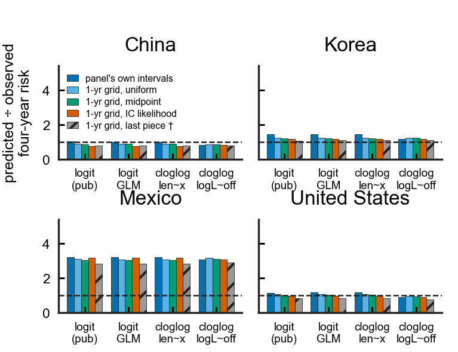
- **Figure S7. Logistic calibration by risk decile and smooth curve, before and after the local repair (sensitivity to Figures 1 and 4).** `incident_calibration_curves` - observed four-year risk (IPCW, `cif_mid`) against predicted risk in deciles of the *frozen logistic model*, open vermilion squares after the 5% intercept repair, person-clustered bootstrap intervals; `incident_calibration_smooth` - the logistic spline equivalent. The logistic panel ratios here (China 1.02, Mexico 3.22, United States 1.16) belong to the logistic sensitivity arm; the joint primary estimator's frozen ratios are 0.80 / 1.15 / 2.98 / 0.90 (Table 3, Figures 1 and 4), and it is the joint figures that carry the headline.
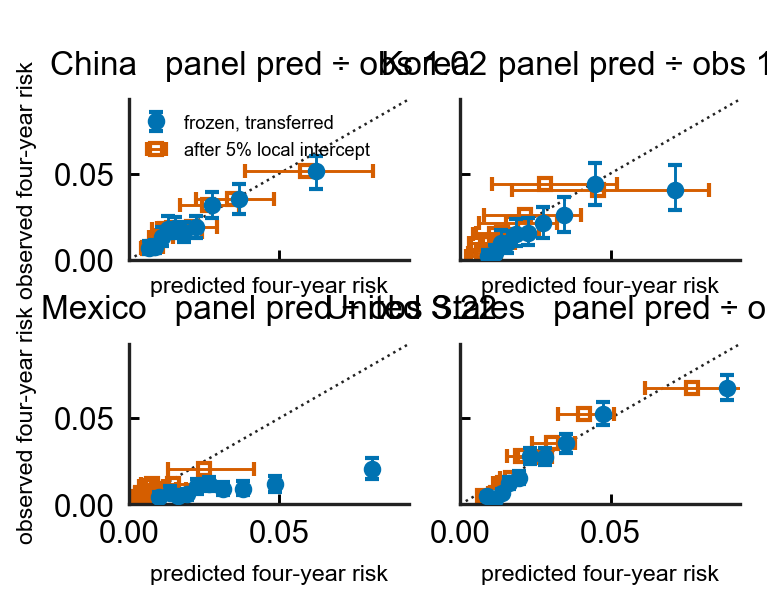
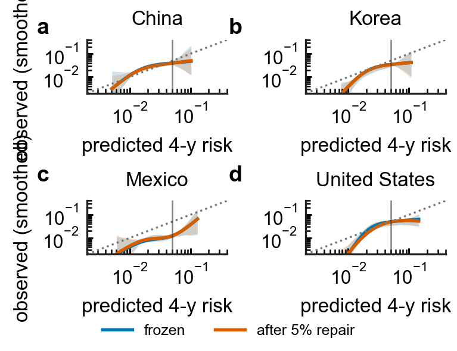
- **Figure S8. Age-band transportability (logistic arm).** `incident_subgroup_age` - AUROC by age band with person-clustered 95% CIs, and net benefit by age band with treat-all marked, four countries. The joint primary estimator's within-population age analysis is Table 12; this figure plots the logistic arm.
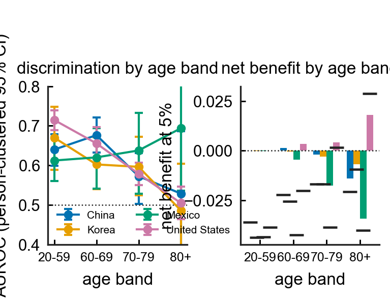

`intl/make_figures_incident.py` and `intl/incident_figures_joint.py` generate these panels; the three-cohort panels drafted before the estimand audit are kept in `deliverables/figures/incident/superseded/` and are not cited.
