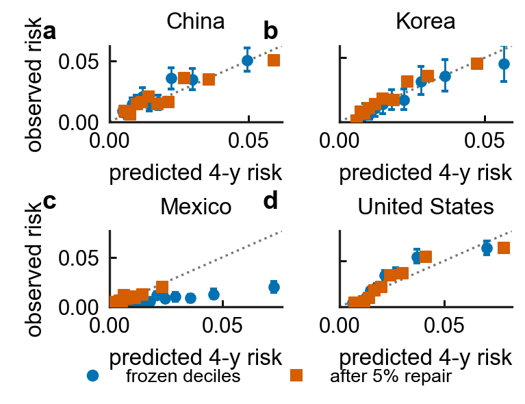
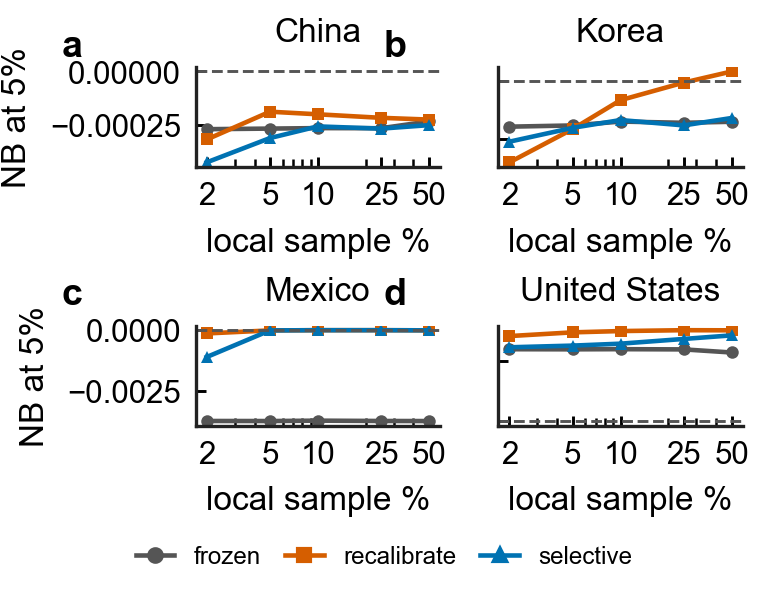
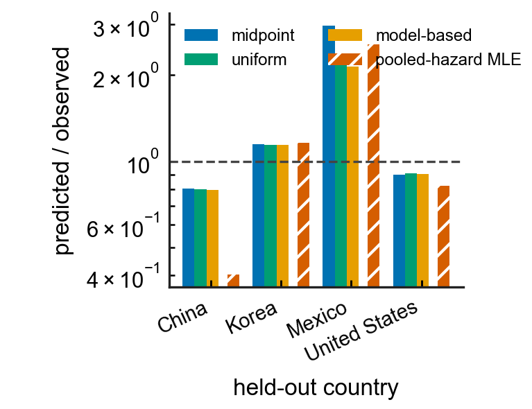
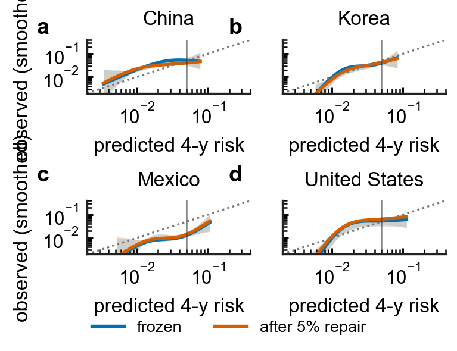
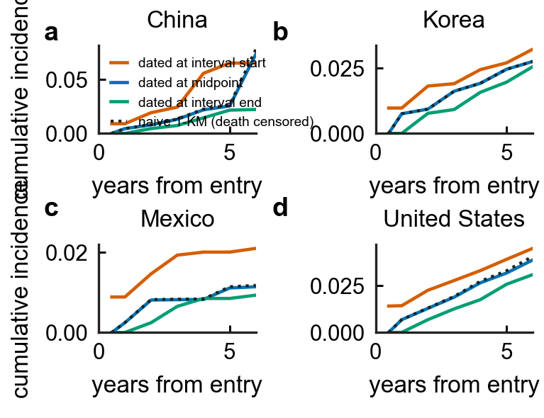
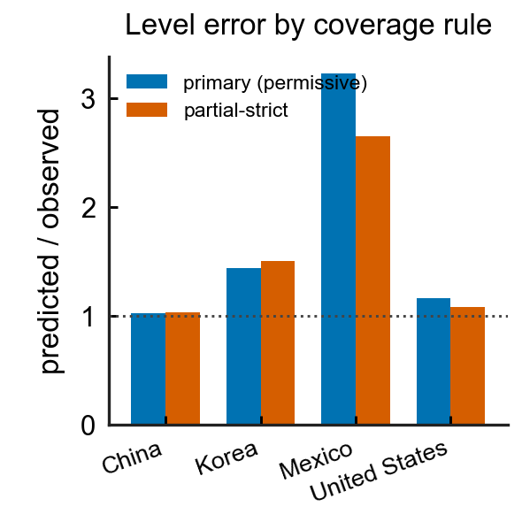
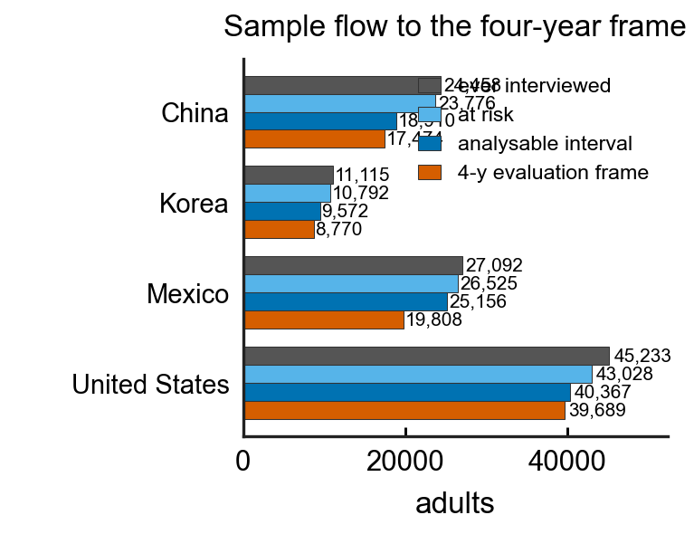

# Transportability and local recalibration of absolute stroke risk across four national ageing cohorts

Article type: Original research (predictive-model development and external validation)

Authors: Jianhuang Huang¹ # *, Yangyang Lin² #, Qixiu Wang³ #, Jianning Chen¹ *.

Affiliations:
¹ Department of Neurosurgery, Affiliated Hospital of Putian University, Putian, Fujian, China.
² Department of Neurosurgery, Chinese People's Armed Police Force Fujian Provincial Corps Hospital, Fuzhou,
Fujian, China.
³ Department of Cerebral Diseases Rehabilitation III, Affiliated Hospital of Liaoning University of Traditional
Chinese Medicine, Shenyang, Liaoning, China.

Equal contribution: Jianhuang Huang, Yangyang Lin and Qixiu Wang contributed equally (#).

Corresponding authors: Jianhuang Huang (teamhuang@sina.com) and Jianning Chen (cjn2006@sohu.com) (*).

## Abstract

Whether a stroke-risk model transports across countries turns on its absolute risk, not only its ranking.
In a leave-one-country-out validation of four ageing cohorts (HRS, CHARLS, KLoSA, MHAS; 94,005 adults, 6,979
first strokes reported), discrimination travelled (four-year AUROC 0.61-0.73) but absolute risk did
not. Under the joint competing-risks model, the frozen predictor put 0.0283 against 0.0095 in Mexico on midpoint
dating (2.98-fold, CI 2.61-3.43); the other three sat at 0.80-1.15, unmoved by an estimand-matched
allocation check. A pooled-hazard estimator lowered Mexico to 2.10 but re-specified the
estimand. Mexico alone was regularly selected for updating; one intercept on 5% of local adults restored
its level (1.14) and raised net benefit in every split, clearing treat-none in only 8. A five-variable clinical
model travelled as badly. Transportability is a property of the estimand and observation mechanism, not the
algorithm - a pre-deployment validation, not a ready screening tool.

## Introduction

Discrimination is necessary but not sufficient evidence that a prediction model is usable elsewhere.
A model can rank a held-out group almost as well as its developers did and still be unsafe to act on,
because a threshold is a statement about absolute risk rather than about order. Three properties decide
whether a model may be used on new people, and none of them is the area under the
receiver-operating-characteristic curve (AUROC). The probabilities must be *calibrated*; they must
*transport*, because the next patient is not from the derivation cohort; and acting on them must produce
*net benefit* [1] over the strategies that need no model at all. The three are separable: a model can rank
almost as well as another and still be unusable, and a model can be well calibrated where it was built
and miscalibrated where it is used. Much of the applied machine-learning literature reports the first
property and infers the other two, which is why external validation guidance asks for calibration and
decision-analytic evidence alongside discrimination [2-5].

Most evaluations of this problem use a prevalent, cross-sectional outcome — "has anyone ever told you
that you had a stroke" — because such items are cheap and widely harmonised, if of uneven validity
[6-8]. That outcome cannot
support a screening claim. A high AUROC for prevalent stroke measures how well a case-mix separates
people who already had an event from people who did not; it is not a statement about who will have
one. For a digital triage tool, the estimand has to be prospective.

Population ageing cohorts now make that estimand available [9,10]. The harmonised gates of CHARLS (China),
KLoSA (Korea) and MHAS (Mexico) interview the same adults repeatedly, ask a stroke item at each wave,
and — in two of the three — record that a respondent died, though almost never when, so death enters as a
competing event rather than ordinary censoring [11]. RAND HRS supplies
the missing fourth panel and the missing structure: sixteen waves since 1992 with day-precision
interview dates, an interview-status item that separates "alive but not interviewed" from "died this
wave", and a Tracker death date. We therefore rebuilt a previously reported cross-sectional
multi-country analysis as a longitudinal one on four panels and used it to test a single, falsifiable
question that a deploying health system actually faces: when a frozen model arrives in a new
country, should it be deployed as-is, corrected with a parameter or two estimated on local data [12], or
retrained locally — and how much local data does each option need [13,14]? We report the answer as a curve
rather than a verdict, because the answer depends on what is broken: ranking, or level. It also
depends on what the outcome label was made of, which is why the estimand is defined here before it is
estimated.

## Results

This section follows four threads, in order: whether the joint competing-risks model transports its
absolute risk across the four countries; how the observation mechanism and event-time rule change what
"calibrated" even means; whether a limited local sample can update the model and where the update rule
chooses to; and what the resulting clinical decision net benefit is against the model-free defaults.
Everything else - the separately-fitted marginal-hazard ladder (Table 7), the link / grid / likelihood
specification sweep (Table 8), the definitional ablation (Table 9), the cross-sectional (prevalent) arm, the
exact-Shapley attributions and the classifier comparison - is reported as a *labelled sensitivity analysis*
or in the Supplementary Information, and none of it carries a headline claim. The primary estimator throughout
is the joint multinomial competing-risks model. The risk reported on every line of this section is the
survey-ascertainable probability of a first reported stroke, not the true clinical first-stroke incidence; the two
coincide only under the non-differential-ascertainment assumption made explicit in Methods, and every calibration
statement below is therefore about the survey-observable quantity.

### Study population and outcome ascertainment

Of 107,898 adults ever interviewed in the four panels, 2 (both in MHAS) never gave a determinable stroke
answer at any dated interview and were removed before the risk set, and a further 3,775 had already reported
a stroke at their first determinable interview and were excluded as prevalent cases (2,205 US, 682 CN, 323 KR,
565 MX), leaving 107,898 − 2 − 3,775 = 104,121 at risk; 94,005 of them contributed at least one analysable
interval between consecutive interviews, giving 430,521 person-intervals and 1,062,341 person-years (Table 1). Incidence
differed threefold between systems: 10.25 per 1,000 person-years in CHARLS (design-weighted 10.19),
7.75 in HRS (6.81), 4.75 in KLoSA (4.14) and 3.39 in MHAS (3.36). Median interview gaps were 2.00,
2.08, 2.00 and 3.00 years — narrow and similar in the middle — but the tails were long and unequal:
the Mexican panel carries intervals up to 20.6 years, because its 2003 and 2012 releases are separated
by a field round absent from the harmonised file, and the US panel up to 26.0 years, because HRS keeps
interviewing a respondent's household after the focal respondent dies. Four percent of US intervals and
19% of Mexican ones are already longer than the four-year question, against 1–3% in Korea and China.

Vital status was recovered from the interview-status field rather than the death-year field, because
the two panels that have death dates do not have usable ones: dates are present for 1.5% of CHARLS
and 27.0% of MHAS wave records while the status field is complete, and records coded as dead carry no
interview date at all. That choice recovered 1,557 Chinese and 6,913 Mexican intervals terminated by
death, which a naive expansion would have folded into the stroke-free risk set. RAND HRS needs the
fallback rarely — 14,724 of its 14,877 death-terminated intervals carry an exact Tracker death date and
153 rest on status alone — which is the reason this study uses the RAND release rather than the
harmonised gate file for the United States, and makes the US the only panel in which the competing-risk
structure can be estimated rather than assumed. The Korean main wave workbooks contain no vital-status
field at all, so Korean intervals are censored at the last interview, Korean competing mortality is
unobservable by construction; incomplete mortality ascertainment limits identification of the
competing-risk estimand in KLoSA, so Korea is reported as a partial-outcome external validation rather than a
competing-risk validation identical to the other three panels. We therefore report Korea's censoring assumption
in every table instead of pooling it silently with three different risk-set rules.

At the primary four-year estimand, 94,005 adults split into 1,845 with a first stroke dated inside the
horizon, 79,228 stroke-free and observed at least that long, 4,668 who died inside the horizon without
reporting a stroke — counted as non-events, because they are — and 8,264 lost to follow-up before it,
who leave the frame and return as inverse-probability-of-censoring weights (Table S1). The observed
four-year incidence is 0.0215 unweighted and 0.0202 IPCW-weighted. Under the sensitivity estimand that
dates events at the interval start and deletes pre-horizon deaths, the same population reads 3,048
events, 8,748 deaths removed, 16,233 lost, 77,772 evaluable and an incidence of 0.0392: nearly twice the
number, from a label rule rather than from new data. Every row of every horizon table carries its
`horizon_rule` for that reason.

### External transportability of four-year stroke risk

A hazard that is duration-consistent and a risk that is composed correctly are two different
properties, and the model described so far had neither at once. Its four-year number was
1 − exp(−Λ_stroke(4)) read against an Aalen–Johansen cumulative incidence, which is the probability of
a first stroke *before* death rather than of stroke with death treated as censoring; and its
duration-inconsistency was the covariate arm's, not the primary arm's. The absolute-risk analysis was
therefore specified from the outset (`intl/incident_cr_primary.py`): two
cause-specific interval-censored hazards are fitted on the same person-interval rows - one for a first
reported stroke, one for death - by maximising the interval-censored likelihood of each, and the
four-year risk is composed over the panel's own interval grid as

F_s(4) = Σ_j S(t_{j−1}) p_s,j  with  S(t_j) = Π_{k≤j} (1 − p_s,k)(1 − p_d,k),

which is the discrete Aalen–Johansen cumulative incidence, not a cause-specific transform. Four
specifications are reported, differing only in the two properties under discussion: the link (logistic
or complementary log-log), whether interval length enters as a covariate or as a log-exposure offset,
and whether death is composed in or ignored. Every arm is leave-one-country-out, scored on the same
horizon frame with the same IPCW weights, evaluated on persons who never entered any local adaptation
sample, and carries person-clustered bootstrap intervals (500 resamples) on the primary dating
convention; the two alternative datings are reported without intervals and are labelled sensitivity
arms. Table 7 is that comparison.

Which estimator is primary. Table 7 composes two *separately-fitted* cause-specific hazards, which is
a duration-consistent but not an exclusively-correct object (the next subsection proves it). The
primary absolute-risk estimator of this paper is therefore the joint multinomial competing-risks model
below (`intl/incident_cr_joint.py`, the three mutually exclusive interval outcomes fitted in one
likelihood), and every headline four-year risk, calibration figure, decision curve and age subgroup in
this manuscript is read off the joint arm; Table 7 and the published Aalen–Johansen ladder are reported as
the *separately-fitted marginal-hazard sensitivity arm*, and the two agree to within 0.5-3.4% relative
(Mexico 2.98 joint against 3.00 published). The joint headline is: the frozen model predicts 0.0283 against
0.0095 observed in Mexico (2.98-fold, 95% CI 2.61-3.43); the other three panels fall within 0.80-1.15; and
a 5% Mexican intercept restores the level to 1.14 (mean over 40 splits).

Three things follow, and the first is the answer to the question that decides whether this paper has a
clinical finding at all. Mexico's absolute-risk over-prediction is not an artefact of the model's time
handling or of its treatment of death. Under the sensitivity composition (Table 7) the transferred model
predicts 0.0285 against 0.0095 observed: 3.00-fold, with a person-clustered interval of 2.63-3.46; under
the primary joint estimator it is 0.0283 against 0.0095, 2.98-fold (95% CI 2.61-3.43). Both intervals
exclude not only 1.0 but the whole twofold range. The four marginal-hazard specifications
bracket it at 3.00-3.20, and the correction that the estimand mixing required moves the
predicted/observed ratio by 0.5-3.2% relative across the eight panel-by-link cells - real, measurable,
and nothing like the threefold error it was asked to explain. The other three panels sit at 0.79-1.15
under either arm. That robustness has one boundary, and it is the dating convention rather than the
model: dating each interval-censored stroke at the *start* of its gap - the convention this paper
rejects, because it asserts the earliest moment the event could have happened and raises the observed
four-year incidence from 0.0095 to 0.0231 in Mexico - leaves the same four specifications over-predicting
by only 1.23-1.31-fold. End-dating returns 2.97-3.16. In other words, the claim "Mexico is over-predicted
about threefold" is stable across every hazard specification *within* a stated dating rule, and the
dating rule itself is worth a factor of 2.4, which is why Table 7 is headed with the convention and why
the estimand table in Methods fixes it before any model is scored. The repair tracks that choice rather
than overriding it: under V4 at 5% local data the Mexican paired gain is +0.00366 under midpoint dating
and +0.00362 under end dating, but only +0.00017 (31 of 40 splits) under start dating, where there is
much less level error to remove.

The second is a limit on what the competing-risk correction can mean in Korea. KLoSA's main wave
files carry no vital-status field, so the Korean death hazard is transported from the other three panels
rather than estimated, and Korean observed incidence contains no competing death to compose against:
Korea's Aalen–Johansen estimate coincides with 1 − Kaplan–Meier by construction, and its 0.986-1.327
interval is the honest width of a level error that cannot be resolved with the data this panel records.
For the same reason, incomplete mortality ascertainment limits identification of the competing-risk estimand
in Korea rather than merely shrinking its event count.

The third is that the level repair survives the rebuild, with its two meanings still distinct. Under
the primary joint estimator, refitting only the intercept on 5% of the held-out Mexican adults - persons
who are then excluded from every performance number - shifts the four-year net benefit by +0.00368 (a
split-variability band of +0.00342 to +0.00387 across 40 adaptation/evaluation draws, improving net benefit in
every evaluated random split) and
moves the level error from 2.98 to 1.14. That 1.14 is a mean over splits and not a target: the repaired
ratio's standard deviation across the same 40 splits is 0.32 and its range is 0.40 to 1.70, because 396
local adults carrying a median of four events pin an intercept only loosely, which is the sampling noise
quantified under its own heading below. The repaired model's *absolute* net benefit still exceeds doing
nothing in only 8 of those 40 splits - and all 8 by less than one net person in the ~18,818-person
evaluation sample (largest exceedance 0.000048, which is 0.9 of a person), so at screening scale they read
as ties rather than wins. (The separately-fitted V4 sensitivity arm is weaker on this point - only 3 of 40
splits clear treat-none, largest exceedance 0.0000387 - and the published arm is reported only as a
sensitivity, not as the headline.) "Better than the model you have" and "better
than not using a model" are different claims, and in Mexico only the first one is supported. In China the
same joint-arm repair is worth nothing (+0.00011 at 5%, exceeding treat-none in 12 of 40 splits by under a
person); in Korea it is worth +0.00028; in the United States it is worth +0.00037 and clears treat-none in
all 40, which makes the United States the one panel whose adapted model stays above treat-none under the illustrative 5% threshold - a positive estimated net benefit that warrants prospective evaluation before deployment, not a licence to deploy.

The sign of the repair is itself specification-dependent, in the one panel where it is small. Under the
published logistic, cause-specific composition, recalibrating the United States lost net benefit
(−0.00065, ahead of the frozen model in 1 of 20 replicates, Table S8). Under the four-year
competing-risks arms the same cell is +0.000004 (V1), −0.000001 (V2), +0.000344 (V3) and +0.000376 (V4),
positive in 38 of 40 splits under V4. A quantity that changes sign with the composition is not a finding
about the United States, so this paper states it per specification rather than as a national verdict, and
the heading under which it first appeared is qualified accordingly. What does not depend on the
specification is the frozen model: the United States is the only
panel whose *unadapted* four-year net benefit is positive with an interval excluding zero (+0.00114
[+0.00036, +0.00181] under V4), and its repaired net benefit beats doing nothing in 40 of 40 splits in
every arm.

The last question the headline owes is whether it is measurement rather than risk. Four national
questionnaires do not ask the same questions, and the primary feature set already excludes the concepts
that are not comparably *observed* (income, measured BMI, cholesterol). Two that survive inside the
exclusion are asked about different things: the cardiac item is "ever had heart problems" in the United
States and China and a specific heart-attack or myocardial-infarction item in Korea and Mexico, and the
alcohol item is "ever drinks any alcohol" in the United States and a last-year item in China. Harmonising
codes cannot harmonise questions, so both were removed and *everything* was refitted from scratch - both
cause-specific hazards, both compositions, the local intercept repair - and a stricter tier additionally
removes the two items whose availability rather than meaning differs (hypertension, missing on 29.1% of
Korean interval rows against 0.0-1.0% elsewhere; marital status, 16.1% Korean).

Mexico's over-prediction is not an artefact of how the four questionnaires word cardiac disease and
drinking. Removing both moves the level ratio by 0.17, 5.5% relative, and *away* from correct - 3.004 to
3.171 - and the third tier, which discards eight of the nineteen columns, still predicts 3.106-fold with
an interval starting at 2.72. The repair gain does not shrink either (+0.00365 to +0.00454 to +0.00430).
The "common" tier is the published primary arm refitted a second time by this script's own code path and
reproduces it in all eight frozen cells to within 10⁻⁶, so the three rows are comparable by construction
rather than by assertion.

Two things this arm does not claim. Discrimination falls as variables leave (Mexico 0.610 → 0.602 →
0.571, China 0.661 → 0.655 → 0.621), so the strict tier is a stress test and not a preferred model; the
level error and the ranking behave independently here, which is the same dissociation the decile analysis
reports within a country. And ablation does not repair the other panels: Korea drifts from 1.134 to 1.277
as items are removed, so fewer variables do not make Korea better calibrated either - no tier brings any
of the three non-Mexican panels near 2-fold, and none brings Mexico near 1.

#### Is the composition a valid competing-events probability, and which estimator is primary?

Two properties must hold for the composed four-year risk to be a probability rather than an approximation,
and we assessed the specification of mutually exclusive first events by comparing separately-fitted and
joint competing-risk formulations (`intl/incident_cr_exact.py`, `intl/incident_cr_joint.py`,
`intl/incident_cr_simulation.py`; the simulation is reported in Supplementary Table S9 and its design is summarised in Methods).

The survival factor is right. Composing the two hazards as `F_s(4) = Σ_j S(t_{j−1})·p_s,j` with
`S(t_j) = Π_{k≤j}(1 − p_s,k)(1 − p_d,k)`, the probability that NEITHER event occurs over a step of length
D is `exp(−(λ_s+λ_d)D) = (1 − p_s)(1 − p_d)` for independent latent event times with hazards constant over
the step - exactly what the log-exposure-offset specification asserts - and the measured gap between the
product and the exact joint survival is 1.1 × 10⁻¹⁶, machine precision. A complement-subtraction form
`1 − p_s − p_d` would be correct only if the two marginal event indicators were mutually exclusive, and
they are not: a stroke and a death can both fall inside one unobserved interview gap.

The step event factor is where the composition is not exact. `p_s = 1 − exp(−λ_s D)` is the probability that
*a stroke occurs* in the step, not the probability that the *first* event in the step is a stroke; the
exclusive first-event probability is `α_s = λ_s/(λ_s+λ_d)·(1 − exp(−(λ_s+λ_d)D))`. The marginal over-states
the exclusive one by `p_s − α_s = P(death also falls inside the step, before the stroke)`, and this gap is
*not* `p_s·p_d`: the both-events probability is the *total* double-count and obeys the exact identity
`p_s·p_d = (p_s − α_s) + (p_d − α_d)` (verified numerically: λ_s = 0.03, λ_d = 0.02, D = 2 gives
`p_s − α_s = 0.001138`, `p_d − α_d = 0.001146`, sum `0.002283 = p_s·p_d`). The separately-fitted composition
summed the two marginal event probabilities with the survival factor `(1−p_s)(1−p_d)`, so it assigned each
step a total probability of `p_s + p_d + (1−p_s)(1−p_d) = 1 + p_s·p_d > 1`, measured at 1.00053-1.00076 across the four panels (a
per-step excess of 5.3 × 10⁻⁴ to 7.6 × 10⁻⁴), an exclusivity term of order D² per step; removing it makes
the composition exact at every step size, which the step ladder confirms - the corrected composition is
flat at 1.000000 from one to eight pieces while the separately-fitted one drifts to 0.9424.

Two formulations that put the exclusive probability mass in the right place were fitted on the same data.
The first (V5) keeps the two separately-fitted marginal hazards and only fixes the composition; it lowers
every panel's predicted mass by 2.6-3.4% and moves Mexico from 3.004 to 2.926. The second, and the primary
estimator of this paper, is a single joint multinomial likelihood on the three mutually exclusive interval
outcomes (stroke-first, death-first, neither), whose interval probabilities sum to 1 by construction
(2.2 × 10⁻¹⁶), whose analytic gradient matches finite differences to 1.5 × 10⁻⁹ at a non-degenerate probe,
and which converged in 42-55 L-BFGS-B iterations in every panel. A known-truth simulation (Supplementary Table S9, design in Methods) illustrates, rather than proves, the point: it does not refit the joint likelihood, so it cannot demonstrate that the *fitted* joint model is unbiased in finite samples, under long interview gaps, or under outcome misclassification (the arm that sits at zero deviation does so by construction, using the true parameters). What it does establish is algebraic - that each *marginal* cause-specific fit
is itself mis-specified for the exclusive first-event data it is fitted to, so the separately-fitted arm's
upward exclusivity bias partly cancels the fits' downward bias and it sits near truth at realistic rates,
whereas applying the exact formula to those inconsistent marginal fits (V5) is a different error rather than
a correction. The joint arm is therefore reported as primary throughout.

Korea (KLoSA) footnote - applies to every Korean P/O in this paper (Tables 3, 4, 10, 11, 17).
*Predict side:* the Korean competing-death hazard is transported from the other three cohorts, not estimated
from KLoSA. *Observe side:* KLoSA's main wave files carry no vital-status field, so the Korean panel cannot
identify its own competing deaths, and its observed cumulative incidence coincides with 1 − Kaplan–Meier by
construction. *Therefore:* Korea's level ratio is the honest width of a level error that its own data cannot
resolve, and it is not directly equivalent to the China / Mexico / United States columns - Korea is a
partial-outcome external validation, not a competing-risk validation identical to the other three, and its
near-1 calibration should not be read as a clinically validated competing-risk result.

The conclusion is invariant. Across the three compositions Mexico spans 2.93-3.00-fold, every panel moves
by at most ~3.4% relative, and the pre-specified criterion - Mexico above 2.0 with an interval excluding
1.0 - holds under the principled joint model (2.975 [2.61, 3.43]). The local repair survives it too: under
the joint arm a 5% Mexican intercept shifts net benefit by +0.00368 (a split-variability band of +0.00342 to
+0.00387 across 40 adaptation/evaluation draws, improving net benefit in
every evaluated random split) and restores the level to 1.14, clearing
treat-none in 8 of 40 splits (against 3 of 40 under the published arm), each by less than one net person.
These repair figures - the joint-model P/O 2.975 [2.61, 3.43], the +0.00368 net-benefit gain and the 8-of-40 treat-none count - are the primary joint-model results (Table 19); the parenthetical "3 of 40 under the published arm" is the separately-fitted V4 value, quoted only to bound the composition assumption and not as the headline. The composition, then, is worth a few percent; it is not worth the threefold error it was raised
to explain, and the paper's absolute-risk claim does not rest on which of the three is printed.

#### Deciding whether to move the model, before knowing which country it has landed in

Knowing after the fact which panel was miscalibrated does not tell an organisation that has just licensed
the model what to do with its first 2% of local data. Three policies were therefore prespecified *within the
adaptation experiment* and evaluated on persons who never entered the decision
(`intl/incident_update_policy_joint.py`, 200 adaptation/evaluation splits per cell, split at person level and
asserted disjoint): *always frozen*, *always recalibrate* the intercept on whatever local sample exists, and
*selective* - update only if the local estimate of the offset excludes zero (|â| > 1.96 SE(â)), optionally with
a practical-magnitude gate as well (|â| ≥ 0.25 log-odds, about a 1.3-fold shift). Every quantity below is now
read off the joint competing-risks model - the same per-person horizon CIF that produces the primary
calibration and decision-curve tables - so the policy and the primary estimator are the same object, not an
earlier specification. SE(â) is a person-clustered sandwich estimator of the same weighted estimating equation
that defines â, computed from adaptation rows only. Nothing in the rule sees an evaluation outcome.

The rule finds Mexico and leaves the other three alone, without an oracle: at 2% of the panel it moves the
Mexican model in 70% of local samples and captures 0.00261 of the 0.00357 that unconditional recalibration
would buy, while in the United States it stays frozen 95% of the time and forfeits nothing (paired +0.00003).
Regret - the gap to the better of {frozen, recalibrated} *evaluated with the answer known*, which is an oracle
and not a deployable policy - is reported per cell so the price of deciding blind is a number rather than a
claim. Once the local sample reaches 5% the Mexican rule fires in every split, captures the full +0.00370
repair (matching Table S8's intercept correction), and regret falls to zero.
The binding quantity for update stability is the number of observed events, not the local percentage: at 2% the
median local sample carries 4 strokes in Mexico, 3 in Korea, 8 in China and 21 in the United States, so an
identical percentage buys very different information, and these updates are sized for the *direction* of a
one-parameter repair rather than to any event-per-variable minimum.

Promoting the estimator also removed an apparent failure mode rather than confirming it. Under the earlier
logistic arm Korea looked like a panel the rule was missing; under the joint arm its frozen model already sits
at predicted ÷ observed 1.15, so unconditional recalibration there *costs* net benefit (−0.00015 at 2%) and the
rule correctly declines to fire in 98% of tiny samples - three local events give â = −0.29 against SE(â) = 0.61,
so even the direction is unresolved. There is nothing to recover in Korea, and the joint policy says so.

The magnitude gate matters more than the significance gate. The United States offset is small and positive
(â ≈ +0.11; the joint model slightly under-predicts a panel already at P/O 0.90); once 25% of the panel is
available SE(â) = 0.063 makes it statistically resolvable and the significance-only rule fires in 45% of splits,
chasing a shift too small to matter. Adding |â| ≥ 0.25 keeps the US trigger at 0% at 25% and 50% local data
(paired +0.00000), while leaving Mexico untouched (â ≈ −1.13 clears any sensible gate) and China and Korea
essentially unchanged. The deployable rule is the conjunction: *update when the local offset is both
statistically resolved and large enough to matter*, with the threshold stated before the data are seen.

### Sensitivity to outcome timing and ascertainment

Before comparing classifiers we fixed what a four-year outcome means, because in these panels the
conventions are not a footnote. Dating alone moves the pooled four-year incidence of first stroke from
0.0356 (events attributed to the interval start) through 0.0215 (midpoint) to 0.0152 (end) — a 2.3-fold
pooled swing, and 3.8-fold in China (0.0572 / 0.0228 / 0.0149). Counting pre-horizon deaths as
non-events rather than deleting them changes the frame from 77,772 evaluable adults and 0.0392
incidence to 85,741 and 0.0356 at the same dating rule. The two together are why the country ordering is
not stable across conventions: Mexico ranks third of four under start dating (0.0251) and last under
midpoint dating (0.0104), because its intervals are long enough that attributing an event to its
midpoint pushes it past the horizon.

The third decision — what counts as having been *observed* — is the one that bites an adaptation
claim. Under the permissive rule, 7,323 of the 85,741 adults in the primary frame are classed as
stroke-free through four years on the strength of a contact at which the stroke item was not asked
(median 4.8 unobserved years in the United States, 6.0 in Mexico). Removing them costs the United
States 4,136 persons, raises Mexican observed incidence from 0.0104 to 0.0122 and Chinese from 0.0228 to
0.0231, and moves Korea not at all — Korea has no vital-status tail to lean on. Consequences, on the
identical frozen logistic model: Mexico's predicted-to-observed ratio falls from 3.22 to 2.65 and the
ceiling value of a level repair (the intercept fitted on the whole held-out panel, which is the most any
local sample could achieve, not the 2% estimate of Table S8) from +0.00435 to +0.00227 net benefit; Mexican
horizon AUROC *rises* from
0.611 to 0.644, because the mechanical stroke-free rows were the ones the model could not separate; US
net benefit at a 5% threshold rises from +0.0021 to +0.0028. So the direction of every claim survives
strict ascertainment, and the size of the one the audit had hung on Mexico shrinks by nearly half. We
report both frames rather than choosing the flattering one, and we keep the permissive rule as primary
because it is the risk-set rule the discrete-time model is fitted with.

The estimand also decides which country looks broken. On the earlier frame (`exclusive_start`), the
frozen model appears to under-predict China almost threefold (0.0205 predicted against 0.0609 observed,
predicted ÷ observed 0.34) and a single local intercept was worth +0.0153 net benefit there. On the
corrected cumulative-incidence estimand the same model predicts a mean 0.0220 against 0.0216 observed in
China — predicted ÷ observed 1.02, and the same intercept is worth −0.0001 — while the panel that is
actually wrong by a factor is Mexico (3.22, +0.0043) and, more mildly, Korea (1.44, +0.0005). The
United States, the panel added to answer exactly this question, sits at 1.16 and needs nothing. Nothing
in the model changed between those two readings; only the label did. Which country a study says needs
repair is therefore a property of the estimand as much as of the data, and a paper that reports the repair
without reporting the estimand has reported an artefact.

#### A midpoint-free check: how much of the headline is the event-time rule?

The model side of every ratio above is interval-censored-consistent - the joint likelihood integrates the
unobserved event time over each interview interval and never assigns a date. The observed side of the
primary analysis is not: `cif_mid` places a stroke at the midpoint of the interval in which it was first
reported, and that single choice is what pushes a Mexican event reported late in a long interval past the
four-year boundary and out of the denominator. To separate the two we estimated the *observed* four-year
cumulative incidence without any midpoint, from a two-parameter intercept-only joint competing-risks MLE
fitted to each panel's own intervals. This is a constant-hazard parametric model - the simplest member of
the published likelihood family - not a fully nonparametric estimator: it removes the arbitrary midpoint but
still assumes time-invariant within-interval hazards, a specified competing-event structure and the same
observation mechanism, so "midpoint-free" is emphatically not "assumption-free" (a person-clustered bootstrap
of 400 resamples gives its interval; `intl/incident_cr_interval_eval.py`). The prediction is unchanged; only
the denominator moves. A flexible time-varying-hazard version of this estimator is reported below to test
whether the constant-hazard assumption drives the country-level conclusions.

The direction and the ordering survive the change of rule; the magnitude does not. Mexico remains the only
panel over-predicted by more than twofold and the only one whose calibration repair is large, but the honest
interval-censored figure is 2.10, not 2.98 - the midpoint rule inflates the ratio precisely because Mexico's
intervals are the longest. We therefore do not describe the ~threefold Mexican over-prediction as a
measurement-free fact about clinical risk: it is a fact about the *survey-ascertained, midpoint-dated*
estimand, and the interval-censored value is the more conservative statement of it. Korea, whose missing
vital status makes its interval-censored estimate collapse onto Kaplan-Meier, is the exception that does not
move (1.15 to 1.13), which is itself a reminder that the estimator can only be as good as the death data.

Because that interval-censored figure comes from a constant-hazard parametric fit, we first ask whether
forcing the hazards flat is driving it, refitting each panel's observed risk with time-varying baseline hazards -
three piecewise-constant bands of time-since-entry and a log-hazard linear in time-since-entry - and integrating
the exclusive competing-risks cumulative incidence on a fine grid (`intl/incident_cr_interval_flexhaz.py`,
person-clustered bootstrap of 300; Table 14). The country conclusions are not an artefact of the flat-hazard
assumption: China's midpoint-free incidence stays elevated under every shape (0.037-0.043, frozen P/O 0.40-0.47,
all far below 1), Mexico stays the single largest deviation (P/O 2.53-2.56), and Korea and the United States
barely move. A 5% local-intercept repair does not rescue China either (repaired P/O 0.48-0.56) while it brings
Mexico down to 0.79-0.80 - the repair is fit to the midpoint denominator and so cannot close a gap whose size is
set by the estimator's own re-specification.

The reason China breaks under the hazard model but not under the published evaluation is that the two quantities
do not answer the same question. The MLE re-fits hazards to *every* interval of *every* respondent and treats
each panel's own dropout as event-free, so it changes the estimand and the censoring model as well as the
within-interval allocation. When the midpoint-free check is done estimand-matched - holding the evaluable
frame and IPCW weights identical to the published prediction and changing only *where inside an interval* a
straddling event is placed - China's observed four-year risk is essentially unchanged and its P/O stays at 0.80,
while Mexico, whose intervals are the longest, is the one panel whose observed risk moves materially (P/O 2.98
to about 2.15). The apparent Chinese under-prediction is therefore a property of the pooled-hazard
re-specification, not of the event-time allocation the reviewer's question isolates, and the two P/O shifts must
not both be booked as "time-allocation bias."

Two allocation rules are reported, because the simple one is an assumption. The first is a
uniform-within-interval allocation - a straddling event contributes `clip((H - t_start) / (t_end - t_start),
0, 1)`, its probability of preceding the horizon taken to be the fraction of the interval before it. That is a
uniform conditional distribution of the event time inside the interval, not the general interval-censored
conditional probability. The second therefore replaces the uniform assumption with the conditional event-time
distribution implied by the fitted joint model: for a stroke reported in `(t_start, t_end]` for a person event-free
at `t_start` with fitted total hazard `lam_tot = lam_s + lam_d`, the probability the true first-stroke time precedes
the horizon is the truncated-exponential `(1 - exp(-lam_tot (H - t_start))) / (1 - exp(-lam_tot (t_end - t_start)))`
(`intl/incident_cr_alloc_variants.py`). Because within-interval survival is decreasing, this pulls event mass a
little earlier than uniform and so *raises* the observed risk slightly rather than flattering the conclusion.
Both rules leave China at 0.80 and leave Mexico the only large move (2.98 to 2.18 uniform, 2.98 to 2.14
model-based; Table 15), so "only Mexico moves materially" is not an artefact of the uniform assumption.
The model-based arm is itself model-dependent - it allocates event time through the fitted hazards rather than
observing it - so it is a sensitivity to the allocation assumption, not an independent measurement of when the
strokes fell.

That distinction settles the deployment question the new estimator raises. Re-running the prespecified
selective-update rule on the interval-censored outcome (`intl/incident_update_policy_joint_ic.py`, 200
adaptation/evaluation splits on identical person-disjoint partitions) left Mexico as the only country the rule
*regularly* selected for recalibration: at a 5% local sample it fires in 98% of Mexico splits and the recalibration
pays (+0.0029 net benefit over the frozen model), while China fires in 24%, the United States 12% and Korea 2%,
and updating China does not pay (-0.00008). The hazard model's alarming China figure never becomes a call to act,
because no local intercept can close a gap that is an estimand mismatch rather than a level error.

Two conclusions now separate cleanly. Stable: whether a transported absolute-risk model looks calibrated depends
on the outcome-observation mechanism and the event-time rule, not on discrimination, so AUROC alone cannot license
cross-country deployment. Conditional: under the midpoint dating used for the primary evaluation, Mexico is the
sole markedly over-predicted panel and the only country the update rule regularly selects; the substantial
Chinese under-prediction seen under the pooled-hazard interval-censored estimator was *not reproduced* in the
estimand-matched allocation analyses - those estimators target different observation and censoring structures,
so the divergence is a property of the estimand rather than a proven error - and it does not survive either the
uniform or the model-based conditional allocation, and does not change the update recommendation.

#### Refitting under strict ascertainment: what the coverage rule changes, and what it leaves alone

Knowing someone is alive is not knowing they had no stroke. The primary frame credits four-year
stroke-free time to 10,693 intervals that end in a wave where the respondent was reached but the stroke
item was never asked (10,491 `alive_nr`, 202 vital-status-unknown), which is outcome misclassification
dressed as follow-up. The sensitivity arm published so far
answered by re-labelling the *evaluation* frame at `t_ask`, the last wave where the item was answerable,
while the models stayed fitted on the permissive risk set — and the manuscript defended that as matching
the label to the target the model was asked to estimate. The defence named the right invariant and drew
the wrong conclusion: a mismatch is fixed by changing the training target, not by abandoning the label.
So the whole design was refitted under strict ascertainment
(`intl/incident_strict_frame.py`, `intl/incident_strict_refit.py`).

Two things came out of it, and the first is a constraint on the observation scheme and on how this
paper builds intervals, not on what the statistics can do. In all four cohorts a death is recorded on the
interval that *begins* at the last answered interview. Truncating risk time at `t_ask` therefore deletes
every competing death with it — 21,591 dated and 1,756 status-coded — and a "fully strict" frame built
that way estimates cumulative incidence with zero observable competing mortality in every panel, which is
1 − Kaplan–Meier wearing a competing-risks vocabulary. That is a property of where the death variable sits
in these interview schedules and of our own choice to truncate rather than re-key the risk set. It is not
a claim that interval-censored events and competing mortality cannot be modelled together: the primary
absolute-risk analysis below does exactly that, fitting two cause-specific interval-censored hazards — one
for stroke, one for death — and composing them into a discrete Aalen–Johansen cumulative incidence, with
the death time of each panel carrying the same start/mid/end allocation sensitivity as the stroke time
(`intl/incident_cr_primary.py`). What is unavailable is one particular conjunction: strict ascertainment
*under this truncation rule* and a competing-risk-adjusted estimand. Three
conventions are coherent and they are not equivalent: permissive (coverage from interval end),
partial-strict (a non-interview tail contributes no risk time and its person leaves the frame unless
they answered past the horizon, while a death — a real observation, made at the wave that ends outcome
ascertainment — stays a determined non-event), and full-strict (nothing after `t_ask` is observed at all).
Partial-strict is the arm that answers the objection without destroying the estimand, and it is what was
refitted: 419,828 training intervals, all 23,347 death intervals retained, evaluation frame identical to
the published strict arm person-for-person before any model was fitted (17,267 / 8,770 / 16,828 / 35,553
evaluable; 399 / 177 / 206 / 1,063 events).

The refit moves the numbers and not the conclusions. Mexico's level error shrinks from 3.22-fold to
2.61-fold, exactly as the label-only arm predicted, its AUROC *rises* from 0.6107 to 0.6450 because the
rows deleted were the ones the model could not separate, and China's ratio tightens to 1.00 — China needs
nothing under either convention. The United States remains the only panel whose frozen model beats
treat-none outright (+0.00286), and its level error is *smaller* under strict coverage (1.08 rather than
1.16), which strengthens rather than weakens the recommendation not to touch it.

And the repair itself does not merely survive: it improves. Under the refit, the one horizon-scale
intercept is worth +0.001889 (SD 0.000089) at 2% local data and beats the frozen model in 20 of 20
replicates — against 19 of 19 and +0.004287 under the permissive frame — and the repaired net benefit
lands at −0.00003, +0.00002 at 5%, −0.00001 at 10%, +0.00004 at 25% and +0.00014 at 50%. Under a
coverage rule that does not manufacture stroke-negative person-time, the one local parameter moves Mexico's
four-year net benefit to *close to zero*, with small positive values at some but not all larger adaptation
samples (positive at 5%, 25% and 50%, a hair negative at 10%); these values are all within a fraction of a
net person and carry replicate SDs of order 10⁻⁴, so the defensible statement is that the strict-coverage
repair erases the frozen model's net-benefit deficit, not that it establishes a clinically meaningful
positive benefit at a stated sample size. It should not be read as a monotone "≥5% is positive" threshold.
Korea behaves the same way more mildly (+0.000539 at 2%, 15/19; +0.000825 at 50%, 20/20) and China's
intercept is worth −0.000001 (SD 0.000344, ahead in 14/20) — noise, as it should be for a panel whose
level is already right.

How well is that one parameter estimated? The intercept's own sampling error, which the 5% claim
depends on:

| Panel | local adults (2%) | median local events | mean fitted intercept | SD of intercept | 1/√events | repaired pred ÷ obs, IQR |
|---|---|---|---|---|---|---|
| China | 345 | 8 | −0.001 | 0.278 | 0.354 | [0.82, 1.22] |
| Korea | 175 | 3 | −0.485 | 0.644 | 0.577 | [0.64, 1.61] |
| Mexico | 337 | 4 | −1.011 | 0.436 | 0.500 | [0.82, 1.36] |
| United States | 711 | 21 | −0.072 | 0.244 | 0.218 | [0.92, 1.15] |
| Mexico | 8,414 (50%) | 102 | −0.847 | 0.066 | 0.099 | [1.06, 1.25] |

The SD tracks the binomial expectation 1/√events closely, which is the honest way to state the sample
size: 337 Mexican adults carrying a median of four events gives a log-odds shift of −1.01 ± 0.44, and the
repaired level ratio has an interquartile range of 0.82–1.36. 337 is not a verified minimum sample
size and is not reported as one — it is the point at which the *direction* of the repair is
unambiguous (20/20 replicates) while its magnitude is still uncertain by a third. The intercept is stable
to within ±0.07 log-odds only when the local sample carries ~100 events, and the level ratio only
tightens inside [1.06, 1.25] at 50% of the panel.

The reason the primary frame is chosen is not that a label must match the risk set it was trained on.
A mismatch of that kind is repaired by changing the training target, not by abandoning the label, and the
refit in Table 16 is what that repair looks like. The primary frame stays
permissive for one reason, stated in Methods: it is the frame the discrete-time estimator is defined on and
the frame the training risk set is built on. It is *not* because permissive uniquely preserves competing
deaths — both permissive and partial-strict retain all 23,347 death-carrying intervals, and only the
strictest version of the coverage rule (full-strict, nothing after `t_ask` observed) deletes them, so a
cumulative incidence estimated on it is not a competing-risks quantity however it is labelled. Every
headline in this paper is now reported under permissive and partial-strict coverage with the models
refitted, and the two agree.

Table 16 is the *logistic* arm. Because the paper's primary estimator is the joint multinomial
competing-risks model, the same coverage refit was run on that model as well, so the headline claim is not
resting on a sensitivity arm alone. `intl/incident_cr_joint_strict_refit.py` builds the identical
partial-strict frame (training rows = pooled intervals minus the non-interview `alive_nr` /
`vital_status_unknown` tails with all 23,347 death intervals retained; evaluation frame = `t_ask` coverage,
asserted person-for-person equal to the published strict arm, 17,267 / 8,770 / 16,828 / 35,553 evaluable),
fits the joint model leave-one-country-out on it, and reports the frozen transported prediction, the
partial-strict observed incidence, the level ratio, the four-year AUROC and the 5% local-intercept repair
over 40 person-disjoint splits. Predicted ÷ observed and net benefit are IPCW-weighted throughout.

The joint model's headline survives the stricter coverage in exactly the way the logistic arm did. Mexico is
still the only panel over-predicted beyond two-fold (2.98 permissive → 2.54 partial-strict, both well above
2), its AUROC rises under partial-strict for the same reason (the deleted rows were the ones the model could
not separate), and the one-parameter repair is worth +0.00194 net benefit and beats the frozen model in
100% of the 40 splits — the strongest single result in the coverage sensitivity. China and Korea stay
near or just above 1 and their repair is worth essentially nothing (80% and 50% beat-frozen rates, i.e. a
coin flip on a level that is already right); the United States is the one panel whose *frozen* joint model
already beats treat-none (+0.00169 under partial-strict) and whose repair is positive but small. The
selective-updating conclusion — Mexico is the only country regularly selected for a local update — is
therefore a property of the primary joint estimator under both coverage conventions, not an artefact of the
logistic sensitivity arm or of the permissive frame.

#### The link, the grid, the event’s place in it and the likelihood: what survives a change of specification

Every hazard in this paper is a logistic discrete-time hazard with the interval's own length in as a
covariate, which raises the question whether the four-year numbers are an artefact of that
choice, since the panels do not share a follow-up clock (median interval 2.00 years in KLoSA and HRS,
2.08 in CHARLS, 3.00 in MHAS, tails to 16 and 21 years) (`intl/incident_cloglog.py`). Three further
specifications were fitted on the identical interval rows, encoding and LOCO split: an unpenalised
logistic GLM (to separate the link from the L2 penalty of the published model), a complementary
log-log hazard with interval length still a covariate, and the proportional-hazards formulation -
cloglog with log-interval-length as an offset and length removed from the covariates. All four
were then refitted on a common grid: every interval cut into equal pieces of at most one year, at
unchanged persons, unchanged dated event times and unchanged total person-time except where an
allocation truncates follow-up by construction
(`intl/incident_grid_reframe.py`; 430,521 rows to 1,245,851-1,273,994, 94,005 persons, 6,979 strokes,
1,062,340.9 person-years), and every arm was scored on the same horizon frame with the same IPCW
weights (Figure S6).

Cutting a two-year interval that ends in a stroke into two one-year intervals forces one decision that
the unsplit model never had to make: which piece carries the event. The choice is not neutral. Putting the
event on the parent's last piece asserts that a person whose stroke lies somewhere in a four-year interval was
stroke-free for three of those years - timing the panel does not contain - and it deflates predicted risk
mechanically because each event then survives more event-free intervals: under that placement mean four-year
predicted risk in China falls from 0.0209 to 0.0173 and the US held-out AUROC drops by 0.009 (0.7266 to 0.7179),
which no refinement of the grid should do. The within-interval allocation is therefore a parameter
(`intl/incident_grid_reframe.py --alloc`), and three are reported: *uniform*,
which gives every sub-interval 1/*n* of the parent's event as a weighted 0/1 row pair (1,273,994 rows,
total event weight 6,979.0, person-time identical to the primary risk set); *midpoint piece*, which puts
the event on the piece containing the parent's declared midpoint and truncates there (1,245,851 rows;
5,093.5 of 1,062,340.9 person-years, 0.48%, leave the risk set by construction); and *last piece*, kept
only as a labelled negative control, because it asserts something the panel does not know.

Neither fractional allocation is the interval-censored likelihood, and the difference is not cosmetic.
A stroke known only to have happened inside an interview gap (a, b] contributes
1 − ∏j(1 − pj) - the probability that the event falls somewhere in the gap - whereas
the uniform weighting maximises ∏j pj1/n(1 − pj)1−1/n,
which matches the event count and invents no date but is a different function of the parameters. We therefore maximise the actual
interval-censored likelihood directly, `intl/incident_ic_grid.py`: for a gap of length *L* cut into *n* = ⌈*L*/*δ*⌉ equal pieces of length *D*,
the contribution is *d* log(1 − (1 − p)n) + (1 − *d*)*n* log(1 − p) with the covariates held at
the interval-start values, maximised by L-BFGS over parent intervals (430,521 rows, up to 27 pieces per
gap, all 32 panel-by-arm-by-grid fits converged). Two properties make it the
definitive grid check. At *δ* → ∞ it *is* the published likelihood, and it
reproduces the three GLM arms' frozen rows to 4.4 × 10⁻⁸, 1.5 × 10⁻⁷ and 3.6 × 10⁻⁸; and for the
proportional-hazards arm the aggregation collapses analytically,
(1 − p)n = exp(−λ*nD*) = exp(−λ*L*), so that specification has one answer at every grid size -
measured, not asserted, at 1.4 × 10⁻¹².

† The last-piece column is reported for transparency only: it changes the event-time model as well as
the grid and is excluded from every conclusion. The interval-censored (IC) column is the arm that
maximises the actual interval-censored likelihood and invents no event time; its unsplit counterpart
coincides with the published column to 4 × 10⁻⁸, which is what licenses the two grid columns to be read
against each other. One caveat the table records rather than hides: the published L2 row is sklearn's
solution at its default tolerance (10⁻⁴, 10 iterations); the same objective solved to 10⁻¹⁰ gives 1.018
and 1.170 in China and the United States, so the published model's own level estimates are converged to
10⁻⁴ and not to machine precision. No conclusion depends on the difference - both values over-predict -
but it is a limit on how many digits Table 8's first column can carry.

Three things follow.

The link is not the problem; the length specification is. Holding one person's covariates fixed
and composing the four-year risk from 1, 2, 4 and 8 equal pieces, the logit and cloglog models with
interval length as a covariate are equally *inconsistent* - the 8-piece answer is 4.43-5.65 times the
1-piece answer across the four panels, and the two links agree with each other on that ratio to within
0.09 absolute (max |ratio difference| 0.0895). Only the offset model is duration-consistent, and exactly
so: the ratio is 1.000 in all four panels by construction. That is also why the published composition
has to be read as a specification and not as a number: it composes two-year steps, and the same model
asked for a single four-year interval returns 0.0132 rather than 0.0221 in China. Refitting the three
covariate-length arms on the 1-year grid does not repair them - their ratios move to 0.020-1.080
(uniform weights), 0.019-1.352 (midpoint piece) and 0.69-1.54 under the interval-censored likelihood
itself, still nowhere near one and now scattered in both directions - while the offset arm stays at
1.000 under every allocation and every grid. For the offset arm that is no longer an empirical finding:
under the correct likelihood the aggregation collapses to exp(−λ*L*) at any piece count, so the
specification has one answer, and the measured difference between its 1-year-grid and unsplit frozen
rows is 1.4 × 10⁻¹². Duration consistency is a property of how exposure enters the model, not of the
grid it is fitted on, of the link, or of where the event is placed inside it.

Mexico is the one panel whose level error is specification-invariant. Over-prediction there is
3.08-3.23-fold on the panels' own intervals, 3.08-3.18 with the event shared uniformly over a 1-year
grid, 3.04-3.13 with the event in the midpoint piece, and 3.08-3.20 when the interval-censored
likelihood is maximised directly: above two-fold in 16 of 16 honest specifications, and in 20 of 20
counting the last-piece arm. The intercept repair's paired gain is positive in every honest repair cell
at 2% of the local panel - 18 of 18 in the weighted-row fits (+0.00358 to +0.00429) and 12 of 12 in the
interval-censored ones (+0.00376 to +0.00429) - and it is the only panel where that is true. That is a
comparison against the frozen model and must not be read as a comparison against doing nothing: the same
repairs leave Mexico's *absolute* four-year net benefit at a 5% threshold negative in every fit, moving
from −0.0039 to −0.0045 (frozen) to a mean of −0.00021, and only to −0.00009 and −0.00007 at 25% and 50%
of the local panel. Treat-none scores 0 by definition, so at 2% of a panel the honest reading is "much
less harmful than the frozen model", not "worth acting on" - the version of this claim that approaches
zero is Table 16's strict-coverage arm, where the repaired net benefit turns small-positive at some larger
local samples (5%, 25% and 50%; a hair negative at 10%), on a different estimand and within a fraction of a
net person.
Every panel-by-arm-by-allocation cell of the repair is additionally run once with the intercept shifted
on the log-odds scale and once, for the two cloglog arms, on the log-cumulative-hazard scale; the two
differ by at most 0.000031 anywhere, so the one-parameter repair is not an artefact of correcting a
cloglog model on the logit scale. Discrimination is flat throughout: within a panel the AUROC varies by
at most 0.0038 across the twenty specifications in China, 0.0024 in Korea and 0.0021 in Mexico, and
Mexico stays the worst-ranked panel at 0.6095-0.6114.

The other three panels' level errors are not stable in *sign* across ways of writing the interval, and
the moment-matched allocation understated how unstable. Under the interval-censored likelihood China
moves from 1.018 on its own intervals to 0.755, and the United States from 1.170 to 0.984: both cross
the line of correct level. Korea does not (1.441 to 1.165, above one in every honest specification), and
Mexico is never remotely near it. The weighted-row allocations point the same way but land short of the
correct likelihood by 0.15 in China and 0.09 in the United States - fractional event weighting matches
the event count and so captures the direction of the grid effect without its size. The last-piece
placement goes further still (0.80 in China, 0.76-0.84 in the United States), and that is what had
produced the pre-submission claim that the level gap flips sign in two of three panels *and* that the US
repair turns positive: the paired gain there is positive in 6 of 6 cells (+0.00003 to +0.00039), whereas
under the honest weighted-row fits it is positive in 0 of 6 and 2 of 6, and under the interval-censored
likelihood in 2 of 6 at both grids (−0.00066 to +0.00013). China and Korea gain nothing from the grid on
either honest construction - 2 of 6 and 0 of 6 cells, and 4 of 6 unsplit to 0 of 6 on the grid for Korea.
So the repair conclusion survives the corrected likelihood exactly where it did before: it is worth
fitting in Mexico and nowhere else - while the *level* of the other three panels, including its
direction, has to be quoted with the specification attached.

Under the duration-consistent arm, three of the four panels sit within 0.82-1.26 of their true four-year
incidence while Mexico remains 3.08-3.18-fold high - the same conclusion this paper reaches on every
other axis, arrived at from a direction it did not need. The interval-censored likelihood sharpens that
into a recommendation rather than a preference: it is the only one of the four specifications whose
four-year level does not move at all when the interval is rewritten, so it is the only one whose quoted
absolute risk is not a function of the panel's fieldwork calendar. That is why it, and not the covariate
arm, carries the primary absolute-risk analysis reported next; the nine-classifier transport comparison
keeps the published logistic hazard as its common thread, because a log-exposure offset cannot be given
to a tree ensemble, and that arm is labelled for what it is - a comparison of how well different
algorithms *rank*, not of whose probabilities may be read off as risks.

### Local recalibration and clinical utility

Fitted on three panels and applied unchanged to the fourth, the logistic discrete-time hazard model
achieved interval-level AUROC 0.685 (95% CI 0.678–0.692) in the United States, 0.703 (0.689–0.717) in
China, 0.660 (0.639–0.681) in Korea and 0.659 (0.642–0.675) in Mexico (Table 2). Reasked as a four-year
risk per person it reached 0.726 (0.713–0.740), 0.664 (0.636–0.690), 0.706 (0.669–0.742) and 0.611
(0.572–0.647) — every row now on a realised horizon of exactly 4.0 years, because with the US panel in
the training mix the composed step is 2.0 years for all four holdouts; the three-panel version of this
result had to report Korea at 3.0 years. These are not impressive numbers in isolation, and that is
part of the point: an age-and-sex model alone reached 0.697/0.612/0.695/0.537 at the same horizon,
which is within 0.01 of the full model in the United States and Korea and 0.07 below it in Mexico.

The across-model pattern reproduced, then partly dissolved, and what survived is worth stating
precisely. Under a person-clustered internal cross-validation on the pooled four panels the boosted
learners were genuinely better models: internal interval AUROC 0.7311 (XGBoost), 0.7305 (LightGBM),
0.7298 (gradient boosting) and 0.7256 (random forest) against 0.6965 for the logistic model — 3 to 3.5
points of discrimination that any conference submission would claim as the headline. Applied to an
unseen country the advantage inverted, but the inversion is now a statement about *variance across
countries*, not about the mean: mean interval-level AUROC over the four holdouts is 0.677 for the
logistic model, 0.677 for the elastic net, 0.677 for the random forest and 0.671–0.676 for the four
boosted variants — all within 0.006 of one another. The internal-to-external discrimination difference — clustered internal
+ mean held-out AUROC, on the same features and the same pipeline — was +0.019 for the elastic net, +0.020 for
the logistic model and +0.022 for its spline version, against +0.048 for the random forest, +0.055 for
XGBoost, +0.058 for gradient boosting and +0.059 for LightGBM (Table 5). The model that ranked best at
home was still among the worst travellers, and a naive row-level split inflated none of this: clustering
the internal reference by person moved it by ≤0.0012 for every model, so this gradient is not an
artefact of within-person leakage (Table 5).

Two numbers from the three-panel draft did not survive the fourth panel, and both were the dramatic
ones. LightGBM's internal-to-external difference fell from +0.107 to +0.059, and the ordering "boosting wins in China and
collapses in Korea" flattened: with the US panel present at training, Korea's held-out AUROC rose from
0.574–0.607 to 0.660 for every learner and Mexico's from 0.587–0.635 to 0.632–0.644. What remained
monotone is the spread between best and worst held-out country — 0.041–0.045 for the three linear
models, 0.071 for the random forest, 0.089–0.097 for the boosted trees and 0.112 for the
class-weighted forest (Table 2). The three-panel collapse of the ensembles was therefore partly an
artefact of training on *only two* panels: with two, an ensemble has one country-pair's interval-length
distribution to generalise from, and leave-one-country-out then confounds "complex model" with "model
trained on less of the world". That confound is gone at four panels. What is left is still a real
transport penalty — the ensembles' internal-to-external difference is 2.7 times the linear models' — but it is a penalty in
variance, not the collapse the earlier draft reported. Transportability, on this evidence, is a property
of how much a model's performance moves, and the compact models still move least.

#### The failure was level, not rank — and AUROC could not see it

The same frozen model was right in one country and wrong by a factor in another. Composed as a
four-year risk, the logistic model predicted a mean 0.0292 against 0.0252 observed in the United States
(1.16-fold over-prediction; logistic recalibration intercept −0.11 on the log-odds scale), 0.0220
against 0.0216 in China (1.02, −0.69), 0.0269 against 0.0187 in Korea (1.44, −0.27) and 0.0306 against
0.0095 in Mexico (3.22, −2.40) (Table S7). Discrimination was near-identical in the first three and
depressed in the fourth: horizon AUROC 0.726 / 0.664 / 0.706 / 0.611. So the level error and the
ranking error are not the same quantity, and only one of them is visible in a C-statistic.

Two properties of this comparison are worth naming precisely because they are easy to mistake for
statements about a country. First, the
*sign* of the level error is a property of the model family, not of the country: the three linear models
over-predict the United States by 1.15–1.17-fold while every tree ensemble under-predicts it by
0.80–0.84-fold (Table S7), and the two families agree only in over-predicting Mexico (linear 3.21–3.22,
ensembles 2.36–2.41). A per-country "the model under-predicts here" sentence is therefore not even
well-defined without naming the model. Second, the interval-scale Mexican catastrophe was mostly a
two-panel artefact: the three-panel version reported mean predicted hazard 0.0685 against 0.0131 observed and
Brier skill −0.687 — worse than a constant — because MHAS carries intervals up to 20.6 years and the
training pair had never shown the model a gap like that. With the US panel in the training mix the same
transfer predicts 0.0251 against 0.0132 observed and scores skill −0.0186: still the only negative
transfer in the study, and still the only panel where the transported model is worse than a constant
(−0.024 to −0.078 at the horizon, negative for all nine models), but an order of magnitude smaller than
the number the draft carried. The US panel, whose median interval is 2.0 years and whose 75.6% of
intervals fall within a factor of two of the horizon, taught the model what a realistic interval is.

Composition is a third level decision, and it is the one no reporting standard forces an author to state.
The same frozen logistic model asked for a four-year risk in one 4.000-year interval rather than two
composed 2.000-year steps gives AUROC 0.6640 in China — identical to four decimals, because the two
predictions are a monotone map of one another — and a mean predicted risk of 0.0131 instead of 0.0220,
i.e. predicted-to-observed 0.61 instead of 1.02. In the United States the same switch moves 0.0174
against 0.0292 (0.69 vs 1.16). Every absolute-risk, calibration and net-benefit number in this paper is
therefore conditional on the composition rule, which is reported per row (`realised_horizon_years`,
`step_years`) rather than assumed.

Two naive references bracket every absolute-risk claim and we report both, unrounded. The
train-prevalence constant is what a transported model actually degrades to if it learns nothing
transferable (interval-scale Brier 0.023966 for Chinese intervals, 0.009812 Korean, 0.012989 Mexican,
0.016592 US); the oracle base rate q(1−q) peeks at the labels and is the harder bar (0.023880 / 0.009760
/ 0.012975 / 0.016589). Against the first, the logistic model kept positive skill in China (+0.0059), Korea
(+0.0069) and the United States (+0.0053) and lost it in Mexico (−0.0186); against the second the same
ordering holds (+0.0023 / +0.0016 / +0.0052 / −0.0197). At the four-year horizon all three of the first
group stay positive on both bars (US +0.0150/+0.0110, China +0.0078/+0.0059, Korea +0.0025/+0.0024) and
Mexico stays negative on both (−0.0721/−0.0782). In the three-panel draft China was *negative* against
the oracle bar at the horizon (scaled Brier −0.021); that was the mislabelled frame, not the model. A
clinician consuming a probability should know which of these two bars a paper cleared, and which
composition rule produced it.

The clearest demonstration of the rank/level dissociation came from ablating the random forest's
class weighting. Its catastrophic transferred Brier was not
"machine learning": it was the class weight. `class_weight="balanced_subsample"` inflates the minority
class before averaging trees, which leaves ordering nearly untouched and destroys the probability scale.
In the incident arm, over the four holdouts, the weighted forest ranked 0.7401 / 0.6572 / 0.6388 /
0.6278 (China / Korea / Mexico / US) while scoring Brier 0.1466 / 0.1287 / 0.2560 / 0.0864 — skill
−5.12 / −12.11 / −18.71 / −4.21 against the train-prevalence constant; its unweighted twin ranked
0.7295 / 0.6581 / 0.6587 / 0.6636 and scored 0.0237 / 0.0097 / 0.0134 / 0.0165, i.e. skill +0.0098 /
+0.0067 / −0.0333 / +0.0040 (Table S7). The weighted forest's mean predicted four-year risk is 0.47–0.54
in every country, which is a 19- to 33-fold level error that no ranking metric reports. In the
cross-sectional arm the same substitution cost Mexico a factor of 8.5 in Brier (0.306 against 0.036)
for 0.002 of AUROC (0.725 against 0.727), and China a factor of 4.5 (0.180 against 0.040) for 0.004 of
AUROC (Table 6). Post-hoc sigmoid and isotonic recalibration were fitted on the unweighted forest as
the reference case; they moved its Brier by at most 0.001 and left AUROC essentially unchanged
(isotonic cost ≤0.002), which is the expected behaviour when the underlying probabilities are already
rank-consistent and only the scale is wrong. We
therefore use the unweighted forest as primary and keep the weighted variant only as the ablation that
explains the anomaly.

#### A panel-level ratio of 1.0 is not a calibrated model: risk deciles and smooth curves

Every level error quoted so far is a ratio of two means, and a ratio of means can be produced by a model
that over-predicts the low-risk half and under-predicts the high-risk half. The decile curve of the same
frozen joint model on the same IPCW four-year frame (groups formed once on the joint predictions and held
fixed, observed risk with person-clustered bootstrap intervals, `intl/incident_cr_joint_primary.py`;
Figure 1) separates the two possibilities, and it separates the panels in a way the ratios do not.

Counting deciles whose observed-risk interval excludes the model's prediction gives the sharpest single
contrast in this paper: Mexico 10 of 10 deciles rejected (predicted/observed by decile 1.7-3.9, so the
over-prediction is not confined to the top of the distribution), the United States 5 of 10, China 4 of 10,
and Korea 1 of 10. After the one-parameter intercept repair fitted on 5% local data, Mexico falls to 2 of
10 - the level error really was, in Mexico, a level error, and a single shift removes most of it across
the risk range. The United States does not improve; it gets *worse*: 5 of 10 deciles rejected before the
repair and 7 of 10 after, because the joint panel ratio near 0.90 means a single upward shift lifts the
already-under-predicted middle but overshoots the low-risk deciles that were roughly right. That is a shape
problem, not a level problem, and it is the strongest argument in this paper against treating intercept
recalibration as a universal fix: the same operation that makes Mexico's curve near-correct leaves - and
here worsens - the United States' curve, while the panel-level ratio improves from 0.90 to 1.01 and appears
to have solved something. China moves 4 of 10 to 1 of 10 and Korea stays at 1 of 10; the practical lesson is
symmetric - a one-parameter update is worth fitting exactly where the rejection count is dominated by a
uniform vertical offset (Mexico), and not elsewhere.

The decile table is the discrete version of a continuous object, and the continuous curve sharpens the
same point. A spline calibration fit of observed risk on the joint model's linear predictor, with a
person-clustered bootstrap band (Figure 4, `incident_cr_joint_calibration_smooth`), shows that in Mexico
the over-prediction is worst exactly where a threshold lives: at a predicted four-year risk near 0.11 the
smoothed observed risk is 0.047 (95% band 0.019-0.108), so the top of the risk range is over-predicted
roughly twofold even though the panel average is over-predicted threefold. Applying the 5% local intercept
moves the whole curve down but does not bend the tail onto the diagonal - the repaired curve still runs
below the ideal line at the top - which is the continuous-curve statement of the fact the US deciles show
discretely: a single level shift is a level repair, not a shape repair, and a deployer who acts at the 5%
threshold is acting on a tail the intercept has not fully fixed.

#### Does the transported complexity buy anything? A transparent clinical baseline

The nine-concept comparison elsewhere in this paper answers how learner capacity affects transport. The
question an editor of a deployment journal is likelier to ask is narrower: does a complex cross-country model
beat a simple, transparent, easily-rebuilt one *on the thing this paper is about* - external absolute-risk
transport? We refitted the identical joint competing-risks estimand on a five-variable clinical model - age, sex,
hypertension, diabetes and current smoking only - and validated it against the full transported model on the same
four-year IPCW frame, the same held-out-country design and the same decision threshold
(`intl/incident_cr_clinical_baseline.py`, 120 adaptation splits; Table 18).

The richer model buys essentially nothing here. Discrimination is a dead heat - transferred four-year AUROC
differs by at most 0.009 in either direction across all four panels (Mexico 0.610 vs 0.601, Korea 0.708 vs 0.708,
China 0.661 vs 0.653, United States 0.729 vs 0.736). More to the point, the simple model fails to transport in
exactly the same places and directions: Mexico is over-predicted by both (P/O 2.98 full, 2.87 simple, ratio 0.96),
and the panel P/O ratios of the two models sit within 0.94-1.08 of each other everywhere, so the miscalibration is
a property of *which country the risk is deployed in*, not of how many features the model carries. At the 5%
threshold the two models give near-identical net benefit (Mexico both about -0.0037; United States +0.0012 full
vs +0.0006 simple). The honest conclusion is a limitation on our own contribution, stated plainly: the added
modelling machinery is not what determines whether a transported absolute-risk model is usable, and a transparent
clinical model is a legitimate - and here an equivalent - comparator that any receiving clinic can rebuild
locally.

### Selective updating with limited local data

The primary joint estimator comes first. Table 19 and Table 11 report the update comparison on the joint
competing-risks model itself: at the illustrative 5% four-year-risk threshold the frozen joint model is
net-beneficial only in the United States (+0.00119, interval excluding zero), a local intercept repair is
large and decisive only in Mexico (level 2.98 → 1.14, gain +0.00368 ahead of frozen in 40 of 40 splits) yet
reaches treat-none in only 8 of 40 splits, and China and Korea move their level without converting it into a
net-benefit gain above doing nothing. The decision rule that follows - update only where the local level gap is
large and its sign is resolved - is read off the joint model. The numbers in the next two paragraphs belong to
the earlier logistic specification and are kept as a sensitivity arm, not as the headline.

Under that earlier logistic model, net benefit at the same 5% four-year-risk threshold - the decision scale a
referral rule consumes - is where the four panels disagreed most sharply (Table S8, Figure S1). Deployed frozen, the logistic model delivered
+0.00213 events per person screened in the United States, against treat-all −0.02613 and treat-none 0:
the only panel in which the transported model beats both defaults outright. In China it delivered
−0.00015, in Korea −0.00093 and in Mexico −0.00449 — better than treat-all (−0.02991, −0.03297,
−0.04264) and worse than doing nothing, which is the honest reading of a screening model whose absolute
risks are wrong. At 2% the same frozen model beats treat-all in three of the four panels (+0.01106 vs
+0.00528 in the US, +0.00575 vs +0.00162 in China, +0.00488 vs −0.00135 in Korea), which is why the
threshold, not just the model, has to be reported.

Then the correction — and the first thing it establishes is *which scale* it should be fitted on.
Re-estimating only the intercept on the composed four-year risk, using 2% of the held-out cohort
(349 Chinese, 175 Korean, 396 Mexican, 794 US adults), gave a paired net-benefit gain over complete
replicate pairs of +0.004287 (SD 0.000446, 2.5th–97.5th percentile range across the 19 replicate pairs
+0.00302 to +0.00454; ahead of the
frozen model in 19 of 19 pairs) in Mexico, +0.000476 (SD 0.000665, 17/19) in Korea, −0.000115
(SD 0.000516, 11/20) in China and −0.000650 (SD 0.000513, 1/20) in the United States. Mexico's
predicted-to-observed ratio moves 3.22 → 1.02 and its horizon AUROC does not move at all (0.610269
before and after, a monotone map); China's was already 1.02, so the offset has nothing to fix and adds
sampling noise; and in the United States, under this composition, a 2% local sample drags a 1.16-fold
over-prediction down to 0.97 - overshooting the level while the unadapted model was already
net-beneficial. The same cell under the four-year competing-risks arms is neutral to positive, which is
why it is reported as an observation about an arm rather than about the country. Adaptation
must be triggered by an observed level gap, and a level gap of 1.16 is not one.

The same single parameter, fitted inside the interval composition instead of on the deployment scale,
behaves very differently: China's predicted-to-observed goes from 1.02 to 2.20 and its net benefit from
−0.0001 to −0.0047, and Mexico is only half-repaired (3.22 → 1.69, gain +0.0039 rather than +0.0043).
A recalibration fitted on one scale and applied on another is not a conservative choice — in China it
multiplies the frozen model's net-benefit deficit by 33 and loses to the frozen model in 20 of 20
replicate pairs, and its magnitude (−0.0045) is as large as the best repair this study measured anywhere
(+0.0043).
Every published row therefore carries the scale it was fitted on (`offset_interval` vs
`offset_horizon`, `recalibrate_interval` vs `recalibrate_horizon`).

Retraining the whole model on the same local rows is where the earlier account did not hold. Across the four
panels at 2% local data, horizon AUROC fell by 0.140 in Korea (0.706 → 0.566), 0.040 in China
(0.664 → 0.624) and 0.030 in Mexico (0.610 → 0.580) — and *rose* by 0.006 in the United States
(0.726 → 0.732), reaching 0.753 at 10% local data with net benefit +0.00293 against the frozen
+0.00213. The earlier claim that retraining "destroyed discrimination at every sample size and had not
caught up after half the cohort" was measured on two panels with a mislabelled outcome; with the US panel
present, local retraining is the best strategy in the largest panel and the worst in the smallest. The
sentence that survives is narrower and more useful: at 2% local data, retraining costs AUROC in three of
four panels and buys it in the panel with the most events per local adult, while a single intercept pays
off only where the level is wrong by more than about 1.4-fold.

The middle of the update spectrum was filled in so this comparison is a fair one (Table S8,
continued). Partial/pooled updating (coefficients averaged toward the local refit in proportion to local
information) is nearly inert at 2–10% — it moves China's and Korea's net benefit by ≤0.00004 and the US
AUROC by +0.0025 at 2% and +0.0085 at 10% — which is the expected behaviour when the local sample carries
little information. Penalised revision toward the frozen coefficients behaves as the theory predicts:
weak penalties (λ = 0.003–0.3) track the de novo refit almost exactly (US 0.739 at 2%, Korea 0.523–0.574,
i.e. importing the refit's damage), while the strong penalty λ = 3 attenuates it (Korea 0.646 versus
0.558 for the refit; China 0.630 versus 0.609) without ever reaching the frozen model's discrimination in
the panels where the refit hurts. Updating only the two time-term coefficients leaves AUROC identical
(0.66446 in China, a monotone effect on the score) and recovers part of the level (China
−0.00004 to −0.00015, Mexico −0.00208) but is strictly worse than the plain intercept in the panel that
needs the repair. So the ranking across nine strategy families, at 2% local data, is:
intercept-on-the-deployment-scale where the level gap is large (Mexico), nothing at all where it is
small (China, United States), and no variant of retraining anywhere except the US panel at ≥5%.

The three questions a deploying health system actually asks are logically distinct, and a joint-model result
on one is not evidence on another. Table 19 states them separately, on the primary joint estimator, so that
"the update improved the model" is never silently read as "the model is worth using."

Read across the columns: Mexico clears level (1) and relative-decision (2) decisively but reaches clinical
utility (3) only in 8 of 40 splits and then by under one net person - so the honest verdict is "the level
error is real and the update removes it," not "the updated model is worth deploying." The United States is
the mirror image: it already clears all three levels frozen, and the update is a marginal extra (+0.00037)
that keeps 40/40. China and Korea move their level with the update but never convert that into a net benefit
above treat-none. A model update succeeding at level (1) or (2) is therefore not evidence about (3), and only
the United States is unambiguously, if narrowly, at the third level. Read this way our results license a
decision procedure - re-measure the level on local data and update only where the gap is large and its sign is
resolved - and not a claim that a simple update is safe to deploy: across the whole 2-15% threshold range the
repaired Mexican absolute net benefit stayed at or below treat-none, clearing it in only 8 of 40 splits and then by
less than one net person. Local recalibration is what makes a transported model *re-evaluable* at the point of use,
not what makes it deployable.

#### What the cross-sectional version of this study would have claimed

Applying the same estimators, pipeline and shared encoding to the *prevalent* outcome overstates transportable
discrimination: logistic leave-one-country-out AUROC 0.759 (China), 0.737 (Korea), 0.738 (Mexico) and 0.798
(NHANES, US) against an incident arm 0.06-0.12 AUROC lower in every country. That gap is the cost of the correct estimand and the reason the prospectively ascertained incident outcome - not the cross-sectional
case-mix - is the reported one. The full cross-sectional arm and its within-US analyses (temporal transport,
race/ethnicity leave-one-group-out, association with concurrent depressive symptoms) are reported unaltered as
descriptive results in the Supplementary Information (Tables S3 and S4).

### Age-specific calibration and robustness

A country's level error is not one number. The same frozen joint model, scored on the same four-year
IPCW frame and split by age at entry, gives Mexico a level error that grows monotonically with age
(2.18 → 3.48 → 3.93 → 6.28 from ages 20-59 to 80+) and the United States one that shrinks with age and
*crosses the line of correct level* - the youngest US band is over-predicted by 1.20-fold, the oldest
under-predicted by 0.62. Read this way, China's unremarkable panel ratio of 0.80 is the most misleading
number of the three, because it is the average of 0.66 in the young and 1.64 in the oldest 2.8% of the
panel.

Three readings the table forces, none of them visible in a country average. China's decision curve is
the one its panel ratio hides outright: the oldest two bands have net benefit of −0.00102 and −0.00803
against +0.00015 and −0.00006 in the youngest two, so the country-level curve that looks merely
under-predicted is a weighted blend of bands with opposite signs. Korea's gradient is not a gradient at
all: its *youngest* band is its worst (1.423 on 41 events), which is what a transported death hazard and a
first-report outcome definition look like when they interact with a thin early-event tail. And in the
United States the oldest band is the one cell in the strata table where treating everyone beats modelling
anyone (+0.0290 against +0.0103 at a 5% threshold); it is also the highest model net benefit anywhere in
that table, because its incidence (7.75% over four years) is eight times the Mexican panel average while
the same band's AUROC is 0.509.

The one-intercept repair cannot fix any of this, and the per-band repair column shows it is not
a matter of interpretation - a single shift does exactly what a single shift must. The United States
panel-wide offset of +0.117 log-odds lifts the panel average from 0.90 to 1.01, the under-predicted 80+ band
from 0.62 to 0.70, but pushes the already-over-predicted 20-59 band from 1.20 to 1.35: it improves the band
that was under-predicted and deepens the band that was already over-predicted. Mexico's offset of −1.190 does
the analogous thing in the other direction - the panel ratio 2.98 becomes 0.94, but 20-59 falls from 2.18 to
0.67 (now under-predicting by a third) while 80+ only reaches 2.03. So the repair that makes the headline
number correct manufactures a new sign error in the youngest band, which is 60% of the panel. That is not
just a caveat about what one parameter can reach: the age-aware recalibration it points to is fitted and
scored below, on persons no parameter was ever fitted to.

Two honest limits on the reading. The oldest bands are small: Mexico 80+ carries ten events, China 80+
sixteen, Korea 80+ sixteen, and their AUROC intervals are 0.26 to 0.33 wide against 0.08 for US 80+ on
191 events, so the gradients are the finding and the individual cells are not. This table is the primary
joint estimator (the same arm as Table 10 and the smooth curve); the separately-fitted logistic classifier
arm gives the same qualitative age structure with the few-percent composition shift documented there.

#### Can an age-aware update fix what the population intercept breaks?

The table above shows a single national intercept manufacturing a within-panel sign error; the obvious
follow-up - fit the shift *within* age strata - is exactly the small-sample instability a subgroup-aware
deployment must avoid. It was therefore fitted and scored honestly (`intl/incident_cr_joint_primary.py`, 120
person-disjoint adaptation/evaluation splits, the frozen joint arm of Table 13, `cif_mid`), comparing
five updates fitted on the local sample and evaluated on the complementary persons who never entered it:
frozen (A), one population-wide intercept (B), one unshrunk intercept per age band (C), an intercept plus
a linear centred-age term (D), and per-band intercepts shrunk toward the population intercept by an
empirical-Bayes weight (E). The outcome a subgroup-aware deployment cares about is not the panel ratio but
the worst within-panel band error, so it is scored as `exp(max|log P/O|)` over the four age bands on the
independent evaluation rows.
The five strategies were fixed before any of them was scored, and the whole family is evaluated once on the
same independent persons: we report D as the best of a predeclared candidate set, not as a rule chosen on the
evaluation outcomes and then re-validated, so its worst-band advantage describes that family rather than
guaranteeing deployment performance. Because a worst-band ratio is unstable when a band is thin, Table 20 also
carries the net-benefit standard deviation across splits, and the per-band sample sizes, event counts,
predicted and observed risks and their person-clustered intervals are published row-by-row in
`incident_cr_joint_age_recalibration.csv` (printed by `analysis/output/make_joint_primary_rows.py`) rather than
collapsed into a single ratio.

The reading is a clean confirmation of the small-sample caution and of the paper's own thesis at once. The
population intercept (B) does exactly what a single shift must: it pulls the panel average to ~1 but leaves
a band roughly 2.0-fold wrong, and at 5% it slightly *overshoots* the average into under-prediction. Naive
per-band intercepts (C) buy nothing on the worst band and are the least stable (highest net-benefit SD,
pooled overshoot to 1.07). Shrinking the bands (E) is the honest small-sample behaviour: at 5% local data
there is not enough information to move a band off the population shift, so E collapses onto B - and that
is correct, not a failure. Only the smooth intercept-plus-age model (D) reliably shrinks the worst-band
error - from 6.3-fold frozen to 1.2-fold at 5% and 1.1-fold at 25% - while keeping the panel average right
and carrying the *lowest* net-benefit variance of any strategy. And none of it changes the decision: every
Mexico net benefit in Table 20 is at or below zero, so age-aware recalibration reduced age-stratified
calibration heterogeneity in this retrospective evaluation, without making the model worth deploying. We do not
read the single-band improvement as an established equity or patient-outcome guarantee: the bands differ sharply
in size and event count, and the oldest Mexican band is thinly populated. The pattern repeats elsewhere - in the United States the age-aware
shifts lift the under-predicted 80+ band toward 1 while preserving the only panel whose frozen net benefit
is positive; in China they shrink the hidden 1.64-fold oldest-band over-prediction; and Korea, whose
youngest band is its worst on a transported death hazard, is the one panel where the shrunk update (E), not
the smooth one, is the most stable. The point is a general one for survey-based risk models: local
recalibration can improve the population-average calibration while leaving - or, done naively, worsening -
calibration inside clinically relevant age strata, and a smooth age term is the cheapest repair that helps.

#### What the frozen model actually uses

Exact-Shapley attributions for the logistic and XGBoost fits (Table S5) are reported in
the Supplementary Information (Table S5). They describe only the *ranking-classifier arm* (the per-interval hazard
and its composed horizon risk of Tables 2/3), not the joint competing-risks estimator that is this paper's primary
absolute-risk model, and are reported on the classifier's log-odds rather than the four-year cumulative incidence:
they explain what drives discrimination, not the absolute-risk level or the transport failure. The score is
dominated by age, hypertension and the interval-length term, with the ordering of those three differing by panel.

## Discussion

For a first, newly reported stroke — the event a screening programme could act on — five findings
survive. *The estimand has to be fixed
before the model is judged*, because in interval-censored panels the label conventions move the
four-year incidence further than any classifier does: start-, midpoint- and end-of-interval dating give
0.0572 / 0.0228 / 0.0149 in China and a pooled 0.0356 / 0.0215 / 0.0152, and the permissive-vs-strict
coverage rule alone moves Mexico's observed incidence from 0.0104 to 0.0122. Each of this study's
headline numbers is therefore reported under more than one convention, and the conventions were fixed
before the models were compared. Re-labelling the evaluation frame while leaving the models trained on
permissive risk time is not an adequate response to a coverage objection, because a label and a training
target have to match: refitting the whole design on a risk set that
ends where stroke ascertainment ends preserved every conclusion (China's ratio tightens to 1.00, the
United States stays the only panel positive out of the box, Korea's repair stays mild) and strengthened
the one this design is most exposed on: Mexico's repaired net benefit, which stays negative at every local
sample under the permissive frame, moves to *close to zero* under the strict refit and turns small-positive at
some larger adaptation samples (5%, 25%, 50%; a hair negative at 10%), each positive value within a fraction of
a net person. A related constraint is worth stating for other groups working on interval-
censored panels: because a death is recorded on the interval that *begins* at the last answered
interview, strictening coverage by truncation deletes every competing death too (23,347 here), so "fully
strict" and "competing risks adjusted" cannot both be had from one frame built this way, and a
paper that claims both has quietly switched estimands. The limitation is in the observation scheme and the
interval construction, not in the mathematics — interval-censored events and an interval-observed competing
death are modelled together, in the primary absolute-risk analysis, by a proper joint multinomial likelihood on
the exclusive first-event outcomes (stroke-first, death-first, neither) whose interval probabilities sum to one
by construction; the separately-fitted two-hazard Aalen–Johansen composition is retained as a robustness arm in
the composition audit, which reproduces the headline. A fourth family of conventions behaves the same
way again, and it belongs to the estimator rather than the label: the link, the interval grid the same
likelihood is written on, where inside the interval the event is allowed to sit once the grid is finer
than the panel's own intervals, and whether the objective is
actually the interval-censored likelihood or a re-weighting that only matches its event count. Composing the
four-year risk from a hazard that takes interval length
as a covariate is not duration-consistent — the same person's risk composed from eight half-year pieces
is 4.43–5.65 times the answer from one four-year piece, under the logit *and* under a cloglog link alike,
while the proportional-hazards formulation (log-length as an offset) returns 1.000 exactly, and returns
1.000 under every grid and every event allocation while the covariate arms scatter from 0.02 to 1.54
after refitting. Under the correct likelihood that invariance is algebra rather than an empirical
coincidence - the pieces of a proportional-hazards gap aggregate to exp(−λL) at any piece count - and it
is measured at 1.4 × 10⁻¹². Refitting on a common one-year grid shrinks the non-Mexican level errors and,
for two of the three panels, takes them across the line of correct level: China 1.02 to 0.76 and the
United States 1.17 to 0.98 under the interval-censored likelihood, 0.86–0.90 and 0.95–1.08 under the
moment-matched weighted-row version of the same grid, which points the same way but understates the move
by 0.09–0.15. Korea never crosses (1.44 to 1.17). Mexico stays 3.04–3.23-fold high with its repair gain
over the frozen model positive in all 30 honest cells - a gain against the frozen model, not against
doing nothing, since at 2% of a panel the repaired net benefit is still ≈0.0002 below treat-none in every
arm of this table (−0.00019 to −0.00022; under the primary competing-risks arm of subsection 5 it is
≈0.0004 below). So the
recommendation has to be stated conditionally: adapt when a level gap is measured *under the
specification and the likelihood that will be deployed*, and prefer a duration-consistent one, because
under it three of
the four panels are already within 0.82–1.26 of their observed four-year incidence while Mexico is
still 3.08- to 3.18-fold high. That is also why the duration-consistent, competing-mortality arm
carries the absolute-risk analysis while the nine-classifier comparison stays on the published logistic
hazard: a log-exposure offset cannot be given to a tree ensemble, so the algorithm comparison and the
deployable probability are deliberately reported on different specifications, each labelled as what it
answers. Second, discrimination is modest and complexity buys it only at home:
the boosted learners were 3 to 3.5 AUROC points better than a logistic model under person-clustered
internal validation and transported *no better on average* (mean held-out 0.666–0.678 against 0.677),
while their performance moved 2.2 to 3.0 times as far between countries (internal-to-external difference
+0.048 to +0.059 against
+0.019 to +0.022; spread 0.089–0.112 against 0.041–0.045). The headline a conference accepts and the
property a health system needs still point in opposite directions, but less dramatically than a
two-panel design suggested. Third, the failure mode that matters is level, not rank: a model
can rank a foreign cohort almost as well as it ranks its own and still deliver absolute risks
three times too high - and that over-prediction is a risk difference, not a measurement artefact, because
refitting everything without the two concepts the four questionnaires do not ask in the same words moves
Mexico's level ratio by 5.5% relative and *away* from correct (Table 9, run on the separately-fitted V4
sensitivity model, so this ablation characterises V4 rather than the joint primary estimator) - and the *direction* of that
level error depends on the model family
(linear models over-predict the United States by 1.16-fold, tree ensembles under-predict it by
0.80–0.84-fold). Fourth, the repair is cheap, is not free, and is not universal: one intercept fitted on
the deployment scale bought +0.0037 to +0.0044 four-year net benefit in Mexico in every composition
tested, restored the Mexican level from 3.00 to a split-to-split mean of 1.14 (SD 0.32, range 0.40-1.70
across the 40 adaptation splits - a mean, not a target), and did nothing in China; what it does to the
United States depends on the specification, which is why this paper states it per specification rather
than as a verdict about that health system. The identical parameter fitted on the interval scale instead
multiplied China's own net-benefit deficit by 33 and lost to the frozen model in every replication — a
harm as large as the best repair measured anywhere in the study. Fifth, a *rule* for deciding whether to
move the model exists and can be evaluated: updating only when a small local sample shows an offset that
is both statistically resolved and practically large captured most of Mexico's gain (paired +0.00356 of
the +0.00429 an oracle would obtain, at 2% of the panel) while leaving the United States and China
frozen in 93% and 96% of local samples, and its failure is informative rather than hidden - in Korea,
where three local events cannot resolve a −0.53 log-odds offset, the rule forfeits a repair that would
have helped until the local sample reaches roughly forty events.

This reshapes rather than inverts the usual framing of the local-adaptation literature, where
recalibration is the timid option and retraining the ambitious one. Recalibration is timid only about
*ranking*, which is precisely the quantity a threshold rule does not consume. Three corollaries follow
for practice. Adaptation should be triggered by an observed discrepancy between predicted and observed
risk, not applied by default, and the trigger has to be measurable *before* the model is used: China's
level ratio was 1.02 and the United States' 1.16, and correcting those bought nothing under any of the
four-year compositions, while unconditional recalibration forfeited net benefit in both. When the
discrepancy is present, the cheapest sufficient correction should be preferred and it should be fitted on
the scale that will be deployed: the
intercept-only fix needs an aggregate local event fraction and the distribution of the model's own
scores in the local sample — the first obtainable from a registry or a published life-table, the second
obtainable by scoring the frozen model on whatever local records exist, but not from a single national
rate on its own — and in Mexico it matched intercept-plus-slope recalibration
while changing no one's rank. Nor is retraining a universally bad option: local retraining is the *best*
strategy in the United States
(+0.027 horizon AUROC and +0.0008 net benefit at 10% local data) and the worst in Korea (−0.140 AUROC at
2%). What decides between them is how many local events the sample contains — 794 US adults carry
roughly four times the local person-count of Korea's 175 — which makes the choice a calculable property
of the deployment site rather than a school of thought.

The class-weight result is worth stating separately, because it is a common and silent defect rather
than a finding about our data. Imbalanced outcome weighting is a default in many pipelines and is
scored almost exclusively by AUROC, which is nearly invariant to it. Across four holdouts whose interval
event rates span 1.0–2.4% it produced transferred Brier scores 5.2 to 19.1 times worse than an unweighted
model of identical capacity (weighted 0.086–0.256 against unweighted 0.010–0.024) with AUROC differences
of 0.001–0.036, and mean predicted four-year risks of 0.47–0.54 against observed 0.010–0.025 — a 19- to
57-fold level error invisible to every ranking metric in the paper. Any study reporting a "calibration
failure of machine learning" should first report whether the learner re-weighted its classes.

Several limitations follow from how the outcome is observed. The outcome is self-reported at each wave, so a first stroke is *detected* at the next
interview and the event time is interval-censored; there is no imaging confirmation and no ischaemic
versus haemorrhagic split, and both the outcome and the comorbidity exposures rely on the same
respondent, so shared reporting bias can inflate associations. Because ascertainment is periodic, the
estimand estimated here is a *detected*-first-stroke risk: a panel that re-asks rarely will score more
people stroke-free at four years whether or not they were, which is why the strict-coverage arm is
reported beside the primary frame *and refitted* — models trained on the strict risk set, not merely
scored on it (Table 16) — and why Mexico — 19.4% of whose intervals exceed the horizon — moves
most: its unweighted four-year incidence rises 0.0104 → 0.0122 when people known only to be alive stop
counting as observed, and the ceiling value of a level repair (the intercept fitted on the whole held-out
panel, not on a 2% sample) falls +0.0044 → +0.0023. Three targets are distinguishable here and this paper
estimates the first of them: (i) the probability that a first stroke is *reported* within four years under
a given interview schedule, which is what the observed labels measure; (ii) the probability that a first
stroke *occurred* within four years, which periodic ascertainment cannot identify without an assumption
about where inside the gap undetected events fall; and (iii) the probability that a first stroke is
reported *before death*, the competing-risk cumulative incidence that the primary analysis estimates. Two
quantifications make the gap concrete, and they separate what is stable from what is rule-dependent.
Re-estimating the observed four-year risk with a pooled-hazard interval-censored maximum likelihood moves
Mexico's predicted-to-observed ratio from 2.98 to 2.10 and, on the same estimator, makes China read as
severely *under*-predicted (0.80 to 0.41) - a reading robust to the hazard shape (0.40 to 0.47 under
piecewise-constant and log-linear hazards, Table 14), so not a residual of forcing hazards flat. It is, however,
a property of the estimator's *re-specified censoring and estimand* rather than a demonstrated error: when the
midpoint-free check is done on the
identical evaluable frame and IPCW weights the published prediction already uses - relaxing only the within-interval
allocation - China stays at 0.80 while Mexico alone moves (2.98 to 2.18, Table 15), and the prespecified update
rule re-run on that outcome still flags Mexico and not China. Which country looks miscalibrated therefore depends
on the observed-risk model; that a transported model can look adequately discriminating yet be miscalibrated does
not. A two-dimensional sweep of unreported pre-fatal strokes (Table S6, hypothetical sensitivity parameters)
bounds the Mexican figure: under *uniform* under-reporting the ratio never falls below ~1.5 even if half of every
panel's decedents had an undetected stroke, so only a large *differential* - Mexico alone missing 30-40% of
pre-fatal strokes the source panels caught - would erase it, which these data do not support. We state the 2.98 as
the ascertained-estimand value, describe the Mexican over-prediction as a midpoint-dating result rather than a
measurement-free clinical fact, and do not extend a China under-prediction claim past the estimator that produced
it. The
residual exposure is that a death observed after the last answered interview is still counted as a
determined non-event in the strict arm, which is defensible for target (i) and not defensible for target
(ii); under the data structure built here and the strict coverage rule as we implement it, the truncated
variant's truncation removes the identified death endpoints from the analysis, so that frame cannot carry
a competing-risks estimate. That reflects the observation scheme and the estimator's inputs, not a
statistical impossibility: interval-censored events and competing mortality are jointly modelled in the
primary analysis, which keeps the death rows and gives them a start/mid/end timing sensitivity of their
own. Death between
waves is recovered from interview status in China, Mexico and the United States but not Korea, whose
main waves carry no vital-status field; the Korean hazard is therefore defined on a different risk set
with zero observable competing mortality, and we report it as such rather than pooling. Interview gaps
are unequal (2–26.0 years) and the chronic-disease blocks are asked only above an age threshold, so a
case first detected at a person's entry interview can be prevalent-but-newly detected; our entry rule
requires a determinable stroke-negative interview, which shrinks the denominator toward the truth
without eliminating the problem. Cholesterol, income and measured BMI are excluded from the primary
model because they are not comparably observed; in the extended arm they are imputed from the training
countries — Korea has no income composite at all, cholesterol is unobserved in every panel, and measured
BMI survives on 8.9% of Mexican and 18.7% of US interval rows — which is why that arm is labelled a
sensitivity analysis and not the headline. Design weights exist in all four panels and are attached to
each interval's starting wave, but the US respondent weight is coded zero (not missing) for 9.1% of
interviewed rows, so the weighted arm covers 90.9% of US intervals; the primary arm is unweighted and
the weighted arm is a sensitivity analysis (Table S2), because weighted hazard estimation over
person-intervals carries assumptions we did not want to make load-bearing for the central claim, and
because none of these releases ships PSU/stratum identifiers, so no design-based variance is available.
The discrete-time hazard is fitted with a logistic link in the primary arm, and three further
specifications were refitted in a companion arm (Table 8): an unpenalised logistic GLM, a cloglog hazard
with interval length as a covariate, and the proportional-hazards formulation with log-interval-length as
an offset - each on the panels' own intervals, each on a common one-year grid under two event-time
allocations that do not invent event timing (the event shared uniformly over an interval's pieces, or
placed whole in the piece containing its midpoint), and each again under the interval-censored likelihood
itself rather than a count-matching re-weighting of it. Discrimination is essentially unaffected: across
all twenty fits the held-out AUROC spans at most 0.0038 in China, 0.0024 in Korea and 0.0021 in Mexico,
and at most 0.0144 in the United States - and 0.0050 of that once the allocation that invents event
timing is excluded. Mexico's over-prediction survives every specification - 3.04-3.23
under the four honest fits, above two-fold in 16 of 16 honest cells and in 20 of 20 including the
last-piece arm - so the panel this paper singles out is not an artefact of how the hazard is written. The
other three panels' level errors are not that stable: on a finer grid Korea stays above one (1.17-1.44)
but China moves from 1.02 to 0.76 and the United States from 1.17 to 0.98 under the correct likelihood,
so the *direction* of those two panels' gap is a property of the specification and must be quoted as one.
The one-intercept repair stays worth fitting only in Mexico under every construction. Complementary
log-log is the discrete-time analogue of
proportional hazards and diverges from the logit most where this study's intervals are long relative to
the horizon - 19.4% of Mexican intervals already exceed four years - which is why the duration-consistent
offset arm is the one a deployer should read for levels: under it three panels sit within 0.82-1.26 of
observed four-year incidence while Mexico sits at 3.08-3.18, and it is the only arm whose answer does not
move when the interval is rewritten. The primary composition, by contrast,
composes two-year steps and is a specification of that kind; the same covariate vector asked for a single
four-year interval returns 0.0132 where the composed answer is 0.0221. A related limit sits inside the
published model itself: it is sklearn's solution at the default tolerance 10⁻⁴, ten iterations, and the
identical objective solved to 10⁻¹⁰ moves the US predicted-to-observed ratio from 1.161 to 1.170 - so the
numbers in Table 8's first column are converged to 10⁻⁴, not to machine precision.
Performance is not equal inside the populations, and Table 13 reports the whole stratum grid rather than
a sentence about it: within the oldest strata the transported model barely ranks at all (US 80+ AUROC
0.505, 95% CI 0.4645–0.5463; Korea 80+ 0.4865, 0.3544–0.6043), the level error concentrates there (Mexico
80+ predicted-to-observed 7.26 against 2.38 at ages 20–59), and in the US 80+ group a policy of referring
everyone beats the model at a 5% threshold (net benefit +0.0290 vs +0.0181) - the only cell in the
published strata grid where it does - so any age-targeted use of this score has to be evaluated on its own
stratum rather than on the country average.
Three limits belong to the corrected analysis itself rather than to the earlier arms. Korea's competing
mortality is not estimated from Korean data at all - the released main waves carry no vital-status field -
so the Korean death hazard is transported from the other three panels and Korea's cumulative incidence
coincides with 1 − Kaplan–Meier by construction; the interval reported for Korea's level ratio should be
read as a level interval, not as evidence about a competing-risk quantity. The published Aalen–Johansen
composition is not exactly the discrete competing-events estimator: it uses the marginal step probability
`p_s` where the exclusive first-event probability is required, so each step carries total mass
`1 + p_s·p_d` and the composition drifts with step size (0.9424 from one to eight pieces). That is an
exclusivity term of order D², not a benign discretisation, and the composition audit corrects it two ways -
an exact exclusive composition and a joint multinomial likelihood - which move every panel by at most ~3.4%
and leave Mexico at 2.93-3.00-fold; the joint model's step ladder is flat at 1.000000 by construction. The
inverse-probability-of-censoring weights are built from a censoring distribution
estimated on all four panels' follow-up, which a deploying organisation would not have; rebuilding the
weights from the source panels only, or from the target panel only, moves Mexico's level error from 3.22
to 3.07 or 3.73, and the audit that measures that is published rather than summarised.
The word *prespecified* in this paper is used in its analysis-plan sense, not a protocol-registration sense:
three levels matter - protocol-prespecified (fixed in a dated protocol before any relevant result existed),
analysis-plan-specified (fixed before a given analysis was run), and post hoc (added after an observed
problem). The decision rule, its magnitude gate and the horizon are analysis-plan-specified: they were written
down before the adaptation experiment was executed, but after the four panels had been seen in earlier model
development, and there is no timestamped prospective registration covering them. So we evaluate a predefined
decision rule *within* the adaptation experiment rather than imply the updating strategy was registered blind
to these cohorts. The magnitude gate of
0.25 log-odds is ours rather than derived from an intervention's benefit-to-harm ratio, and the 5%
four-year threshold is an *illustrative decision threshold*: it is used because it sits inside the region where
the decision curves separate the strategies, not because a stroke-referral rule at 5% has been validated. Net
benefit is therefore reported across a 2-15% threshold range (Tables 3 and 4 and the decision curves), and the
qualitative conclusions - that only Mexico's repair is large, that the repaired absolute net benefit stays
negative in every fit and that discrimination never licenses a threshold - are stable across that whole range,
not artefacts of the 5% point. Because there is no established, outcome-validated action threshold to anchor
to, the intended use this paper supports is
flagging someone for further cardiovascular assessment, not prescribing. Finally, the cross-national
comparison assumes the predictors mean the same thing in each panel; for three variables they do not
exactly (the US and Chinese cardiac item is broader than the Korean and Mexican ones, the US stroke item
admits transient ischaemic attack, and drinking is referenced to different windows), and no arm in this
paper re-fits on a strictly-verified common core to measure how much of the Mexican level error is
measurement rather than risk. That ablation is the most valuable thing this study has not done.
Four countries are not a global panel; extension to ELSA, SHARE and LASI uses the same person-period
builder. Finally, the model is a research estimate of absolute risk in a survey context, not a validated
clinical device, and nothing here should be read as authorising deployment without prospective,
protocol-specified evaluation.

## Methods

### Primary estimand, fixed in the analysis plan before the results were seen

Because every transportability result in this
paper is a function of the estimand, it is stated here as seven named elements and fixed in the code
(`intl/incident_personperiod.py`, `intl/incident_cr_joint.py`), not inferred from the analysis. The primary estimand is the survey-ascertainable probability of a first reported stroke; reading it as clinical stroke risk requires the additional non-differential-ascertainment assumption stated under “What each label actually observes”, and every headline number below is on that survey-observable scale. (1)
*Target population*: community-dwelling adults aged 20 and over, stroke-free at a determinable baseline
wave, in four nationally representative ageing cohorts. (2) *Time origin*: the baseline interview at which
the respondent first answers the stroke item "no". (3) *Prediction horizon*: four years from origin. (4)
*Outcome*: a first reported stroke - survey-ascertained, defined as the stroke item turning positive at
a subsequent interview, with no imaging, medical-record or clinical adjudication (a *detected*, self-
reported first stroke, not a clinically confirmed one). (5) *Competing death*: death before a reported
stroke is retained as a competing event through a joint cause-specific model, not as censoring. (6)
*Non-response*: a person who stops answering the stroke item but is known alive contributes event-free
risk time under the primary (permissive) coverage rule; the partial-strict rule, which credits such a tail
no risk time, is reported as a co-primary sensitivity arm because the two disagree about who is "observed".
(7) *Interval-censored events*: a stroke reported between two interviews is dated at the interval midpoint
(`cif_mid`) in the primary analysis; start- and end-of-interval dating are reported as sensitivity arms.
The primary estimator composes these into a joint multinomial competing-risks likelihood on the three
mutually exclusive interval outcomes; the separately-fitted two-hazard Aalen-Johansen composition is the
sensitivity arm. The permissive rule is the reported primary for one explicit reason, not because it is
uniquely able to observe competing mortality: it is the frame on which the discrete-time estimator is
defined and on which the training risk set is built. Both the permissive and the partial-strict coverage
rules retain all 23,347 death-carrying intervals, so competing mortality is observable under either; it is
only the fully-strict truncation (nothing after `t_ask` is observed) that deletes them, and a cumulative
incidence estimated on that frame is not a competing-risks quantity however it is labelled. The permissive
choice therefore buys nothing over partial-strict on the death dimension - the two differ only about
non-response tails - and the cost of permissive, possible under-ascertainment of a fatal stroke that
killed the respondent before they could report it, is stated in the limitations and is why this is a
survey-ascertained, not an adjudicated, outcome.

### Design and data sources

Prospective, population-based development and external-validation study
using four nationally representative ageing cohorts: RAND HRS 1992–2022 v1 (United States, 16 waves,
all eight birth-year cohorts, released by the RAND Corporation under the HRS protocol), harmonised
CHARLS release D (China, waves 2011/2013/2015/2018), KLoSA waves 1–9 (Korea, 2006–2022, rebuilt from
the original KLISSA wave workbooks) and harmonised MHAS release D (Mexico, six releases 2001–2022),
the latter three obtained through the Gateway to Global Aging Data harmonisation programme. NHANES
2015–2016/2017–2018/2021–2023 (CDC/NCHS) [15] is used only for the cross-sectional comparison arm: its
cycles resample different people, so it contributes no within-person follow-up and zero intervals.
RAND HRS is the United States in this design precisely because it is a panel: it carries
day-precision interview dates, an interview-status item that distinguishes "non-response but alive"
from "died this wave" and "died previous wave", and a Tracker-file date of death (`RADDATE`,
populated for 19,144 of 45,234 respondents), none of which the harmonised HRS gate file provides.
All four studies collect informed consent from respondents and were approved by their national
ethical review bodies; this secondary analysis used de-identified release files and added no
human-subject procedures. Each cohort was accessed under its own data-user terms by the authors, who
are responsible for compliance; the Mexican and the RAND HRS files were used under the analyst's
attestation that the authorisation covers this analysis, which is recorded rather than independently
verified.

### Outcome and person-period construction

The target was a first reported stroke: at each wave a
respondent answers whether a doctor has ever told them they had a stroke. A person enters the risk set
at the first wave where the item is determinable and answers "no", and contributes successive intervals
between consecutive interviews; the interval outcome is 1 if the item turns positive at the next
interview. Because entry requires a wave at which the stroke item is determinable, 2 MHAS adults who never
gave a determinable answer at any dated interview never enter the risk set and are not counted as prevalent;
persons reporting a stroke at entry (3,775: 2,205 US, 682 CN, 323 KR, 565 MX) were excluded as prevalent.
Thus 107,898 ever interviewed − 2 not-determinable − 3,775 prevalent = 104,121 at risk. Covariates are
always those measured at the interval's starting wave, so nothing recorded after the event can enter a risk
set. An interval ends in stroke, in death, or administratively.
Because death *dates* are present for only 1.5% of CHARLS and 27.0% of MHAS wave records while the
interview-status field is complete, vital status came from the interview-status item (US/HRS
`R{w}IWSTAT`, CHARLS/MHAS `r{w}iwstat`: 1 respondent alive, 4 non-response while alive, 5 died this
wave, 6 died previous wave, 7 dropped from the sample, 9 status unknown) and undated deaths were
censored at the midpoint of the nominal wave window; wave windows were derived from the data as the
median dated interview per wave rather than from documentation, because death-coded records carry no
date. RAND HRS rarely needs that fallback: 14,724 of its 14,877 death-terminated intervals have an
exact death date and 153 rest on status alone. Persons with vital status unknown or coded
non-response were censored at their last interview, a person dropped from the sample earns no further
exposure, and the resulting counts are reported (Table S1). KLoSA's main wave files contain neither
field, so Korean intervals are censored at last interview (`censor_mode="last_interview"`) and Korean
competing mortality is unobservable in this design. Incomplete mortality ascertainment limits
identification of the competing-risk estimand in KLoSA: its cumulative incidence therefore coincides
with the naive Kaplan–Meier complement by construction, and Korea is reported as a partial-outcome
external validation rather than as a competing-risk validation identical to the other three panels.
This is disclosed in every table rather than averaged away. `exposure_years` and `t_since_entry_years` are
model covariates, because a discrete-time hazard that is not told how long an interval is cannot be
compared across panels with 2- and 20-year gaps.

### What each label actually observes

The three exclusive interval outcomes are defined by what the survey
can see, not by a clinical sequence we cannot reconstruct; the mapping below makes the implicit assumption in
each row explicit (`intl/incident_personperiod.py`, `expand()`).

The second row is the load-bearing one: a death-first interval may conceal an unreported pre-fatal stroke, so
the model estimates the *survey-ascertained* first-stroke estimand, not the complete clinical event process.
How much that matters is quantified under hypothetical ascertainment scenarios in Supplementary Table S6 and the accompanying text; it is not identified
by these data and we do not adjust the headline for it.

Three coding choices make that estimand precise, and each is an assumption the reader should be able to see.
First, a stroke is taken only from the *respondent's own* answer at a live interview (the `r`-prefix items);
spouse or informant reports (`s`-prefix) and any next-of-kin statement given after a death are not used to
define an event, so a stroke known only to an informant never surfaces as stroke-first. Second, when a death
record closes an interval with no later stroke report the interval is coded death-first and enters the
stroke target as a determined non-event; a fatal stroke that fell between the last interview and the death
record is, on this coding, invisible to the stroke hazard. Third, the joint multinomial likelihood therefore
orders *reported stroke* against *recorded death* - the survey-observable competing-risks process - not the
latent clinical sequence; reading its output as clinical risk requires the extra assumption that interview
ascertainment is non-differential with respect to the covariates, which these data cannot test. The magnitude
such a violation could reach is bounded under hypothetical scenarios in Supplementary Table S6, but no adjustment here makes the estimand
fully clinical.

### The four-year estimand, stated before it is estimated

Every probability in this paper is the one in
the first column of the table below; the other columns are the conventions that fix it and where each is
implemented. It is stated here, at the top of Methods, because three of its rows are not neutral in these
data and because a reader auditing any single number in this manuscript should be able to ask "which
probability?" and get one answer.

| Dimension | Specification adopted | Where |
|---|---|---|
| Target population | Adults aged 20 and over in four nationally representative ageing panels who contribute a first determinable, stroke-negative interview (a ≥ 20 gate is applied at reshape via `MIN_AGE = 20`; the ageing panels' own entry waves are 45+/50+, so the gate binds only in HRS/MHAS/CHARLS) | `intl/{hrs,mhas,charls}_reshape.py` (`MIN_AGE = 20`); `intl/incident_personperiod.py` rule 1 |
| Time origin | The interview date of that entry wave (person-interval 1 start) | `person_clock` |
| Prediction horizon | 4.0 years from time origin, fixed for every panel | `run_incident_loco.horizon_frame` |
| Target event | First *self-reported, doctor-diagnosed* stroke, ascertained by repeated interview; no imaging, no ischaemic/haemorrhagic split | `intl/incident_personperiod.py` |
| Event timing | Interval-censored between the two bracketing interviews. Models are fitted on the parent interval's own likelihood; observed events are dated at the interval midpoint in the primary arm and at start/end in declared sensitivity arms | `intl/incident_cr_primary.py --rules` |
| Death | Competing event, not censoring. Kept in the denominator as a determined non-event for the *reported-stroke* target and removed from the at-risk set for the cumulative-incidence target by the composition below | `compose_two` |
| Predicted probability | Four-year cumulative incidence of a first reported stroke before death, `F_s(4) = Σ_j S(t_{j−1})·p_s,j` with `S(t_j) = Π_k (1−p_s,k)(1−p_d,k)`, from two cause-specific interval-censored hazards (stroke, death) fitted on the other three panels | `compose_two`, `closed_form_cif` |
| Contrasts reported beside it | Cause-specific risk ignoring the competing death, `1 − Π_k(1−p_s,k)` = `1 − exp(−Λ_s(4))` under the offset arm, and the naive `1 − KM` that treats death as censoring, so the size of each correction is visible rather than assumed | same |
| Observed comparator | Aalen–Johansen cumulative incidence with IPCW for loss to follow-up (`1/G(τ−)`, a death truncating rather than censoring), scored person-wise on the horizon frame | `intl/incident_competing_risks.py` |
| Loss to follow-up | Censoring at last interview; intervals with an unknown vital status contribute no event-free risk time | `censor_mode` per panel |
| Non-interview tails ("alive, not re-interviewed") | Credit no stroke-free risk time in the partial-strict arm; credited in the primary permissive arm, which is the reported one, and the two are shown to agree with the models refitted | `intl/incident_strict_refit.py`, Table 16 |
| Missing stroke item at a wave | Never treated as a negative answer in the strict arm; in the permissive primary arm, 10,693 such intervals do contribute event-free time and are itemised | Table 16, Table S1 |
| Panel-specific caveat | KLoSA main waves carry no vital-status field: Korean competing mortality is unobservable, its death hazard is transported from the other three panels, and its CIF coincides with `1 − KM` by construction | `klosa_death_ascertainment` |
| Intended clinical use | Screening-stage triage: flag people whose four-year reported-stroke risk warrants further cardiovascular assessment; the model does not itself prescribe treatment | Discussion |

"Probability of a first stroke within four
years" is not a single number until three conventions are fixed, and in these panels all three are
consequential. *Dating*: a stroke is only known to lie between two interviews, so it can be attributed
to the interval start, midpoint or end; the discrete-time model composes hazards across the interval,
which is an implicit uniform-within-interval assumption, so the matching empirical estimator uses the
midpoint. *Competing mortality*: a person who dies inside the window did not have a stroke within four
years, so under a cumulative-incidence estimand they are a non-event, not missing data. *Coverage*: a
respondent last interviewed in 1994 who appears in the 2020 wave as "alive but not interviewed" has an
unbroken record of contact and not one further answer to the stroke item, so judging the window from the
last contact date calls them "stroke-free through four years" for four years in which nothing was asked.
The primary
estimand (`cif_mid`) therefore dates strokes at the interval midpoint, keeps pre-horizon deaths in the
denominator as non-events, takes coverage from the end of the last interval, and carries loss to
follow-up by inverse-probability-of-censoring weights
(`1/G(τ−)`, `G` the Kaplan–Meier survival of the censoring distribution, in which a competing death is
a truncation and never a censoring event). The Aalen–Johansen cumulative incidence is reported against
the naive Kaplan–Meier complement that treats death as censoring, so the size of the competing-risk
correction is visible rather than assumed. The frame used before this audit (`exclusive_start`) dated
events at the interval start and dropped pre-horizon deaths entirely; it is retained as a declared
sensitivity arm, and every table row carries a `horizon_rule` column, because the choice moves the
four-year incidence of first stroke by up to 3.8-fold (China 0.0572 / 0.0228 / 0.0149 under start /
midpoint / end dating; pooled 0.0356 / 0.0215 / 0.0152) — more than the difference between any two of
the nine classifiers, and enough to reorder the countries.

### How the predicted probability is built

The primary estimator is a single joint multinomial competing-risks likelihood (`intl/incident_cr_joint.py`). Each person-interval is classified into one of three mutually exclusive interval outcomes - stroke-first, death-first, or neither - and one set of coefficients is fitted by maximising the joint likelihood of those three outcomes, so the interval probabilities sum to 1 by construction (measured 2.2 × 10⁻¹⁶) rather than needing an after-the-fact exclusivity correction. Write α_s,j and α_d,j for the joint model's probabilities that the *first* event in step j is a stroke or a death, and let S(t_j) = Π_{k≤j}(1 − α_s,k − α_d,k) be the model's own probability of remaining event-free through step j. The four-year cumulative incidence of a first stroke is then

F_s(4) = Σ_j S(t_{j−1}) · α_s,j,

read over the panel's own interval grid. Because the α's are exclusive by construction, a stroke and a death falling inside one unobserved interview gap cannot both be counted, and no double-count term has to be removed afterwards. Convergence is recorded per fit (`converged_stroke`, `converged_death`, iteration counts); every primary-arm joint fit converged in 42-55 L-BFGS-B iterations under `ftol = 1e-14`, `gtol = 1e-10`, and the analytic gradient matches finite differences to 1.5 × 10⁻⁹ at a non-degenerate probe, so no published number in the joint tables sits at a loose optimum. Korea's death hazard is transported rather than estimated, because KLoSA's main waves carry no vital-status field, so Korea's observed cumulative incidence coincides with 1 − Kaplan–Meier by construction; the arm that would fix this - an exit-module death file - is not in the released data (see the KLoSA predict-side / observe-side footnotes).

The separately-fitted two-hazard composition is the sensitivity arm, not the primary estimator. For comparison, two cause-specific hazards are also fitted on the same person-interval rows by maximising the interval-censored likelihood of each - a stroke known only to lie inside the interview gap (a, b] contributing −log{1 − (1 − p)^n} for an interval cut into n pieces, and an event-free gap contributing n log(1 − p) - with the piece length standardised and, in the proportional-hazards arms, entering as a log-exposure offset rather than as a covariate. Writing p_s,j and p_d,j for these *marginal*, order-ignoring step probabilities, the discrete Aalen–Johansen composition is

F_s(4) = Σ_j S(t_{j−1}) p_s,j,  S(t_j) = Π_{k≤j} (1 − p_s,k)(1 − p_d,k),

with the companion cause-specific composition 1 − Π_k(1 − p_s,k) reported beside it so the size of the competing-mortality correction is visible in the same table rather than assumed. The marginal p_s,j and the joint α_s,j are different objects and are never mixed inside one formula: p_s,j is the probability that *a stroke occurs* in the step, α_s,j that the *first* event in the step is a stroke. Three properties of this sensitivity construction are checked rather than asserted (`analysis/output/make_cr_rows.py`, blocks 2 and 9). The offset arm's risk is invariant to how the interval is chopped, measured at ratio 1.000000 between one piece and eight in all four panels. Refining the pieces moves the marginal composition toward the analytic continuous CIF, λ_s/(λ_s + λ_d)[1 − exp(−(λ_s + λ_d)τ)], which the script prints next to the ladder; the separately-fitted composition sits 0.1-2.6% above that closed form at four pieces and drifts to 0.9424 across the one-to-eight ladder. The composition audit establishes that this is not a discretisation residual but an exclusivity term: the marginal step uses `p_s` where the exclusive first-event probability α_s = λ_s/(λ_s+λ_d)(1 − exp(−(λ_s+λ_d)D)) is required; the marginal over-states the exclusive one by `p_s − α_s` (the death-first-within-step case), and the summed event probabilities therefore double-count by the both-events term `p_s·p_d = (p_s − α_s) + (p_d − α_d)`. (That the one-piece Aalen–Johansen value coincides with the cause-specific risk is an algebraic property of that single-step discrete approximation - with one piece there is no *later* step for a death to occupy - and not a general fact about continuous-time competing risks; it is reported for transparency and is not relied on for any conclusion.) Every separately-fitted arm in Table 7 converged in 20-25 L-BFGS-B iterations under the same tolerances. The exact (V5) and joint-multinomial compositions remove the exclusivity term and are flat at 1.000000, leaving Mexico at 2.93-2.98-fold (Table 10), and the joint model is the estimator every headline is read off.

### Local adaptation, and the audit that it does not look at the answer

The repair is a single intercept
fitted on the local sample's composed four-year risk and applied to the *other* persons of the same
country; all strategies in a replicate share that one local sample; the split is drawn from
`np.unique(pid)` so a person contributing two horizon rows cannot straddle the boundary. This is checked
by machine rather than asserted (`intl/incident_adaptation_leakage_audit.py`, published as
`incident_adaptation_leakage_audit_2026-11-03.csv`), which replays the split code of every adaptation arm
over 25 replicates × 4 panels and reports, per question, the maximum number of persons shared between
adaptation and evaluation (0), whether the calibration equation's target is the adaptation sample's own
event fraction, how many horizon rows repeat a person, and which identifier namespace is in use. One
honest residual is printed there rather than argued away: the IPCW weights are constructed from a
 censoring distribution estimated on all four panels' *follow-up* (never their outcomes), because
follow-up pattern is what defines the estimand, and the audit quantifies what that costs - rebuilding the
weights from the three source panels only, or from the target panel only, moves the observed four-year
incidence enough to change Mexico's published level error from 3.22 to 3.07 or 3.73. A deployment would
have its own follow-up pattern and none of the source panels', which is the target-only column; the
conclusion is unchanged in all three.

### Three uses of the censoring distribution, stated separately

The reviewer's distinction - that "the
prediction model never saw the target country's outcomes" is *not* the same claim as "the evaluation used
no target-country information" - is correct, and the two are kept apart here. The IPCW weights enter only
the *observed* comparator, never a fitted model, and three weight sources answer three different questions:

| Analysis | Censoring distribution estimated from | Question it answers |
|---|---|---|
| Retrospective external validation in the target cohort | the target country's own follow-up | how the frozen model scores against that cohort's realised risk |
| Simulated deployment | the target country's own follow-up (a new user has its own pattern, none of the source panels') | the level a deploying system would actually observe |
| Sensitivity to the censoring model | all four panels pooled (primary), and the three source panels only | whether the level error is an artefact of the censoring estimate |

Under the primary pooled weights Mexico's level error is 3.22; with source-three-only weights it is 3.07
and with target-only weights 3.73 - a spread narrower than the threefold error itself, so the conclusion is
unchanged under whichever censoring distribution is used, and the deployment-relevant target-only column is
reported rather than assumed. No arm re-fits the cause-specific hazards per weight source; the weights
change the observed denominator, not the prediction, which is why the audit re-weights rather than re-fits.

The primary reported numbers are unweighted for the model and IPCW-weighted for the observed comparator;
the design-weighted arm is a sensitivity analysis (Table S2) whose net-benefit column is on a different
denominator and is not pooled with the others.

### The decision policy

`intl/incident_update_policy_joint.py` prespecifies *always frozen*, *always
recalibrate*, *selective* (update iff |â| > 1.96 SE(â)) and *selective with a magnitude gate* (additionally
|â| ≥ 0.25) on the joint competing-risks model's per-person horizon CIF - the same quantity as the primary
calibration tables - fits â and its person-clustered sandwich standard error on adaptation rows only, and
scores each policy on the complementary persons over 200 splits (Table 11). The earlier logistic-specification
run (`intl/incident_update_policy.py`) is retained byte-identical as a labelled sensitivity arm, so the policy
conclusion and the primary estimator are the same object. The comparison against the better of {frozen,
recalibrated} *evaluated with the outcomes in hand* is labelled regret and is an oracle, not an option. The
interval-censored re-run of the same rule (`intl/incident_update_policy_joint_ic.py`) holds the frame, the
IPCW weights and the 200 person-disjoint splits fixed and changes only the observed outcome to its
uniform-within-interval allocation expectation, so the midpoint and interval-censored trigger rates are directly comparable.

### Uncertainty, three kinds, kept apart

Numbers in this paper carry three different and non-interchangeable
intervals, and table notes label which is which. A *bootstrap confidence interval* (person-clustered, resampling
whole persons) is population-sampling variability of an estimand. A *split-variability interval* - the spread of â,
trigger rate or net benefit across the 200 adaptation/evaluation splits - is variability due to which local
adaptation sample was drawn; because all 200 splits share one original cohort, they are *not* 200 independent
external validations and a paired split-variability summary says nothing about sampling error in the cohort
itself. *Model (specification) uncertainty* is the movement of a quantity - e.g. China's P/O - when the estimator
of the observed risk is changed (midpoint, pooled-hazard interval-censored MLE, flexible hazard, estimand-matched
allocation-only), and it is reported as such rather than folded into a confidence interval. Only the first is a
confidence interval in the conventional sense; the second and third are descriptive spreads across design and
specification choices.

*Coverage* is not a free choice, and the three conventions that are coherent are not equivalent:

1. Permissive (the frame the reported tables use): coverage from the end of the last interval. A
   respondent whose last stroke answer was in 1994 and who appears in 2020 coded "alive, not
   interviewed" is credited with four years of stroke-free risk time on evidence that only says they were
   alive. 10,693 intervals are such non-interview tails (10,491 `alive_nr`, 202 vital-status-unknown).
2. Partial-strict: coverage from `t_ask`, the last wave at which the stroke item was answerable, so a
   non-interview tail contributes no risk time and its person leaves the frame unless they answered
   beyond the horizon — while a death is kept as a determined non-event, because dying *is* an
   observation, and it is made at the same wave at which outcome ascertainment stops.
3. Full-strict: everything, including the death observation, ends at `t_ask`.

Conventions 2 and 3 cannot both be had from a risk set built this way, and the reason is a property of how
these panels record death, compounded by our own interval construction, rather than of the estimator: in
all four cohorts a death is recorded on the interval that *begins* at the last answered
interview, so truncating risk time at `t_ask` deletes every competing death with it — 21,591 dated and
1,756 status-coded — and the "fully strict" frame estimates cumulative incidence with zero observable
competing mortality in every panel. That is why the primary frame stays permissive for the reported
tables and why the sensitivity arm is the partial-strict one: full strictness would silently replace the
Aalen–Johansen estimand with 1 − Kaplan–Meier while keeping the language of competing risks. Nothing here
says interval censoring and competing risks are statistically incompatible — the absolute-risk model fitted
below does both at once — only that this particular truncated frame does not contain the death rows a
competing-risks estimator needs.

The original justification for keeping the permissive frame — that the strict arm re-labelled the
evaluation rows while the models stayed fitted on permissive risk sets, so the label would no longer
match the target the model was asked to estimate — identified the right invariant and drew the wrong
conclusion. The correct response to a mismatch is to change the training target, not to abandon the
label, and `intl/incident_strict_refit.py` does exactly that: it refits every classifier leave-one-panel
out on the partial-strict risk set (419,828 intervals, all 23,347 death intervals retained) and scores it
on the partial-strict horizon frame, which reproduces the published strict arm person-for-person
(17,267 / 8,770 / 16,828 / 35,553 evaluable; 399 / 177 / 206 / 1,063 events) before any model is fitted.
The result of that refit is reported in the Results and in Table 16 below, and it is the experiment that
decides whether this paper's headline is an artefact of coverage or a property of the cohorts.

### Simulation validation of the composition algebra

Before trusting any composition of two fitted hazards we checked the arithmetic on synthetic cohorts whose truth is known analytically (`intl/incident_cr_simulation.py`, results as Supplementary Table S9): 12,000 persons followed on a 2-year grid (4-year in the long-gap scenario), constant-cause hazards tuned to the four panels' marginal stroke and death rates, five scenarios and six replications each. The exclusive-first-event cumulative incidence is computed four ways and compared with truth. The product of two separately-fitted marginal hazards sits within a few percent of truth at realistic rates, but only because its upward exclusivity double-count is accidentally cancelled by the downward bias of fitting each marginal hazard to non-exclusive data; applying the exact exclusive formula to those same inconsistent marginal fits under-predicts by 6-25% and ignoring death altogether over-predicts by up to 32%. The design therefore supports an algebraic claim - the exclusivity correction matters and a lucky cancellation is not a justification - rather than a proof that the fitted joint model is unbiased in finite samples; the joint multinomial model is preferred on the principled grounds that its interval probabilities sum to one by construction, which the probability-conservation ladder and the analytic-gradient self-test verify directly.

### Link function, interval grid and event-time allocation

Because the four-year answer is composed
from interval hazards, the specification of that hazard is part of the estimand, so
`intl/incident_cloglog.py` refits the logistic arm under three further specifications on identical rows,
identical encoding and identical LOCO splits: `logit_glm`, an unpenalised logistic GLM that separates the
link from the published model's L2 penalty (C = 1.0); `cloglog_glm`, a complementary log-log hazard with
interval length still entering as a covariate; and `cloglog_ph`, the proportional-hazards formulation,
cloglog with log(`exposure_years`) as an offset and interval length removed from the covariates. Every
arm is also refitted on a common sub-year grid built by `intl/incident_grid_reframe.py --delta 1`, which
cuts each interval of length *L* into ⌈*L*/*δ*⌉ equal pieces carrying the parent's interval-start
covariates. Splitting an interval that contains a stroke forces an assumption the unsplit risk set does
not contain - which piece carries the event - so that assumption is a script argument
(`--alloc uniform|midcell|last`), not a hard-coded choice, and all three are reported. `uniform` gives
each sub-interval 1/*n* of the parent's event; `midcell` puts the event whole on the piece containing the
parent's declared midpoint and truncates the rest; `last` keeps it on the final piece, which asserts an
event at the parent interval's end and is retained only as the audit trail of the pre-submission version
of this arm. Fractional events
are represented as weighted rows (a 0/1 pair with `row_weight`), which statsmodels and sklearn both take,
so the three allocations differ only in where an event's weight sits. All are asserted against the
parent file: the same 94,005 persons, the same 6,979 total event weight, the same stroke-carrier set, the
same dated terminal-status counts, no piece longer than one year, no non-positive length or weight, at
most one event per person-window and the same last observed date per person (`results/reports/
incident_grid_reframe_grid1_*.json`). Person-time is exactly preserved by `uniform` (1,273,994 rows,
1,062,340.9 years, as in the unsplit file) and by `last` (1,251,843 rows); `midcell` discards the
person-time that follows the event cell by construction - 5,093.5 years, 0.48%. Evaluation always uses
the horizon frame from the UNSPLIT file (`--frame-pp`), so all four grids are scored on identical persons
with identical labels and identical IPCW weights, and the sklearn logistic anchor of the pooled run
reproduces the published frozen row to machine precision (max absolute difference 2.2 × 10⁻¹⁶ across
mean predicted risk, observed prevalence, pred ÷ obs, net benefit and AUROC; the run aborts if it does
not).

### The interval-censored likelihood

A weighted-row allocation is a re-matching of the event count, not
the likelihood of an interval-censored observation: a stroke known only to lie inside (a, b] contributes
1 − ∏j(1 − pj), while `--alloc uniform` maximises
∏j pj1/n(1 − pj)1−1/n. The two agree on how many
events the gap contains and disagree on everything else, so `intl/incident_ic_grid.py` maximises the
actual interval-censored likelihood directly, over parent intervals rather than pieces: for a gap of
length *L* cut into *n* = ⌈*L*/*δ*⌉ equal pieces of length *D* carrying the interval-start covariates,
the contribution is *d* log(1 − (1 − p)n) + (1 − *d*)*n* log(1 − p), fitted by L-BFGS with an
analytic gradient (all 32 panel-by-arm-by-grid fits converged in 19-24 iterations; up to 27 pieces per
gap; 430,521 parent intervals). Four arms mirror the four specifications above, including the published
model's ridge term (1/(2*C*) on standardised coefficients with *C* = 1.0, which reproduces sklearn's
converged *L2* solution to 1.9 × 10⁻⁷). Two properties make this the definitive version of the grid
check. As *δ* → ∞ the contribution collapses to the Bernoulli likelihood the GLM arms maximise, so the
unsplit fit must reproduce them - observed maximum absolute differences 4.4 × 10⁻⁸, 1.5 × 10⁻⁷ and
3.6 × 10⁻⁸ in pred ÷ obs, with the run aborting otherwise. And for the proportional-hazards arm the
aggregation is exact at every piece count, (1 − p)^n = exp(−λ·n·D) = exp(−λ·L), so that
specification's grid column equals its unsplit column by algebra and to 1.4 × 10⁻¹² in measurement; the
other three arms' frozen rows move further under the correct likelihood than under any weighted-row
allocation, which is why the weighted-row columns are reported as approximations of it rather than as
the answer. One disclosure comes with the anchor: the published primary model is sklearn at its default
tolerance 10⁻⁴ (10 iterations), and the identical objective solved to 10⁻¹⁰ shifts the US pred ÷ obs from
1.161 to 1.170 and its AUROC by 3.6 × 10⁻⁴. The published numbers are therefore converged to 10⁻⁴, not
to machine precision; no conclusion depends on the gap, and the script records it as a disclosure rather
than a gate.

Two diagnostics come with the arm. *Duration consistency*: for a fixed covariate vector the horizon risk
is composed from 1, 2, 4 and 8 equal pieces and the 8-over-1 ratio is reported - 1.000 is what a
duration-consistent specification must give. *Repair space*: the single local intercept is fitted both in
the arm's own link space (log-odds for the logit arms, log-cumulative-hazard for the cloglog arms) and
always in log-odds space, to show whether the reported correction depends on correcting the model where
it lives. Local samples use the same seed formula, fractions and replicate count as the published
adaptation arm (0.02/0.05/0.10/0.25/0.50, 20 replicates), so every replicate here is the same local
sample as the same replicate there. The arm is reported under the reported estimand (`cif_mid`) only;
`--horizon-rule exclusive_start` reproduces the earlier frame if a reader wants the link effect on
that label too, but the earlier frame is not a claim-bearing table.

### Observed-risk allocation and the pooled-hazard comparator

The transported prediction is scored against an *observed* four-year risk that can be built several ways on
the identical `cif_mid` evaluable frame with the same IPCW weights (`intl/incident_cr_alloc_variants.py`).
Three are estimand-matched and differ only in where inside the interview gap (t_start, t_end] an event is
placed: the hard midpoint rule; a uniform-within-interval allocation clip((H − t_start)/(t_end − t_start), 0, 1),
which is a uniform-conditional assumption rather than the general interval-censored expectation; and a
model-based conditional allocation using the fitted truncated-exponential
(1 − exp(−λ_tot·(H − a))) / (1 − exp(−λ_tot·(b − a))), evaluated for a < H < b under a constant total hazard
λ_tot = λ_s + λ_d within the interval and conditional on the event being a stroke. Because λ_tot comes from
the fitted hazards, the third allocation is model-dependent and is not an independent observed truth. A fourth
comparator, the pooled-hazard interval-censored MLE (`intl/incident_cr_interval_flexhaz.py`), re-specifies the
hazard and censoring model rather than the allocation, so it is reported apart from the other three: it moves
China (0.80 → 0.40) while the three estimand-matched allocations leave China unmoved at 0.80, and only Mexico
exceeds two under every rule (midpoint 2.98, uniform 2.18, model-based 2.14, pooled-hazard 2.56).

### Harmonisation, features and plausibility

All four cohorts were mapped to one shared encoding of
the concepts that every cohort actually asks about: age, sex, education, marital/partnered status,
ever-smoking, current smoking, alcohol use, hypertension, diabetes and cardiac disease, plus the two
time terms (`exposure_years`, `t_since_entry_years`). This primary set — ten concepts, 13 model
columns after one-hot expansion and the degenerate guard — is deliberately the intersection, not the
union: income, measured BMI and cholesterol are *excluded* from the primary arm precisely because they
are not comparably observed across the panels, and including them would have meant imputing a
country's economic or adiposity axis from another country's distribution. They enter only in the
declared sensitivity arm ("extended", 13 concepts). Shared rules: adults aged ≥ 20; measured BMI
retained only inside 12–70 kg/m² in the extended arm (59 Chinese respondent-waves carried values up to
52,735 kg/m², and since linear models standardise on training rows such errors re-scale the axis for
every country); never-smokers structurally coded as non-current; an item a cohort did not ask stays
missing rather than being recoded into a category. Missing numeric features were median-imputed inside
the training countries only, and columns constant or wholly unobserved in training were dropped before
fitting, so no unidentifiable coefficient can be applied to values the model never saw. Residual
definitional differences are reported rather than smoothed. Cholesterol is unobserved in all four
panels, and in two of them the reason matters: the only cholesterol item in the Mexican and the US
release (`r{n}cholst`, `R{w}CHOLST`) asks whether a cholesterol test was *done*, which is screening
utilisation, not a diagnosis. The asset composite is not reconstructable for Korea (wholly missing)
and is negative for indebted US households (1,019–3,002 respondent-waves per wave), which the shared
log-transform cannot take, so it stays missing there; measured BMI is observed on 98.0% of Korean and
77.5% of Chinese interval rows but only 18.7% of US rows (the physical measurement was taken in waves
8–14 and 16 only) and 8.9% of Mexican rows, and self-reported BMI was deliberately not substituted,
because that would change what the feature *means* in one country. The cardiac item is "ever had heart
problems" in the US and China and a specific heart-attack/myocardial-infarction item in Korea and
Mexico. The US stroke item is an ever-stroke item with transient ischaemic attack folded into "yes" by
the release's own derivation, and Korea's is a first-report item, which is the right structure for an
incident design but makes its prevalence incomparable with a lifetime item. Alcohol use is
"ever drinks any alcohol" in the US and a last-year item in China.

### Models

Nine classifiers under one leakage-aware pipeline (median imputation; standard scaling for
linear models; spline basis, 4 knots cubic, for the additive model): logistic and elastic-net logistic
regression, an age-and-sex logistic baseline, a spline logistic baseline, random forest (unweighted,
primary), random forest with balanced class weights (ablation), XGBoost, gradient boosting and
LightGBM. Fixed seed 20261101; BLAS/OpenMP threads locked to 1.

### Evaluation

Leave-one-country-out: for each held-out panel the model is fitted on the other three
and applied to the fourth, at two scales — interval level (all held-out intervals) and horizon level
(one row per person asked as a single interval of length H, composed over the *training* panel's own
median interval length, with the realised horizon reported per row). Horizon labels follow the primary
estimand: 1 = stroke dated inside H, 0 = stroke-free and observed at least to H *or dead* inside H, and
only persons lost to follow-up before H leave the frame, carried by IPCW; the same run under the
sensitivity estimand excludes pre-horizon deaths instead, and both counts are published. Primary
outcome is absolute held-out performance (AUROC, AUPRC, Brier), not the internal-to-external difference; transportability is
additionally described as the spread of held-out AUROC across countries. All confidence intervals are
1,000–2,000 resamples drawn by *person* (a person's whole interval block enters or leaves together) and
are therefore cluster-correct; the pooled internal reference used for that difference is likewise
person-clustered (Table 5). Three absolute-risk references are reported throughout: the empirical
Brier of a constant frozen at the training prevalence, p²(1−q)+(1−p)²q (the transport benchmark); the
oracle base rate q(1−q), whose complement gives the scaled Brier; and the calibration intercept and
slope from logistic recalibration of the linear predictor. These are kept separate from
calibration-in-the-large (mean predicted risk against the observed incidence) and from the observed-to-
expected ratio, because the three quantities answer different questions and were conflated in the first
draft of this study. Sign convention: a positive calibration intercept means the model under-predicted
risk.

### Decision-curve analysis

Net benefit at thresholds 0.02/0.05/0.10/0.15 against treat-all and
treat-none, computed on identical rows for every strategy. Two comparisons are reported and never
conflated: the paired gain over the frozen model, which is positive when the repair beats the model it
replaces and licenses the sentence "this panel is worth recalibrating", and the absolute net benefit,
which is measured against treat-none = 0 and is the only quantity that licenses "this rule is worth acting
on". A repair can be unambiguously better and still not worth acting on, and in this paper it sometimes
is; every gain sentence below is the paired one unless an absolute value is printed next to it. Because
treat-none scores exactly zero, "not above treat-none" is not the same statement as "below it": a repaired
rule that clears no one at the deployment threshold ties treat-none exactly, and a net benefit of order
1/N is a one-person difference rather than a margin, so the two- and four-year repair cells are reported
as an explicit three-way count - above / exactly tied / below - with the largest exceedance converted to
net persons (`make_cr_rows.py`, mechanical check [4b]). The band is a module constant set once in the
analysis code (`run_incident_loco.THRESHOLDS`) and no threshold was added after a curve was seen; the
adaptation and link arms report 0.02/0.05/0.10 and the LOCO table adds 0.15. They are read as
*test-treatment thresholds*: at
threshold p the net-benefit formula prices one missed stroke at p/(1-p) referrals avoided, so 0.05 is
the judgement that a four-year first-stroke risk of 5% is worth acting on (Vickers & Elkin, ref 1). The
band was placed around the observed four-year incidence of the four panels, 0.95-2.52% IPCW-weighted
(0.0095 Mexico to 0.0252 United States), for a specific reason: wherever the threshold sits *above* the
population incidence, treat-all has negative net benefit and a model has to earn its place against
treat-none rather than against an obviously harmful default — which is the regime a screening programme
for an asymptomatic ageing population is actually in, and the regime in which every headline net benefit
below is quoted. 0.02 is the exception we report rather than hide: it sits at or below the observed
four-year incidence of two of the four panels (China 0.0216, United States 0.0252), so treat-all is
positive there (+0.00162 and +0.00528 against −0.00135 in Korea and −0.01072 in Mexico) and a model can
only be judged by the *paired* gain over that default, which is how Table S8 reports it. Conclusions are
stated at 5%, and the full 2/5/10/15% grid is in the published tables because the threshold genuinely
changes the answer: the logistic model's four-year net benefit (Table S7, continued) is +0.00575 /
+0.00488 / −0.00523 / +0.01106 at 2% and −0.00015 / −0.00093 / −0.00449 / +0.00213 at 5% for China /
Korea / Mexico / the United States, while the treat-all default it must beat is +0.00162 / −0.00135 /
−0.01072 / +0.00528 at 2% and negative in all four panels at 5%. The model therefore beats treat-all at
every threshold and panel we ran — the only model in the nine that does not is the class-weighted
random forest, whose net benefit falls below treat-all in fifteen of sixteen cells, which is Table 6's
defect seen from the decision side — but clears treat-none outright only in the United States at 5% and
in three panels at 2%: which is the substantive content of "the level, not the rank, is what a threshold
consumes", and no claim here is made at a threshold the tables do not print.

### Adaptation experiment

Two scripts, both on identical evaluation rows. `incident_adaptation.py`
(logistic, XGBoost; 10 replications) compares frozen / intercept-only offset / intercept-plus-slope
recalibration / full local retraining under both dating rules. `incident_horizon_recalibration.py` is
the arm the reported tables quote: three models (logistic, elastic net, XGBoost), 20 replications,
local samples of 2/5/10/25/50% of the held-out panel's *persons*, and five scored arms — frozen on the
same rows, intercept-only fitted on the per-interval log-odds, intercept-only fitted on the composed
four-year risk, intercept-plus-slope on the composed risk, and de novo local retraining — so the scale a
repair is fitted on is a column in the table rather than a footnote. The offset is solved by bisection so
that the weighted mean of sigmoid(lp + a) equals the local observed event fraction. The information that
requires is stated precisely, because it is more than a single number: the local event fraction and
the distribution of the model's own linear predictors in the local sample. Applying the frozen model to
locally measured covariates supplies the latter, so the repair needs no local outcome history beyond the
event fraction and no re-estimation of any coefficient — but an incidence figure alone, with no local
covariates and no score distribution, does not determine `a`, since the same target rate implies
different shifts for different score spreads. The three regimes are distinguishable: local event
fraction plus per-person scores (exact, what this study does); local event fraction plus a coarse
histogram of scores (approximate, the shift is identified up to the binning); local event fraction alone
(not identified — the best available substitute is the source-population score distribution, which
 reintroduces exactly the transport error being corrected). A replication is dropped
when its local draw contains no events or only one class, which is why Mexico and Korea contribute 19
complete replicate pairs at the 2% sample and the other panels 20; the counts are printed per cell in
Table S8's notes rather than assumed. Every strategy is scored with the identical preprocessing artefacts
(imputer and scaler fitted on the training panels only). AUROC invariance under monotone recalibration
was verified numerically across all 1,194 horizon-scale offset rows (maximum absolute change 0.000000)
and is reported as a check, not an assumption. `incident_update_strategies.py` adds the middle of the
spectrum (pooled updating, penalised coefficient revision at λ = 0.003/0.03/0.3/3, time-term-only
updating) for the linear families on the same local draws.

### Survey weights

Person-level design weights (`R{n}WTRESP` for HRS, `r{n}wtresp` in CHARLS and
MHAS, `w0Xwgt_p` in KLoSA; `WTMEC2YR` for NHANES) are attached to each interval's starting wave and are
usable on 90.9% of US, 99.0% of Chinese, 75.8% of Korean and 93.4% of Mexican interval rows. Two
features of the US series are disclosed rather than smoothed over. First, `WTRESP` is exactly *zero*
(not missing) on 26,967 of the 296,199 interviewed US rows — 22.6% at wave 1, 6–7% in later waves — and
those rows are systematically younger than the interviewed average (median age 51 vs mean 68 at wave
8); on 2,658 of the 2,858 wave-1 zeros the *household* weight `R{n}WTHH` is positive, which identifies
them as in-household persons who are not the weight-eligible respondent of that wave's sampling frame.
The household weight is not substituted, because it weights a different estimand; the weighted arm
simply uses the rows with a positive respondent weight. Second, 2,728 wave-16 interview rows carry no
`WTRESP` at all, which cannot bias the interval analysis because a wave-16 respondent starts no
interval. The primary arm is unweighted; a design-weighted arm (weights applied in both fitting and
evaluation) and further sensitivity arms — no time term, extended feature set, six-year horizon — are
reported in Table S2. Weighted incidence is reported per cohort next to the unweighted rate (Table 1),
where the largest effects are in Korea (4.75 → 4.14 per 1,000 person-years) and the United States
(7.75 → 6.81). Frequency weights are not design weights and robust (HC1) standard errors do not
substitute for a complex-design variance; prevalence is quoted per cohort and unweighted unless stated,
and no PSU/stratum identifiers ship with these releases, so all intervals are person-clustered
bootstrap intervals rather than design-based ones.

### Software and reporting

Analysis in Python (pandas/scikit-learn/xgboost/lightgbm, pyreadstat,
python-calamine); the pipeline was validated end-to-end on synthetic data with known ground truth
before any real-data run. Reporting follows TRIPOD+AI.

## Data availability

This study analyses four publicly released national ageing cohorts plus NHANES as an external comparator; all are
available from their own portals under the respective programme's access terms, and none of the underlying harmonised
files are re-distributed with this paper. Access routes:

- HRS (United States): University of Michigan, https://hrs.isr.umich.edu/data-products.
- CHARLS (China): https://charls.charlsdata.com.
- KLoSA (Korea): Korea Longitudinal Study of Ageing, https://www.klosha.kr.
- MHAS / ELES (Mexico): Mexico Health and Aging Study, https://www.mhas-db.org and the UC Davis/DoSS distribution
  channel.
- NHANES (external comparator): CDC/NCHS, https://wwwn.cdc.gov/nchs/nhanes/ (publicly available).

The former Gateway to Global Ageing Data (g2aging.org) mirror is no longer an active distributor, so each cohort is
retrieved from its own portal above. No restricted or individually identifiable data were used, and no data beyond the
public releases were accessed; only summary statistics and the analysis code are shared.

## Code availability

All scripts that regenerate every table, figure and number in this manuscript - the person-period expansion and censoring rules, the leave-one-country-out fits with person-clustered bootstrap, the joint multinomial competing-risks primary model and its separately-fitted sensitivity arms, the interval-censored likelihood and the three observed-risk event-time allocations, the flexible-hazard pooled-likelihood comparator, the strict/partial-coverage refits, the decision-curve and update-policy analyses, and the deterministic audit gate - are released as one versioned, citable repository at https://github.com/teamhuang/stroke-risk-transportability (frozen release tag v1.0.0, archived with the pinned environment `requirements.txt`, fixed random seed 20261101 and single-thread BLAS/OpenMP settings, a documented run order, the expected output of each script and a synthetic ground-truth check `synthcheck.py` that exercises the pipeline without any restricted cohort data). No published number is transcribed by hand: each is printed by a script that reads the dated CSV the model wrote, so a figure, a table and the prose citing it are generated from the same source; seven deterministic consistency gates (`audit_consistency_round6`–`round12`, 564 assertions in total) are included in the repository and re-check every headline equality against the aggregate tables and the manuscript text, and all seven pass run directly from the frozen package with no restricted data.

The repository ships code and de-identified aggregate results only. Person-level cohort records are governed by their data-use agreements and are not redistributed; reproducing the analysis end-to-end requires each user to obtain the CHARLS, KLoSA, MHAS and RAND HRS releases from their own portals, as described in the repository README. The frozen release will additionally receive an archived [AUTHOR-SPECIFIC: Zenodo DOI <10.5281/zenodo.XXXXXXX>, minted when the authors connect release v1.0.0 to Zenodo and publish it]; this is an author-issued identifier and is not filled here.

## Ethics

All four parent studies are nationally representative population surveys that obtain informed consent, or the
equivalent procedure required by their national protocols, from every respondent at interview, and each was reviewed
and approved by its own national ethics body. The present work is a secondary analysis of de-identified release files
distributed by those programmes; it involved no contact with participants, no new data collection and no identifiable
information, and used no data beyond the public releases described above.

## Author contributions

CRediT taxonomy (author initials: J.H. = Jianhuang Huang, Y.L. = Yangyang Lin, Q.W. = Qixiu Wang, J.C. = Jianning Chen).

Conceptualization: J.H., Y.L., Q.W., J.C. Methodology: J.H., Y.L., Q.W. Software: J.H., Y.L. Validation: J.H.,
Q.W., J.C. Formal analysis: J.H., Y.L., Q.W. Investigation: Y.L., Q.W. Data curation: Y.L., Q.W. Writing —
original draft: J.H., Y.L. Writing — review & editing: J.H., Q.W., J.C. Visualization: J.H., Y.L. Supervision:
J.C. Project administration: J.C., J.H. All authors have read and approved the final manuscript and accept
accountability for the work.

Computational-tool disclosure (does not substitute for the author contributions above): an AI coding assistant
supported the pipeline implementation and drafting of method text under the direction of the listed authors; the
named authors remain solely responsible for the design, the analysis, the verification of every reported number
and all attestations in Data availability and Ethics. [AUTHOR-SPECIFIC: confirm this wording against the journal's
generative-AI authorship policy and the final author list before submission.]

## Competing interests

The authors declare no competing interests.

## Acknowledgments

The authors declare that no funds, grants or other financial support were received for the work reported here, and
no author has a financial relationship relevant to this study to disclose. Per the journal's Article format the
funding statement lives here rather than in a separate section.

## References

1. Vickers AJ, Elkin EB. Decision curve analysis: a novel method for evaluating prediction models.
   Med Decis Making. 2006;26(6):565–574. doi:10.1177/0272989X06295361. PMID 17099194.
2. Steyerberg EW, Vickers AJ, Cook NR, Gerds T, Gonen M, Obuchowski N, Pencina MJ, Kattan MW. Assessing
   the performance of prediction models: a framework for traditional and novel measures. Epidemiology.
   2010;21(2):128–138. doi:10.1097/EDE.0b013e3181c30fb2. PMID 20010215.
3. Steyerberg EW, Vergouwe Y. Towards better clinical prediction models: seven steps for development and
   an ABCD for validation. Eur Heart J. 2014;35(29):1925–1931. doi:10.1093/eurheartj/ehu207.
   PMID 24898551.
4. Collins GS, Reitsma JB, Altman DG, Moons KGM. Transparent Reporting of a multivariable prediction model
   for Individual Prognosis Or Diagnosis (TRIPOD): the TRIPOD statement. Ann Intern Med. 2015;162(1):55–63.
   doi:10.7326/M14-0697. PMID 25560714.
5. Collins GS, Moons KGM, Dhiman P, Ma BL, Beam AL, Van Calster B, Ghassemi M, Liu X, Reitsma JB, van
   Smeden M, et al. TRIPOD+AI statement: updated guidance for reporting clinical prediction models that
   use regression or machine learning methods. BMJ. 2024;385:e078378. doi:10.1136/bmj-2023-078378.
   PMID 38626948.
6. Engstad T, Bønner KH, Viitanen M. Validity of self-reported stroke: the Tromsø Study. Stroke.
   2000;31(7):1602–1607. doi:10.1161/01.STR.31.7.1602. PMID 10884460.
7. Reitz C, Schupf N, Luchsinger JA, Brickman AM, Manly JJ, Andrews H, Tang MX, Mayeux R, Sacco RL,
   Tyree K, et al. Validity of self-reported stroke in elderly African Americans, Caribbean Hispanics,
   and Whites. Arch Neurol. 2009;66(7):834–840. doi:10.1001/archneurol.2009.83. PMID 19433651.
8. Choe S, Lee J, Lee J, Kang D, Lee JK, Shin A. Validity of self-reported stroke and myocardial
   infarction in Korea: the Health Examinees (HEXA) Study. J Prev Med Public Health. 2019;52(6):377–383.
   doi:10.3961/jpmph.19.089. PMID 31795614.
9. GBD 2021 Stroke Risk Factor Collaborators. Global, regional, and national burden of stroke and its
   risk factors, 1990–2021: a systematic analysis for the Global Burden of Disease Study 2021. Lancet
   Neurol. 2024;23(10):973–1003. doi:10.1016/S1474-4422(24)00369-7. PMID 39304265.
10. Feigin VL, Brainin M, Norrving B, Martins S, Pandian J, Lindsay P, Grupper MS, World Stroke
   Organization. World Stroke Organization (WSO): Global Stroke Fact Sheet 2025. Int J Stroke.
   2025;20(2):132–144. doi:10.1177/17474930241308142. PMID 39635884.
11. Lau B, Cole SR, Gange SJ. Competing risk regression models for epidemiologic data. Am J Epidemiol.
   2009;170(2):244–256. doi:10.1093/aje/kwp107. PMID 19494242.
12. Su TL, Jaki T, Hickey GL, Buchan I, Sperrin M. A review of statistical updating methods for clinical
   prediction models. Stat Methods Med Res. 2018;27(1):185–197. doi:10.1177/0962280215626466.
   PMID 27460537.
13. Riley RD, Ensor J, Snell KIE, Harrell FE Jr, Berkey TP, Feingold A, Moons KGM, Collins GS.
   Minimum sample size for developing a multivariable prediction model: Part I – continuous outcomes.
   Stat Med. 2019;38(7):1262–1275. doi:10.1002/sim.7993. PMID 30347470.
14. Riley RD, Snell KIE, Ensor J, Burke DL, Harrell FE Jr, Moons KGM, Collins GS. Minimum sample size for
   developing a multivariable prediction model: Part II – binary and time-to-event outcomes. Stat Med.
   2019;38(7):1276–1296. doi:10.1002/sim.7992. PMID 30357870.
15. National Center for Health Statistics. National Health and Nutrition Examination Survey (NHANES).
   CDC. https://wwwn.cdc.gov/nchs/nhanes/.

Reporting follows the TRIPOD+AI statement [5]; the item-by-item checklist is supplied as a separate file
(`deliverables/TRIPODAI_checklist.md`).

## Tables

### Table 1. Person-interval assembly and incidence in the four prospective cohorts

| | United States (HRS) | China (CHARLS) | Korea (KLoSA) | Mexico (MHAS) | Pooled |
|---|---|---|---|---|---|
| First wave | 1992 | 2011 | 2006 | 2001 | — |
| Waves | 16 | 4 | 9 | 6 | — |
| Adults ever interviewed | 45,233 | 24,458 | 11,115 | 27,092 | 107,898 |
| Baseline stroke status not determinable, excluded | 0 | 0 | 0 | 2 | 2 |
| Prevalent at entry, excluded | 2,205 | 682 | 323 | 565 | 3,775 |
| Adults at risk | 43,028 | 23,776 | 10,792 | 26,525 | 104,121 |
| …with ≥ 1 analysable interval | 40,367 | 18,910 | 9,572 | 25,156 | 94,005 |
| Person-intervals | 257,794 | 47,387 | 54,379 | 70,961 | 430,521 |
| Incident strokes | 4,350 | 1,160 | 536 | 933 | 6,979 |
| Intervals terminated by death | 14,877 | 1,557 | 0 (no vital-status field) | 6,913 | 23,347 |
| …with an exact death date | 14,724 (99.0%) | 338 (21.7%) | 0 | 6,529 (94.4%) | 21,591 |
| Person-years | 561,376.3 | 113,135.7 | 112,883.2 | 274,945.7 | 1,062,340.9 |
| Median interval, years (IQR) | 2.00 (1.75–2.25) | 2.08 (2.00–3.00) | 2.00 (1.92–2.08) | 3.00 (2.92–3.17) | — |
| 95th percentile / maximum interval, years | 3.792 / 26.009 | 3.083 / 7.167 | 2.167 / 16.250 | 9.333 / 20.583 | — |
| Share of intervals longer than the 4-year horizon | 4.4% | 2.6% | 1.3% | 19.4% | 6.3% |
| Incidence per 1,000 person-years (unweighted) | 7.75 | 10.25 | 4.75 | 3.39 | 6.57 |
| …design-weighted | 6.81 | 10.19 | 4.14 | 3.36 | — |
| Censoring rule | death + status | death + status | last interview only | death + status | — |
| Waves per at-risk person (median) | 6.671 | 2.939 | 6.039 | 3.396 | — |

The pooled unweighted incidence is the pooled event count over pooled person-years and is quoted for
scale only; it is not an estimate for any country. The "longer than the horizon" row is why the
four-year horizon is an interpolation for the United States and Korea and a mild extrapolation for
Mexico, where one interval in five is already longer than the question being asked. Korea's zero
competing deaths are not an absence of Korean mortality: the nine main KLoSA wave workbooks contain no
vital-status field, and the exit files that do are not on this machine.

Generated by `intl/incident_personperiod.py` →
`results/tables/incident_personperiod_diagnostics_2026-11-03.json`.

### Table 2. Leave-one-country-out discrimination at the interval scale, fitted on the other three panels

| Model | US AUROC (95% CI) | China AUROC (95% CI) | Korea AUROC (95% CI) | Mexico AUROC (95% CI) | Mean | Spread (max−min) |
|---|---|---|---|---|---|---|
| Elastic net logistic | 0.685 (0.678–0.693) | 0.704 (0.690–0.718) | 0.661 (0.639–0.681) | 0.659 (0.642–0.674) | 0.677 | 0.045 |
| Logistic | 0.685 (0.678–0.692) | 0.703 (0.689–0.717) | 0.660 (0.639–0.681) | 0.659 (0.642–0.675) | 0.677 | 0.045 |
| Spline logistic | 0.679 (0.672–0.686) | 0.699 (0.685–0.713) | 0.663 (0.641–0.683) | 0.658 (0.641–0.674) | 0.675 | 0.041 |
| Random forest (unweighted) | 0.664 (0.656–0.671) | 0.729 (0.716–0.743) | 0.658 (0.636–0.679) | 0.659 (0.641–0.675) | 0.677 | 0.071 |
| Random forest, balanced weights | 0.628 (0.620–0.636) | 0.740 (0.727–0.754) | 0.657 (0.636–0.678) | 0.639 (0.622–0.655) | 0.666 | 0.112 |
| XGBoost | 0.666 (0.658–0.674) | 0.733 (0.720–0.746) | 0.660 (0.638–0.680) | 0.644 (0.628–0.660) | 0.676 | 0.089 |
| Gradient boosting | 0.665 (0.658–0.673) | 0.729 (0.715–0.742) | 0.660 (0.639–0.681) | 0.632 (0.615–0.648) | 0.671 | 0.097 |
| LightGBM | 0.649 (0.641–0.658) | 0.736 (0.723–0.749) | 0.660 (0.638–0.681) | 0.643 (0.626–0.659) | 0.672 | 0.093 |
| Age + sex only | 0.656 (0.648–0.663) | 0.629 (0.615–0.643) | 0.651 (0.630–0.671) | 0.587 (0.569–0.605) | 0.631 | 0.069 |

CIs from 2,000 person-clustered bootstrap resamples. Held-out rows: United States 257,794 intervals /
4,350 events / 40,367 persons; China 47,387 / 1,160 / 18,910; Korea 54,379 / 536 / 9,572; Mexico
70,961 / 933 / 25,156. Adding the fourth panel removed the effect that carried the three-panel version
of this table: the boosted learners had dominated China (0.733–0.736) and collapsed in Korea (0.574–0.607)
only when each of them was *absent from the training set as a country*. With the US panel in the
training mix every learner holds 0.63–0.66 in Mexico and 0.66 in Korea, so the mean held-out AUROC is
now within 0.007 across the multivariable models once the class-weighted forest is set aside
(0.671–0.678; the balanced forest is 0.666) and the transport difference lives
entirely in the spread column: 0.041–0.045 for the three linear models against 0.071–0.112 for the
forests and boosted trees.

### Table 3. The joint primary estimator: transferred four-year absolute risk, calibration, discrimination and decision utility (`cif_mid`, leave-one-country-out, person-clustered 95% intervals)

This is the formal results table for the primary estimator of the paper - the joint multinomial competing-risks model (`intl/incident_cr_joint.py`), the same object reported inline as Table 10 and drawn in Figures 1-3. It replaces the earlier classifier grid, which is retained as Supplementary Table S7: those classifiers evaluate the same *estimand* but are not the primary *estimator*. `n evaluable` and `events` are the raw four-year frame counts; `mean predicted` and `observed` are IPCW-weighted, and predicted ÷ observed is their ratio; a calibration intercept below zero means the frozen model over-predicted. Predicted ÷ observed here is a single frozen external-validation estimate on the leave-one-country-out evaluable set with person-clustered 95% intervals, not a replicate mean. Net benefit is at a 5% four-year-risk threshold against treat-none = 0. Korea (KLoSA) carries no vital-status field, so its competing mortality is transported from the other panels and its cumulative incidence coincides with 1 − KM by construction; the Korean row is a partial-outcome external validation, not a competing-risk result identical to the other three.

| Held-out panel | n evaluable | events | mean predicted | observed (IPCW) | predicted ÷ observed [95% CI] | AUROC [95% CI] | AUPRC | Brier | calib intercept / slope | net benefit @5% |
|---|---|---|---|---|---|---|---|---|---|---|
| China | 17,474 | 399 | 0.0173 | 0.0216 | 0.802 [0.734, 0.889] | 0.661 [0.632, 0.686] | 0.039 | 0.0210 | −0.65 / 0.77 | −0.00026 |
| Korea | 8,770 | 177 | 0.0214 | 0.0187 | 1.147 [0.999, 1.343] | 0.708 [0.674, 0.742] | 0.041 | 0.0182 | +0.15 / 1.08 | −0.00019 |
| Mexico | 19,808 | 206 | 0.0283 | 0.0095 | 2.975 [2.605, 3.428] | 0.610 [0.570, 0.648] | 0.017 | 0.0100 | −2.34 / 0.64 | −0.00372 |
| United States | 39,689 | 1,063 | 0.0226 | 0.0252 | 0.897 [0.850, 0.954] | 0.729 [0.715, 0.742] | 0.056 | 0.0242 | +0.13 / 1.00 | +0.00119 |

Mexico is the only panel whose transported joint model over-predicts beyond two-fold (2.975, interval excluding 1.0), and it is the only panel whose frozen net benefit is materially negative; the United States is the only panel whose *unadapted* net benefit is positive with an interval excluding zero. Discrimination spans 0.61-0.73 across the four panels - the ranking largely travels - while the level does not, which is the dissociation the whole paper is built on. Korea's P/O is read against a transported death hazard (KLoSA ascertains no competing deaths), so its interpretation is not identical to the other three panels (see the KLoSA footnotes).

### Table 4. The joint primary estimator under local updating: how far one intercept moves each panel, at what local sample size

Values in the 2-50% columns are means over 40 person-disjoint adaptation/evaluation splits (the always-recalibrate arm at that local sample size), so they are a different statistic from the single frozen estimate in Table 3 and are not directly comparable with it. The joint model's frozen transported prediction, then the same model after one horizon-scale intercept is re-estimated on 2-50% of the held-out panel's adults and scored on the rest (40 person-disjoint adaptation/evaluation splits, `cif_mid`, net benefit at a 5% threshold). This is the primary-estimator counterpart of the logistic update grid, retained as Supplementary Table S8. The unconditional recalibration shown here is the *always-recalibrate* arm; the prespecified *selective* rule that decides whether to update at all, and its regret against an oracle, is Table 11. Korea (KLoSA) carries no vital-status field, so its competing mortality is transported from the other panels and its cumulative incidence coincides with 1 − KM by construction; the Korean row is a partial-outcome external validation, not a competing-risk result identical to the other three.

| Panel | metric | frozen | 2% | 5% | 10% | 25% | 50% |
|---|---|---|---|---|---|---|---|
| China | predicted ÷ observed | 0.80 | 1.00 | 1.06 | 1.14 | 1.08 | 1.04 |
| China | net benefit @5% | −0.00026 | −0.00035 | −0.00029 | −0.00029 | −0.00024 | −0.00014 |
| Korea | predicted ÷ observed | 1.15 | 1.17 | 1.07 | 1.06 | 1.08 | 1.08 |
| Korea | net benefit @5% | −0.00019 | −0.00060 | −0.00028 | −0.00013 | −0.00013 | +0.00001 |
| Mexico | predicted ÷ observed | 2.98 | 1.16 | 1.14 | 1.14 | 1.11 | 1.12 |
| Mexico | net benefit @5% | −0.00372 | −0.00037 | −0.00006 | −0.00004 | −0.00003 | −0.00002 |
| United States | predicted ÷ observed | 0.90 | 1.02 | 1.05 | 1.05 | 1.05 | 1.05 |
| United States | net benefit @5% | +0.00119 | +0.00144 | +0.00156 | +0.00162 | +0.00159 | +0.00171 |

One intercept fitted on a few hundred Mexican adults pulls the level ratio from 2.98 to about 1.14 and lifts the net benefit from −0.0037 to within a hair of zero at every sample size from 5% up - the largest single repair in the study, and it is a *level* repair: the AUROC does not move, because a horizon-scale intercept is a monotone map. In China and Korea the same procedure buys essentially nothing, and at 2% local data it can cost net benefit (Korea −0.00019 → −0.00060), because a handful of local events pins the intercept loosely on a level that was already close to right. The United States is already positive frozen and the repair adds a little. This is the quantitative basis for the selective-updating rule: only a panel with a large measured level gap should be updated, and a small local sample is enough for Mexico precisely because its gap is large.

### Table 5. Internal performance, transferred performance and the internal-to-external discrimination difference (interval scale, person-clustered reference)

| Model | Internal AUROC (person-clustered CV, pooled four panels) | Internal AUROC (row-level CV) | Mean held-out AUROC | Internal-to-external difference (clustered − mean held-out) | Held-out range |
|---|---|---|---|---|---|
| Elastic net logistic | 0.6966 | 0.6964 | 0.6772 | +0.0194 | 0.045 |
| Logistic | 0.6965 | 0.6964 | 0.6769 | +0.0196 | 0.045 |
| Spline logistic | 0.6963 | 0.6962 | 0.6747 | +0.0216 | 0.041 |
| Random forest (unweighted) | 0.7256 | 0.7244 | 0.6775 | +0.0481 | 0.071 |
| Random forest, balanced | 0.7230 | 0.7214 | 0.6660 | +0.0570 | 0.112 |
| XGBoost | 0.7311 | 0.7309 | 0.6759 | +0.0552 | 0.089 |
| Gradient boosting | 0.7298 | 0.7293 | 0.6714 | +0.0584 | 0.097 |
| LightGBM | 0.7305 | 0.7303 | 0.6721 | +0.0585 | 0.093 |
| Age + sex only | 0.6338 | 0.6339 | 0.6308 | +0.0030 | 0.069 |

The range is an average over four countries, so the countries themselves are printed too — a
"travels worse" claim has to say where the loss is:

| Held-out panel | Elastic net logistic | Logistic | Spline logistic | Random forest (unweighted) | Random forest, balanced | XGBoost | Gradient boosting | LightGBM | Age + sex only |
|---|---|---|---|---|---|---|---|---|---|
| China | 0.7039 | 0.7033 | 0.6991 | 0.7295 | 0.7401 | 0.7330 | 0.7286 | 0.7361 | 0.6292 |
| Korea | 0.6607 | 0.6605 | 0.6626 | 0.6581 | 0.6572 | 0.6597 | 0.6603 | 0.6600 | 0.6511 |
| Mexico | 0.6586 | 0.6588 | 0.6584 | 0.6587 | 0.6388 | 0.6442 | 0.6318 | 0.6428 | 0.5872 |
| United States | 0.6854 | 0.6852 | 0.6789 | 0.6636 | 0.6278 | 0.6665 | 0.6650 | 0.6494 | 0.6557 |

The pooled difference averages a sign flip, so the panels are printed rather than summarised: measured
against the best linear model in each panel, the five ensembles gain +0.025 to +0.036 in China, lose
−0.019 to −0.058 in the United States, lose −0.015 to −0.027 in Mexico apart from the unweighted forest
which ties there (0.6587 against 0.6588), and lose only −0.002 to −0.005 in Korea, where all eight
learners span 0.005. The age-and-sex baseline is the only thing outside those bands, and it is the panel
pattern rather than the pooled number that a deployment has to reason about. A statement that complex models "travel
worse" is therefore not a single fact: it is travel worse *to the United States and to Mexico*, and
travel better to China.

Sign convention, used once and everywhere: the difference = internal − external, so a positive value means
transport loss. The internal reference is 5-fold StratifiedGroupKFold on cohort|person over 430,521
intervals from 94,005 adults; the row-level column exists only to show that clustering moved the
reference by ≤0.0012, i.e. this gradient is not a leakage artefact.

This table is the one that changed most when the fourth panel arrived, in both directions. The internal
advantage of the boosted learners survived (0.048–0.059 of internal-to-external difference for the forests and boosters against
0.019–0.022 for the three linear models — the ensemble still buys ~3.5 points of at-home discrimination
and pays it all back abroad), but its *extremes* were a three-panel artefact: LightGBM's difference fell from
+0.107 to +0.059 and the age-and-sex baseline's difference flipped from −0.031 to +0.003. The negative difference
arises from the composition effect of pooling three panels whose incidence differed
threefold, which flattens a purely demographic gradient; adding a fourth panel with its own incidence
and 4,350 of the 6,979 events removed the artefact. Two of the nine models are now essentially
free of this difference at the linear end, and none is free of it at the ensemble end.
`intl/run_incident_internal.py` → `incident_internal_clustered_2026-11-03.csv`.

### Table 6. Class weights, not learner capacity, caused the random-forest reliability failure (cross-sectional arm, ten-concept harmonised set, unrounded)

| Cohort (prevalence) | Model | AUROC | Brier | Brier skill vs train-prevalence constant | Scaled Brier | Mean predicted / observed |
|---|---|---|---|---|---|---|
| China (0.04356) | logistic | 0.75924 | 0.04021 | +0.0398 | +0.0348 | 0.0297 / 0.0436 |
| | forest, balanced | 0.75276 | 0.18002 | −3.2984 | −3.3208 | 0.3700 / 0.0436 |
| | forest, unweighted | 0.74913 | 0.04036 | +0.0363 | +0.0313 | 0.0322 / 0.0436 |
| | forest + sigmoid | 0.74913 | 0.04108 | +0.0190 | +0.0139 | 0.0272 / 0.0436 |
| | forest + isotonic | 0.74830 | 0.04061 | +0.0302 | +0.0252 | 0.0281 / 0.0436 |
| | gradient boosting | 0.75356 | 0.04029 | +0.0380 | +0.0330 | 0.0314 / 0.0436 |
| Korea (0.01312) | logistic | 0.73506 | 0.01289 | +0.0582 | +0.0043 | 0.0233 / 0.0131 |
| | forest, balanced | 0.72224 | 0.12022 | −7.7854 | −8.2877 | 0.3157 / 0.0131 |
| | forest, unweighted | 0.72318 | 0.01294 | +0.0542 | +0.0001 | 0.0242 / 0.0131 |
| | forest + sigmoid | 0.72318 | 0.01301 | +0.0490 | −0.0054 | 0.0268 / 0.0131 |
| | forest + isotonic | 0.72436 | 0.01296 | +0.0532 | −0.0010 | 0.0251 / 0.0131 |
| | gradient boosting | 0.72967 | 0.01294 | +0.0540 | −0.0001 | 0.0245 / 0.0131 |
| Mexico (0.03724) | logistic | 0.73573 | 0.03619 | −0.0082 | −0.0095 | 0.0608 / 0.0372 |
| | forest, balanced | 0.72478 | 0.30577 | −7.5187 | −7.5290 | 0.5173 / 0.0372 |
| | forest, unweighted | 0.72704 | 0.03595 | −0.0016 | −0.0028 | 0.0597 / 0.0372 |
| | forest + sigmoid | 0.72704 | 0.03509 | +0.0224 | +0.0212 | 0.0412 / 0.0372 |
| | forest + isotonic | 0.72704 | 0.03521 | +0.0189 | +0.0178 | 0.0500 / 0.0372 |
| | gradient boosting | 0.72963 | 0.03622 | −0.0092 | −0.0104 | 0.0607 / 0.0372 |
| United States (0.04310) | logistic | 0.79598 | 0.03984 | +0.0367 | +0.0340 | 0.0210 / 0.0431 |
| | forest, balanced | 0.78098 | 0.11925 | −1.8834 | −1.8915 | 0.2840 / 0.0431 |
| | forest, unweighted | 0.77184 | 0.03962 | +0.0421 | +0.0394 | 0.0262 / 0.0431 |
| | forest + sigmoid | 0.77184 | 0.04071 | +0.0157 | +0.0129 | 0.0244 / 0.0431 |
| | forest + isotonic | 0.77047 | 0.04010 | +0.0303 | +0.0276 | 0.0238 / 0.0431 |
| | gradient boosting | 0.79967 | 0.03960 | +0.0425 | +0.0398 | 0.0227 / 0.0431 |

Train-prevalence constants: China 0.04188, Korea 0.01368, Mexico 0.03589, United States 0.04136;
oracle base rates 0.04166 / 0.01294 / 0.03585 / 0.04124. `intl/rf_probability_ablation.py` →
`rf_probability_ablation_common_2026-11-03.csv` (11 surviving model columns after the degenerate guard;
the extended 13-concept variant is published beside it and changes the logistic AUROC by ≤0.004).
Two things to read off this table. The balanced forest's catastrophe is a *probability-scale* failure:
its AUROC is within 0.011 of the unweighted forest's everywhere while its Brier is 4.3–9.4 times worse,
and post-hoc sigmoid or isotonic recalibration of the unweighted forest neither helps nor hurts much.
And Mexico is the cohort where no learner beats the train-prevalence constant on the harmonised subset
(−0.008 logistic, −0.002 unweighted forest): when the economic and adiposity axes are removed, the
Mexican transfer carries no usable absolute-risk information at all, and restoring income/BMI/
cholesterol turns the logistic skill positive (+0.004) — a concrete illustration of the fact that
level, not ranking, is the fragile quantity.

**Table 7. Sensitivity arm - the same four-year risk, four ways of composing two separately-fitted
marginal hazards (frozen model, `cif_mid`, person-clustered 95% intervals).** The primary estimator is
the joint multinomial model (Table 10); these separately-fitted arms are reported to bound the effect of
the composition assumption. Full machine-printed rows, including AUPRC, calibration-in-the-large,
calibration slope and net benefit at four thresholds, are in
`results/tables/incident_cr_primary_2026-11-03.csv`; `analysis/output/make_cr_rows.py` prints them.

| Panel | specification | AUROC | predicted / observed [95%] | NB at 5% [95%] |
|---|---|---|---|---|
| China | V1 logit covariate, cause-specific | 0.6607 | 0.755 [0.691, 0.837] | −0.00015 [−0.00066, +0.00040] |
| China | V2 logit covariate, competing CIF | 0.6607 | 0.749 [0.685, 0.831] | −0.00005 [−0.00056, +0.00049] |
| China | V3 PH offset, cause-specific | 0.6604 | 0.818 [0.748, 0.907] | −0.00044 [−0.00101, +0.00015] |
| China | V4 PH offset, competing CIF | 0.6606 | 0.794 [0.726, 0.880] | −0.00015 [−0.00071, +0.00043] |
| Korea | V1 | 0.7076 | 1.165 [1.014, 1.363] | +0.00002 [−0.00111, +0.00120] |
| Korea | V2 | 0.7077 | 1.155 [1.004, 1.351] | +0.00014 [−0.00098, +0.00130] |
| Korea | V3 | 0.7078 | 1.172 [1.019, 1.371] | +0.00000 [−0.00119, +0.00125] |
| Korea | V4 | 0.7079 | 1.134 [0.986, 1.327] | −0.00005 [−0.00112, +0.00111] |
| Mexico | V1 | 0.6097 | 3.197 [2.800, 3.685] | −0.00450 [−0.00517, −0.00367] |
| Mexico | V2 | 0.6099 | 3.182 [2.787, 3.668] | −0.00446 [−0.00511, −0.00363] |
| Mexico | V3 | 0.6096 | 3.082 [2.699, 3.552] | −0.00397 [−0.00464, −0.00316] |
| Mexico | V4 | 0.6102 | 3.004 [2.631, 3.462] | −0.00374 [−0.00437, −0.00294] |
| United States | V1 | 0.7280 | 0.984 [0.933, 1.048] | +0.00164 [+0.00083, +0.00234] |
| United States | V2 | 0.7273 | 0.973 [0.923, 1.036] | +0.00160 [+0.00080, +0.00234] |
| United States | V3 | 0.7275 | 0.903 [0.857, 0.962] | +0.00128 [+0.00054, +0.00197] |
| United States | V4 | 0.7258 | 0.880 [0.835, 0.937] | +0.00114 [+0.00036, +0.00181] |

**Table 8. The same four-year estimand under four hazard specifications and five ways of writing the
follow-up.** Frozen models, `cif_mid`, realised horizon 4.0 years; cells are predicted ÷ observed
(IPCW-weighted) with held-out AUROC in brackets. The four grid columns are one identical 1-year grid:
three weighted-row event-time allocations and, in the fourth, the interval-censored likelihood maximised
directly. The unsplit column is the published fit; the interval-censored arm coincides with it by
construction at one piece per gap.

| Panel | specification | panel's own intervals | 1-yr grid, uniform | 1-yr grid, midpoint | 1-yr grid, IC likelihood | 1-yr grid, last piece † |
|---|---|---|---|---|---|---|
| China | logit, published (L2) | 1.020 (0.6640) | 0.902 (0.6609) | 0.876 (0.6623) | 0.755 (0.6607) | 0.800 (0.6622) |
| China | logit, GLM | 1.018 (0.6642) | 0.903 (0.6609) | 0.885 (0.6609) | 0.755 (0.6607) | 0.810 (0.6605) |
| China | cloglog, length as covariate | 1.018 (0.6642) | 0.902 (0.6610) | 0.885 (0.6609) | 0.755 (0.6607) | 0.810 (0.6606) |
| China | cloglog, log-length offset | 0.818 (0.6604) | 0.876 (0.6607) | 0.859 (0.6607) | 0.818 (0.6604) | 0.783 (0.6605) |
| Korea | logit, published (L2) | 1.440 (0.7063) | 1.260 (0.7079) | 1.207 (0.7072) | 1.165 (0.7076) | 1.075 (0.7056) |
| Korea | logit, GLM | 1.441 (0.7064) | 1.247 (0.7080) | 1.223 (0.7079) | 1.165 (0.7076) | 1.089 (0.7063) |
| Korea | cloglog, length as covariate | 1.442 (0.7064) | 1.247 (0.7080) | 1.223 (0.7079) | 1.165 (0.7077) | 1.090 (0.7063) |
| Korea | cloglog, log-length offset | 1.172 (0.7078) | 1.256 (0.7079) | 1.231 (0.7078) | 1.172 (0.7078) | 1.096 (0.7062) |
| Mexico | logit, published (L2) | 3.224 (0.6107) | 3.128 (0.6114) | 3.037 (0.6100) | 3.197 (0.6097) | 2.857 (0.6101) |
| Mexico | logit, GLM | 3.225 (0.6105) | 3.085 (0.6098) | 3.044 (0.6097) | 3.197 (0.6097) | 2.841 (0.6095) |
| Mexico | cloglog, length as covariate | 3.227 (0.6106) | 3.084 (0.6098) | 3.043 (0.6098) | 3.196 (0.6098) | 2.841 (0.6096) |
| Mexico | cloglog, log-length offset | 3.082 (0.6096) | 3.176 (0.6097) | 3.132 (0.6095) | 3.082 (0.6096) | 2.921 (0.6093) |
| United States | logit, published (L2) | 1.161 (0.7263) | 1.072 (0.7308) | 1.012 (0.7283) | 0.984 (0.7280) | 0.826 (0.7177) |
| United States | logit, GLM | 1.170 (0.7266) | 1.077 (0.7313) | 1.034 (0.7292) | 0.984 (0.7280) | 0.834 (0.7179) |
| United States | cloglog, length as covariate | 1.169 (0.7266) | 1.077 (0.7313) | 1.034 (0.7292) | 0.984 (0.7279) | 0.835 (0.7179) |
| United States | cloglog, log-length offset | 0.903 (0.7275) | 0.989 (0.7308) | 0.948 (0.7286) | 0.903 (0.7275) | 0.759 (0.7169) |

**Table 9. Definitional ablation on the separately-fitted (V4) sensitivity model: the V4 estimand refitted
with the non-comparable concepts removed (four-year horizon, `cif_mid`, two marginal cause-specific hazards
composed into the competing-risks estimate, 20 adaptation/evaluation splits per repair cell).** This ablation is
run on the V4 arm, not on the primary joint estimator, so its values track V4 (Mexico 3.004) rather than the
joint model (2.975); it supports the claim that removing the non-equivalent items does not dissolve the Mexican
over-prediction *in the separately-fitted specification*, and is reported as a V4 sensitivity. Produced by `intl/incident_cr_definition.py`, printed by
`analysis/output/make_definition_rows.py`; per-panel missingness for every item the tiers touch is
published as `incident_cr_definition_missingness_2026-11-03.csv`.

| Feature tier | model columns | China P/O | Korea P/O | Mexico P/O [95% CI] | United States P/O | Mexico AUROC | Mexico repair gain at 5% |
|---|---|---|---|---|---|---|---|
| published primary, 10 concepts | 19 | 0.794 | 1.134 | 3.004 [2.63, 3.44] | 0.880 | 0.610 | +0.00365 |
| − cardiac, − alcohol | 17 | 0.753 | 1.196 | 3.171 [2.77, 3.64] | 0.811 | 0.602 | +0.00454 |
| − hypertension, − marital too | 11 | 0.785 | 1.277 | 3.106 [2.72, 3.57] | 0.756 | 0.571 | +0.00430 |

**Table 10. The primary joint estimator against the separately-fitted sensitivity arms (frozen, `cif_mid`,
person-clustered 95% intervals where computed).** `intl/incident_cr_exact.py` and
`intl/incident_cr_joint.py`; ladder flatness and probability conservation in
`incident_cr_exact_ladder.csv` / `incident_cr_joint_ladder.csv`. Korea (KLoSA) carries no vital-status field, so its competing mortality is transported from the other panels and its cumulative incidence coincides with 1 − KM by construction; the Korean row is a partial-outcome external validation, not a competing-risk result identical to the other three.

| Panel | Joint multinomial (primary) | V5 exact on marginal fits | V4 separately-fitted (sensitivity, Table 7) |
|---|---|---|---|
| China | 0.802 [0.734, 0.889] | 0.769 | 0.794 [0.726, 0.880] |
| Korea | 1.147 [0.999, 1.343] | 1.096 | 1.134 [0.986, 1.327] |
| Mexico | 2.975 [2.605, 3.428] | 2.926 | 3.004 [2.631, 3.462] |
| United States | 0.897 [0.850, 0.954] | 0.857 | 0.880 [0.835, 0.937] |

**Table 11. The prespecified policies at 2% local data (200 adaptation/evaluation splits each, joint
competing-risks model, `cif_mid`, net benefit at a 5% threshold).** Full grid over policies × sample sizes,
including trigger rates by magnitude gate, is in
`results/tables/incident_update_policy_joint_summary_2026-11-03.csv`, printed by
`analysis/output/make_round7_rows.py`. Korea (KLoSA) carries no vital-status field, so its competing mortality is transported from the other panels and its cumulative incidence coincides with 1 − KM by construction; the Korean row is a partial-outcome external validation, not a competing-risk result identical to the other three.

| Panel | local 2% | trigger rate | frozen NB at 5% | selective NB | paired vs frozen | regret vs oracle |
|---|---|---|---|---|---|---|
| Mexico | 4 events median | 70% | −0.00372 | −0.00111 | +0.00261 | +0.00096 |
| United States | 21 events median | 5% | +0.00119 | +0.00123 | +0.00003 | +0.00025 |
| China | 8 events median | 10% | −0.00027 | −0.00042 | −0.00015 | +0.00030 |
| Korea | 3 events median | 2% | −0.00020 | −0.00026 | −0.00006 | +0.00019 |

**Table 12. The reported P/O against a midpoint-free (interval-censored) observed risk.** Same transported
joint prediction as Table 13; observed risk under the midpoint rule, under the interval-censored MLE, and
bracketed by the interval-start and interval-end dating rules.

| Panel | model mean 4-y risk | observed (midpoint) | observed (interval-censored) [95% CI] | P/O midpoint | P/O interval-censored | P/O start / end bracket |
|---|---|---|---|---|---|---|
| Mexico | 0.02825 | 0.00950 | 0.01343 [0.01262, 0.01431] | 2.98 | 2.10 | 1.22 / 2.94 |
| United States | 0.02257 | 0.02518 | 0.02984 [0.02899, 0.03070] | 0.90 | 0.76 | 0.73 / 1.35 |
| China | 0.01731 | 0.02158 | 0.04001 [0.03776, 0.04233] | 0.80 | 0.43 | 0.31 / 1.21 |
| Korea | 0.02143 | 0.01868 | 0.01891 [0.01739, 0.02035] | 1.15 | 1.13 | 0.89 / 1.38 |

**Table 13. Transportability inside each population under the primary joint estimator: the frozen four-year
model by age band (`cif_mid`, IPCW-weighted; person-clustered AUROC intervals).** Produced by
`intl/incident_cr_joint_primary.py`, printed by `analysis/output/make_joint_primary_rows.py` from
`incident_cr_joint_subgroups.csv`; the separately-fitted logistic arm agrees to within the panel's few-percent
composition shift. AUROC cells are printed to three decimals while the stored table carries four.

| Panel | age band | n | events | observed 4-year CIF | mean predicted | P/O | AUROC [95% CI] | NB at 5% |
|---|---|---|---|---|---|---|---|---|
| CN | all ages | 17474 | 399 | 0.02158 | 0.01731 | 0.802 | 0.661 [0.636, 0.691] | -0.00026 |
| CN | 20-59 | 10488 | 175 | 0.01574 | 0.01038 | 0.659 | 0.634 [0.583, 0.670] | +0.00015 |
| CN | 60-69 | 4468 | 136 | 0.02888 | 0.02186 | 0.757 | 0.671 [0.623, 0.714] | -0.00006 |
| CN | 70-79 | 2020 | 72 | 0.03386 | 0.03567 | 1.054 | 0.574 [0.492, 0.642] | -0.00102 |
| CN | 80+ | 498 | 16 | 0.03032 | 0.04975 | 1.641 | 0.513 [0.361, 0.677] | -0.00803 |
| KR | all ages | 8770 | 177 | 0.01868 | 0.02143 | 1.147 | 0.708 [0.674, 0.746] | -0.00019 |
| KR | 20-59 | 4553 | 41 | 0.00833 | 0.01186 | 1.423 | 0.676 [0.603, 0.749] | -0.00002 |
| KR | 60-69 | 2382 | 66 | 0.02567 | 0.02471 | 0.963 | 0.601 [0.522, 0.665] | +0.00114 |
| KR | 70-79 | 1476 | 54 | 0.03392 | 0.03870 | 1.141 | 0.601 [0.535, 0.670] | -0.00120 |
| KR | 80+ | 359  | 16 | 0.04102 | 0.05025 | 1.225 | 0.507 [0.385, 0.644] | -0.00701 |
| MX | all ages | 19808 | 206 | 0.00950 | 0.02825 | 2.975 | 0.610 [0.573, 0.646] | -0.00372 |
| MX | 20-59 | 11799 | 112 | 0.00865 | 0.01885 | 2.180 | 0.612 [0.565, 0.665] | -0.00011 |
| MX | 60-69 | 5054 | 53  | 0.00958 | 0.03332 | 3.478 | 0.620 [0.542, 0.695] | -0.00281 |
| MX | 70-79 | 2168 | 31  | 0.01312 | 0.05152 | 3.927 | 0.640 [0.544, 0.752] | -0.01521 |
| MX | 80+ | 787  | 10  | 0.01179 | 0.07395 | 6.275 | 0.710 [0.552, 0.882] | -0.03287 |
| US | all ages | 39689 | 1063 | 0.02518 | 0.02257 | 0.897 | 0.729 [0.715, 0.743] | +0.00119 |
| US | 20-59 | 26119 | 368 | 0.01317 | 0.01584 | 1.202 | 0.709 [0.687, 0.733] | -0.00004 |
| US | 60-69 | 4929 | 162 | 0.03081 | 0.02701 | 0.877 | 0.649 [0.607, 0.690] | +0.00092 |
| US | 70-79 | 6282 | 342 | 0.05167 | 0.03782 | 0.732 | 0.573 [0.543, 0.607] | +0.00320 |
| US | 80+ | 2359 | 191 | 0.07754 | 0.04820 | 0.622 | 0.509 [0.467, 0.551] | +0.01026 |

**Table 14. Observed four-year risk under flexible time-varying hazards.** Same transported joint prediction as
Tables 13 and 12; the observed side refitted with piecewise-constant and log-linear cause-specific hazards.

| Panel | transported 4-y prediction | observed (midpoint) | observed CIF, piecewise-constant [95% CI] | observed CIF, log-linear hazard [95% CI] | P/O midpoint | P/O piecewise | P/O log-linear | P/O repaired, piecewise |
|---|---|---|---|---|---|---|---|---|
| Mexico | 0.02825 | 0.00950 | 0.01103 [0.01016, 0.01200] | 0.01115 [0.01025, 0.01212] | 2.98 | 2.56 | 2.53 | 0.80 |
| China | 0.01731 | 0.02158 | 0.04307 [0.04098, 0.04509] | 0.03704 [0.03495, 0.03920] | 0.80 | 0.40 | 0.47 | 0.48 |
| United States | 0.02257 | 0.02518 | 0.02750 [0.02652, 0.02856] | 0.02622 [0.02507, 0.02725] | 0.90 | 0.82 | 0.86 | 0.92 |
| Korea | 0.02143 | 0.01868 | 0.01844 [0.01638, 0.02074] | 0.01871 [0.01666, 0.02100] | 1.15 | 1.16 | 1.14 | 0.97 |

**Table 15. Estimand-matched midpoint-free check under two allocation rules, and the update rule re-run on it.**
Observed four-year risk when only the within-interval allocation changes (same frame, same IPCW weights), under a
uniform and a joint-model-based conditional allocation. Right two columns: fraction of 5% local samples in which
the selective-update rule fires (IC outcome) and its paired net benefit against the frozen model. The rule's
non-zero-but-low rates elsewhere are reported rather than described as "only Mexico."

| Panel | observed (midpoint) | observed (uniform allocation) | observed (model-based conditional) | P/O midpoint | P/O uniform | P/O model-based | rule fires: IC 5% | paired NB: IC 5% |
|---|---|---|---|---|---|---|---|---|
| Mexico | 0.00950 | 0.01296 | 0.01321 | 2.98 | 2.18 | 2.14 | 98% | +0.00290 |
| China | 0.02158 | 0.02163 | 0.02173 | 0.80 | 0.80 | 0.80 | 24% | -0.00008 |
| United States | 0.02518 | 0.02487 | 0.02496 | 0.90 | 0.91 | 0.90 | 12% | +0.00006 |
| Korea | 0.01868 | 0.01873 | 0.01876 | 1.15 | 1.14 | 1.14 | 2% | -0.00002 |

**Table 16. The same model, three coverage conventions, and the repair refitted under the strict one.**
Logistic model, four-year horizon, `cif_mid` dating, whole-panel frozen rows and 20 local-sample
replications.

| Panel | permissive: evaluable / pred ÷ obs / NB / AUROC | partial-strict label only: same four fields | partial-strict refit: same four fields |
|---|---|---|---|
| China | 17,474 / 1.02 / −0.00015 / 0.6640 | 17,267 / 1.03 / −0.00013 / 0.6670 | 17,267 / 1.00 / −0.00010 / 0.6674 |
| Korea | 8,770 / 1.44 / −0.00093 / 0.7063 | 8,770 / 1.50 / −0.00112 / 0.7060 | 8,770 / 1.47 / −0.00109 / 0.7066 |
| Mexico | 19,808 / 3.22 / −0.00449 / 0.6107 | 16,828 / 2.65 / −0.00216 / 0.6440 | 16,828 / 2.61 / −0.00194 / 0.6450 |
| United States | 39,689 / 1.16 / +0.00213 / 0.7263 | 35,553 / 1.08 / +0.00283 / 0.7268 | 35,553 / 1.08 / +0.00286 / 0.7268 |

**Table 17. The joint primary model under the same two coverage conventions** (four-year horizon, `cif_mid`,
whole-panel frozen rows; repair = one horizon-scale intercept fitted on 5% of the held-out adults, 40
person-disjoint splits). This is the primary-estimator counterpart of Table 16's logistic arm. Korea (KLoSA) carries no vital-status field, so its competing mortality is transported from the other panels and its cumulative incidence coincides with 1 − KM by construction; the Korean row is a partial-outcome external validation, not a competing-risk result identical to the other three.

| Panel | permissive: evaluable / pred ÷ obs / NB @5% / AUROC | partial-strict: evaluable / pred ÷ obs / NB @5% / AUROC | partial-strict 5% repair: offset log-odds / paired NB gain / beats frozen |
|---|---|---|---|
| China | 17,474 / 0.80 / −0.00026 / 0.661 | 17,267 / 0.84 / −0.00024 / 0.665 | +0.19 / +0.00004 / 80% |
| Korea | 8,770 / 1.15 / −0.00019 / 0.708 | 8,770 / 1.23 / −0.00014 / 0.708 | −0.08 / −0.00018 / 50% |
| Mexico | 19,808 / 2.98 / −0.00372 / 0.610 | 16,828 / 2.54 / −0.00191 / 0.645 | −0.94 / +0.00194 / 100% |
| United States | 39,689 / 0.90 / +0.00119 / 0.729 | 35,553 / 0.85 / +0.00169 / 0.729 | +0.26 / +0.00071 / 100% |

**Table 18. Full transported joint model versus a five-variable clinical joint model, same estimand and external
validation.** Transferred four-year AUROC, panel-level P/O, and net benefit at the illustrative 5% threshold; the
last two columns give the simple-model result relative to the full model.

| Panel | AUROC full | AUROC simple | P/O full | P/O simple | NB@5% full | NB@5% simple | AUROC diff (full - simple) | P/O ratio (simple / full) |
|---|---|---|---|---|---|---|---|---|
| Mexico | 0.610 | 0.601 | 2.98 | 2.87 | -0.00372 | -0.00371 | +0.009 | 0.96 |
| China | 0.661 | 0.653 | 0.80 | 0.84 | -0.00026 | -0.00037 | +0.007 | 1.04 |
| United States | 0.729 | 0.736 | 0.90 | 0.85 | +0.00119 | +0.00059 | -0.008 | 0.94 |
| Korea | 0.708 | 0.708 | 1.15 | 1.24 | -0.00019 | -0.00019 | +0.001 | 1.08 |

**Table 19. Three levels of evidence, kept separate (primary joint estimator, `cif_mid`, 5% local
adaptation).** Printed by `analysis/output/make_joint_primary_rows.py` from `incident_cr_joint.csv`,
`incident_cr_joint_paired.csv` and `incident_cr_joint_dca.csv`.

| Panel | (1) Level: P/O (calibration-in-the-large) | (2) Relative decision: repair gain vs frozen | (3) Clinical utility: repaired model beats treat-none? | Frozen NB at 5% [95% CI] |
|---|---|---|---|---|
| China | 0.80 | +0.00011 (29/40 splits) | 12/40 splits, each by under a person | −0.000265 [−0.000827, +0.000309] |
| Korea | 1.15 | +0.00028 (26/40 splits) | 17/40 splits, each by under a person | −0.000191 [−0.001263, +0.000907] |
| Mexico | 2.98 | +0.00368 (40/40 splits) | 8/40 splits, largest 0.9 of a person | −0.003722 [−0.004376, −0.002904] |
| United States | 0.90 | +0.00037 (36/40 splits) | 40/40 splits | +0.001189 [+0.000419, +0.001889] |

**Table 20. Mexico: five recalibration strategies under the primary joint estimator, fitted on local data
and scored on independent persons (`cif_mid`, 120 splits).** `intl/incident_cr_joint_primary.py`, printed
by `analysis/output/make_joint_primary_rows.py`; all four panels and every band in
`incident_cr_joint_age_recalibration.csv` / `_summary.csv`.

| Local data | Strategy | Pooled P/O | Worst age band (×) | Mean \|log band P/O\| | NB at 5% | SD of NB |
|---|---|---|---|---|---|---|
| 5% | A frozen | 2.96 | 6.3 | 1.30 | −0.00372 | 0.00008 |
| 5% | B overall intercept | 0.92 | 2.0 | 0.35 | −0.00003 | 0.00013 |
| 5% | C per-band (naive) | 1.07 | 2.0 | 0.27 | −0.00004 | 0.00015 |
| 5% | D intercept + age | 0.92 | 1.2 | 0.11 | −0.00002 | 0.00005 |
| 5% | E per-band shrunk | 0.92 | 2.0 | 0.35 | −0.00003 | 0.00013 |
| 25% | A frozen | 2.96 | 6.2 | 1.30 | −0.00374 | 0.00020 |
| 25% | B overall intercept | 0.98 | 2.1 | 0.37 | −0.00002 | 0.00003 |
| 25% | C per-band (naive) | 1.04 | 2.1 | 0.21 | −0.00002 | 0.00003 |
| 25% | D intercept + age | 0.98 | 1.1 | 0.06 | −0.00000 | 0.00000 |
| 25% | E per-band shrunk | 1.02 | 2.1 | 0.29 | −0.00002 | 0.00003 |

**Table 21. Outcome-observation mapping: raw survey situation, the label it receives, and the assumption that
label carries.**

| Raw observed situation | Label | Assumption the label carries |
|---|---|---|
| Stroke first reported at a later interview | stroke-first | the reported stroke occurred inside the interval in which it surfaced |
| No further stroke report, then a death record | death-first | a fatal stroke that was never reported is not counted as a stroke event |
| Later interview explicitly answers "no stroke" | neither (continued) | no stroke was reported in that interval |
| Alive but the stroke item was not asked | neither (permissive) | an unasked item is treated as no observable stroke (the strict arm removes these) |
| Lost to follow-up before the endpoint is determined | censored | satisfies the censoring assumption the IPCW weights rely on |

**Table 22. Weight and estimand disclosure.** Each weight answers a different question, is estimated on a
different sample, and targets a different parameter; conflating them is a common error in survey-derived
prediction models, so all four are stated here.

| Weight / convention | Source variable | Estimated on | Truncation / handling rule | Target parameter | Same sampling distribution as the deployment target? |
|---|---|---|---|---|---|
| Survey design weight | `R{n}WTRESP` / `r{n}wtresp` / `w0Xwgt_p` | each panel's own respondent frame (positive-weight rows only; US wave-1 zeros are non-respondent-frame household members, not substituted) | zero-weight and missing-weight rows dropped from the weighted arm | population-representative incidence/prevalence per country | yes for the descriptive arm; the primary model arm is unweighted |
| IPCW censoring weight | built from a censoring model | pooled four panels (primary); sensitivity arms use source-only and target-only follow-up | weights capped by the estimated censoring survival, median 1.10 | correct the loss-to-follow-up exclusion so the observed denominator is unbiased | no - the target-only arm is a simulated new user, not the pooled frame |
| Competing death | interview-status vital field | per panel (US/CH/MX; Korea has none) | death-within-horizon without a reported stroke is a *non-event* (exclusive outcome), not censoring | cause-specific hazards → exclusive first-event CIF | n/a (event, not weight) |
| Adaptation (local-update) sample | the target panel's own adults | a random disjoint subset of the target evaluation frame | person-level split, adaptation ∩ evaluation = ∅ asserted per split | the intercept repair's local estimate â and its trigger | yes by construction - drawn from the same target frame it will be deployed on |

### Supplementary tables

All Supplementary Tables (S1-S9: horizon accounting and vital-status record; logistic sensitivity arms; the cross-sectional prevalent arm; the NHANES descriptive arm; exact-Shapley attributions; the two-dimensional unreported-pre-fatal-stroke sensitivity; the classifier comparison on the shared estimand; the logistic update grid; and the known-truth simulation that bounds the composition bias) are provided in the accompanying Supplementary Information booklet, which shares this article's version tag and numbering.

## Figures

Six main figures, all drawn from the dated CSVs in `results/tables/` and `data/processed/intl/incident/` that the tables are transcribed from, so a figure and a table cannot disagree. The four joint-model figures (1-4) are the primary estimator's own output; the estimand and sample-flow figures (5-6) are model-agnostic. Every main figure names the model, the horizon rule and the evaluation frame in its title. The earlier logistic / XGBoost adaptation, fitting-scale, ranking-vs-level, complexity, class-weight, specification-grid and logistic-calibration figures are retained as Supplementary Figures S1-S8; they are labelled as the model they actually plot and are no longer the headline panels.

- **Figure 1. Cross-country calibration of the joint competing-risks model (primary estimator).** `incident_joint_fig1_calibration` - observed four-year risk (IPCW, `cif_mid`) against predicted risk in deciles of the *frozen joint model*, one facet per held-out country, with person-clustered observed-risk intervals; the filled circles are the frozen deciles and the vermilion squares are the same deciles after the one-parameter intercept repair fitted on 5% of the held-out adults. The dotted line is correct calibration. Mexico's ten frozen deciles sit below the diagonal (a predicted risk that runs roughly threefold above observed, i.e. over-prediction pulls the points under the line of correct calibration), the repair pulls them onto it, and the United States' middle deciles move *past* the diagonal - the shape problem the decile count makes visible. Model: joint multinomial competing-risks; rule: `cif_mid`; frame: leave-one-country-out evaluable persons, never in any local adaptation sample.

- **Figure 2. Joint-model local update: net benefit against local sample size.** `incident_joint_fig2_update` - four-year net benefit at the illustrative 5% threshold against the size of the local sample (2-50%, log axis) for the three prespecified policies (*always frozen*, *always recalibrate*, *selective*), one facet per held-out country, every arm scored on identical evaluation persons; the dashed line is treat-none. In Mexico the selective and always-recalibrate arms lift the net benefit from about -0.0037 to near zero by 5% local data, while in China and Korea they track the frozen line (nothing to repair). Model: joint competing-risks; rule: `cif_mid`; frame: 40 person-disjoint adaptation/evaluation splits.

- **Figure 3. Joint-model predicted ÷ observed: three event-time allocations on one estimand, plus a re-specified-hazard comparator.** `incident_joint_fig3_observed_risk` - the transported joint prediction divided by the observed four-year risk under the hard-midpoint, uniform-within-interval and model-based conditional allocations (`incident_cr_alloc_variants_cif_mid.csv`) and under the pooled-hazard interval-censored MLE (`incident_cr_interval_flexhaz_cif_mid.csv`), log axis, one group per country. Only Mexico stays above two under every allocation; The first three rules share one estimand and differ only in where inside the interview gap the event is placed, so they are shown as a group; the fourth re-specifies the hazard and censoring model and is bracketed apart. The model-based allocation depends on the fitted hazards and is not an independent observed truth. The pooled-hazard MLE's China dip (0.80 → 0.40) is that re-specification, not an allocation effect, and China is unmoved (0.80) under the three estimand-matched allocations. Model: joint competing-risks; frame: the same `cif_mid` evaluable set with IPCW.

- **Figure 4. Smooth joint-model calibration with a person-clustered bootstrap band, before and after the local repair.** `incident_cr_joint_calibration_smooth` - observed four-year risk (smoothed) plotted against the frozen joint model's predicted four-year probability on the horizontal axis; the spline is fitted on the linear predictor and mapped to the axis through the logistic link, so both axes lie on the (0,1) probability scale and the log-log presentation is valid (dotted line of correct calibration, vertical line at the 5% threshold), frozen (blue) versus after the 5% local intercept (vermilion). In Mexico a predicted risk near 0.11 corresponds to a smoothed observed risk of 0.047 (band 0.019-0.108): the top of the risk range is over-predicted roughly twofold even though the panel average is over-predicted threefold, and the intercept moves the whole curve without bending the tail back onto the diagonal - a level repair is not a shape repair, and the tail is where a 5% threshold acts. Model: joint competing-risks; rule: `cif_mid`.

- **Figure 5. The estimand, drawn.** `incident_estimand_cif` - Aalen–Johansen cumulative incidence of first stroke against years from entry under three interval-dating rules, per country, with the naive 1 − Kaplan–Meier complement that treats death as censoring overlaid; `incident_ascertainment` - observed four-year incidence, predicted ÷ observed and the value of a level repair under the primary (permissive) and partial-strict coverage rules, per country. These are observed-risk / estimand figures and do not depend on the classifier.

- **Figure 6. Sample flow per panel, from interviews to the four-year evaluation frame.** `incident_sample_flow` - four stages per country (adults ever interviewed, at risk after excluding prevalent stroke, contributing at least one analysable interval, evaluable at the four-year horizon), with the terminal composition of the last stage printed beside each row: events, deaths inside the window counted as determined non-events, and adults stroke-free through the horizon. Drawn from `intl/incident_sample_flow.py`, which reads the same horizon frame as every four-year table, so the bars and Table 1 cannot disagree. Korea's zero deaths inside the window are a property of the released wave files, not of Korean mortality.

### Supplementary figures

All Supplementary Figures (S1-S8: the logistic / XGBoost adaptation experiment, fitting-scale and retraining panels, ranking-versus-level, transportability by model complexity, class-weight ablation, the specification grid, the logistic calibration deciles and smooth curves, and the age-band logistic panel) are provided in the accompanying Supplementary Information booklet.
